# Seasonal cycles and interannual trend

Romanian Black Sea shelf, offshore buoys. Generated by `scripts/seasonal/run_seasonal.py` on 2026-11-23 19:47 from cached data only (`MARINEKIT_OFFLINE=1`). Re-run the script to refresh numbers and figures.

Third analysis step: after the source validation (`docs/indicators/validation/`) and the power spectra (`docs/indicators/spectra/`). The spectra say which cycles exist; this step measures them (amplitude, timing, uncertainty) with a harmonic regression, and then asks whether the annual means show a linear change. Everything marked **SYNTHETIC** is generated, not measured, and only checks the method.

## Key findings

Hand-written reading of the generated tables below (re-check the numbers if the script is re-run on new data).

- **Temperature: one dominant annual cycle, plus a clear semi-annual harmonic.** All sources and stations agree: an annual cycle of 8.7-9.1 °C amplitude (a 17-18 °C swing from winter to summer), warmest on 10-14 August (± 1-4 days), and a semi-annual term of 1.4-1.6 °C with maxima around 21 January and 23 July. The semi-annual term is not a separate process: it gives the cycle its shape, a short peaked summer and a long flat winter. Trend + cycles explain 98-99 % of the variance of monthly means. Satellite, model and buoy give the same amplitude and date within their CIs, which repeats the validation step's conclusion with a different method.
- **Oxygen: annual cycle opposite to temperature.** Buoy surface O2 peaks on 20 February to 1 March (cold water holds more oxygen) with an amplitude of 1.3-1.6 mg/L, plus a semi-annual term of 0.25-0.42 mg/L (maxima mid-April and mid-October). The model has the same timing but, at the three new offshore buoys (2024-2026), a smaller annual amplitude (0.94-0.99 mg/L against 1.30-1.56 mg/L measured, about 30 % less, and peaking 2-3 weeks earlier); at EUXRo03 (2013-2023) both agree (1.42 against 1.51 mg/L). Worth checking before using the model O2 seasonal range for hypoxia risk.
- **Chlorophyll: weaker, noisier cycle with a winter maximum.** Satellite and model give an annual cycle of 0.15-0.19 in log10 (a factor 1.4-1.5 above and below the geometric mean; satellite at OB01 only 0.08), highest in late December to mid-January, plus a semi-annual term of 0.09-0.12 log10 with maxima in mid-May and mid-November (spring and autumn blooms; not significant in the model at EUXRo03). Cycles explain only 32-83 % of the variance of monthly means: blooms are episodic. Buoy chlorophyll is much noisier (cycles explain 9-60 %; EUXRo03 buoy residuals stay correlated for months, lag-1 r 0.87-0.95, which looks like sensor drift or fouling rather than ecology).
- **Salinity: no robust seasonal cycle at the offshore buoys.** The model shows a small annual cycle (0.1-0.3 PSU, saltiest in December-January). The buoys' own spectra mostly show no significant annual peak; with the annual period borrowed from the model or a neighbour buoy the fit finds one at 3 of 4 buoys, but they disagree on its timing (maximum from 5 January to 6 May) and size (0.45 to 3.2 PSU), so it is not a reliable seasonal signal. Buoy salinity is dominated by irregular drops of 1-3 PSU (Danube plume events, inferred) and probably by sensor problems (the validation step already flagged buoy salinity as unreliable).
- **Other PSD periods do not survive the fit.** The intraseasonal peaks passed on by the spectra (14-24, 33-44, 57, 70, 97-101, 122-141, 216, 248, 523-584 days) are mostly not significant once the annual and semi-annual terms are in the model: 10 of 74 such cycle fits have p < 0.05 (HAC), scattered over stations and sources, and adding the third cycle changes AIC by +0.3 to +2.3 (median per variable, i.e. no gain). This agrees with the PSD step: apart from the annual cycle and its harmonics, the variability is red noise, not a cycle.
- **Residuals are autocorrelated, as expected.** Median lag-1 autocorrelation of the residuals: 0.6-0.8 for weekly means, about 0-0.4 for monthly means. That is why HAC (Newey-West) errors are used: classic OLS p-values would be too optimistic.
- **Interannual trend: only EUXRo03 satellite and model have enough years (9-10 complete years, 2014-2023).** SST rises by +0.8 °C per decade (satellite +0.82 [-0.32, +1.97], model +0.77 [-0.36, +1.91]) but this is not statistically significant (p 0.14-0.16): ten years of year-to-year variability (the warm 2023 especially) are too few. Model surface salinity rises by +0.61 PSU per decade [+0.18, +1.03], p = 0.01: the only significant slope, model-only, to check against in situ data before quoting. Chlorophyll and O2 show no significant change. All buoy records have fewer than 8 complete years (EUXRo03 buoy: 1-5 complete years because of gaps; OB01-03: only 2025), so their trends are reported as not meaningful.
- **What would make the trend useful:** the long records the cache does not have yet: satellite SST from 1982, satellite chlorophyll from 1997, the model reanalysis from 1993 at the same points. The code takes them unchanged (`linear_trend(series)`), and the SYNTHETIC 40-year check shows the method recovers a planted +0.40 °C/decade within its CI.

## Method

- **Data**: the same trusted, QC'd daily series as the two earlier steps (validation loaders imported read-only): buoys EUXRo03 (2013-06 to 2023-10) and EUXRoOB01-03 (2024-04 to 2026-11), satellite and model at the buoy position over the buoy period. Chlorophyll is analysed in log10, so its weekly and monthly values are means of log10 (geometric means) and its amplitude is a factor: amplitude 0.2 means x1.6 above and /1.6 below the mean.
- **Windows** (as agreed): annual cycle on monthly means over the last 20 years, seasonal on weekly means over the last 10 years. The cached records are shorter, so each window is the longest available and is stated in every table row: about 10 years at EUXRo03, 2.6 years at OB01-03. Satellite SST from 1982 or a longer model run would allow the full 20-year window; not downloaded (slow API).
- **Aggregation**: calendar-month and calendar-week means of the daily values; a month needs at least 10 days, a week at least 4 (OURS). Each aggregate keeps n and SE = sd / sqrt(n); a WLS fit with weights 1 / SE² is computed next to the OLS fit (`cycles.csv`: amplitude_wls, max_date_wls; `models.csv`: r2_adj_wls). The OLS fit is the one reported here.
- **Periods from the PSD step** (`docs/indicators/spectra/peaks.csv`), per station / variable / source: real (non-SYNTHETIC) peaks with significant_95 true, from both the full and the anomaly spectrum, in the PSD's rank order (1 = strongest by power); kept only if fittable (at least 2 sampling steps: about 61 d for monthly, 14 d for weekly means; at most the record length); a peak closer in frequency than one spectral resolution step to an already chosen one is skipped; up to 3. The rows the PSD step adds with significant_95 false (nearest annual / semi-annual maximum) are not used.
- **Fallback when a series' own spectrum gives fewer than 3** (OURS): the list is filled with significant seasonal-band peaks (>= 60 d) of the same variable from the other sources at the same station, then from the same source at the other stations, and the table says where each period comes from. Reason: the 2.6-year buoy records give a full spectrum with one segment and 2 degrees of freedom, so even the obvious annual SST cycle of buoy OB01 is not significant in its own spectrum; without the fallback its fit would have no seasonal term. Short periods are never borrowed.
- **Snapping**: a peak the PSD step labels annual or semi-annual is fitted at exactly 365.25 / k days when its frequency is within one resolution step of it: a 3-year segment only locates the annual peak to roughly 330-410 days, and fitting a 397-day sinusoid to 10 years of data would drift by months. The PSD period stays in `cycles.csv` (period_psd_d). The 2-10 day peaks of the anomaly spectra cannot be fitted on weekly or monthly means (the PSD step itself reads most of them as chance exceedances).
- **Model**: y(t) = a0 + b t + sum_k [a_k cos(2 pi t / P_k) + b_k sin(2 pi t / P_k)], t in days since 1 January of the first year. Amplitude A_k = sqrt(a_k² + b_k²); time of the maximum = atan2(b_k, a_k) P_k / 2 pi, shown as a calendar date. Standard errors of A and of the date by the delta method. A monthly or weekly mean shrinks a cycle by sinc(bin / P): 1.1 % for the annual cycle in monthly means, 4.5 % for the semi-annual, 11 % for a 97-day cycle; the amplitudes in the tables are corrected for it (raw values and the factor in `cycles.csv`), the curves in the figures are those of the means.
- **Autocorrelation**: residuals of weekly (and often monthly) means are autocorrelated, so all standard errors, 95 % CIs and p-values use the Newey-West HAC covariance (Bartlett kernel; lag = the larger of floor(4 (n/100)^(2/9)) and the first lag where the residual autocorrelation falls below 0.1, at most n / 4, OURS: the plain rule gives 5 weeks while weekly residuals stay correlated for months); classic OLS values are in the CSV for comparison. A cycle's p-value is the joint Wald test of its cos and sin terms.
- **Fit quality**: R², adjusted R², residual sd, AIC and BIC (Gaussian likelihood); nested models with 0, 1, 2, 3 cycles (`nested.csv`): dAIC per added cycle (negative = better; below -2 is a clear gain), classic F-test and HAC Wald p. Residual checks: lag-1 autocorrelation, Durbin-Watson, Ljung-Box (10 lags) and effective n = n (1 - r1) / (1 + r1).
- **Interannual trend**: annual means of the daily series, only for complete years: at least 80 % of days and every season with at least 50 % of its days (OURS); the current year 2026 is excluded. OLS of the annual means on year: slope per decade with 95 % CI (t distribution), p-value, R², n years. Error bars = 95 % CI of each annual mean from its day-to-day noise only (daily anomalies from a 31-day running mean, effective n from their autocorrelation); the spread of the points around the line is the year-to-year variability, which the OLS CI of the slope accounts for. With fewer than 8 complete years the trend is reported as not meaningful, without a number. No Mann-Kendall and no other methods, by design.
- **Figures**: top, the aggregated data (± SE) and the full fit; middle, one panel per cycle, folded on its period, with partial residuals (data minus all other terms); bottom, residuals over time and their autocorrelation (grey band = ± 1.96 / sqrt(n)). Okabe-Ito colours.

## Method check on SYNTHETIC data

The PSD step's SYNTHETIC 40-year daily SST-like series (`scripts/spectra/synthetic.py`: annual 8 °C with the maximum on day 220, semi-annual 1 °C, 6-year oscillation 0.4 °C, trend +0.4 °C/decade, AR(1) red noise rho 0.85, sd 0.7 °C), with the planted periods passed to the fit. `ok` = the planted value is inside the 95 % CI. The same checks, plus gappy series, a 9-day cycle on daily data and a spurious period, run as unit tests in `tests/test_seasonal.py`.

| window | cycle | planted_amp | fitted_amp | planted_max | fitted_max | p | ok |
|---|---|---|---|---|---|---|---|
| monthly, 2002-2021 | 365.2 d | 8.00 | 7.99 [7.92, 8.06] | 8 Aug | 7 Aug | < 0.001 | yes |
| monthly, 2002-2021 | 182.6 d | 1.00 | 0.96 [0.88, 1.05] | 9 Feb, 10 Aug | 7 Feb, 9 Aug | < 0.001 | yes |
| monthly, 2002-2021 | 2191.5 d | 0.40 | 0.36 [0.27, 0.44] |  | day 1969 | < 0.001 | yes |
| weekly, 2012-2021 | 365.2 d | 8.00 | 8.03 [7.93, 8.13] | 8 Aug | 8 Aug | < 0.001 | yes |
| weekly, 2012-2021 | 182.6 d | 1.00 | 0.98 [0.88, 1.08] | 9 Feb, 10 Aug | 10 Feb, 12 Aug | < 0.001 | yes |
| weekly, 2012-2021 | 2191.5 d | 0.40 | 0.32 [0.21, 0.42] |  | day 601 | < 0.001 | yes |
| annual means, 1982-2021 | linear trend | +0.40 °C/decade | +0.39 [+0.31, +0.47] |  |  | < 0.001 | yes |

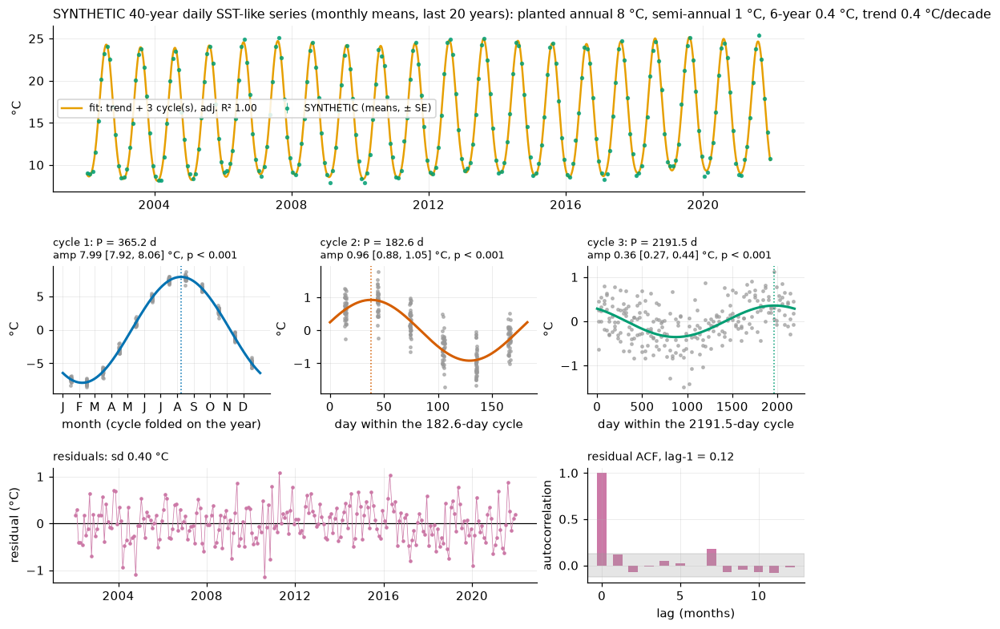

What: the fit recovers the planted amplitudes and dates within their confidence intervals. So what: the method is unbiased on a record like the real ones; the uncertainty on real data comes from the data, not the method.

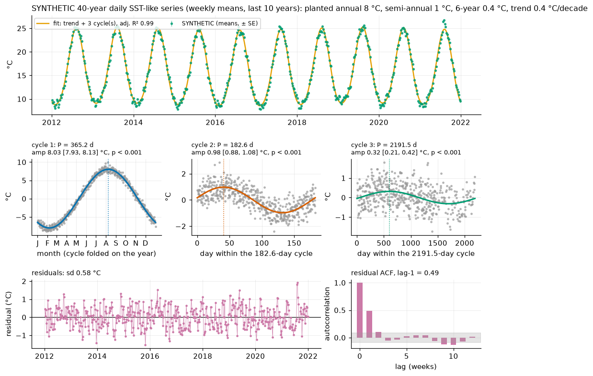

What: the fit recovers the planted amplitudes and dates within their confidence intervals. So what: the method is unbiased on a record like the real ones; the uncertainty on real data comes from the data, not the method.

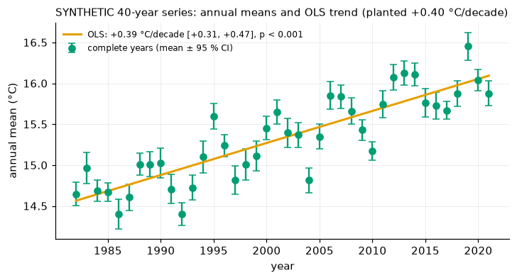

What: the fit recovers the planted amplitudes and dates within their confidence intervals. So what: the method is unbiased on a record like the real ones; the uncertainty on real data comes from the data, not the method.

## Periods used (from peaks.csv)

`peaks.csv` has 470 rows with columns `variable, source, station, synthetic, method, period_days, power, significant_95, rank, spectrum, cycle, psd_over_background, psd_over_95_level, dof`: the format announced in the task brief plus the PSD step's extra columns. An earlier version of the file (station, variable, source, spectrum, method, period_d, cycle, psd_over_background, psd_over_95_level, dof, segments, seg_days, data_note; no rank) is also accepted by `select_periods`. The buoy source is spelled `in situ` in the file and read as `insitu`. The periods fitted per series, where each comes from and whether it was snapped are in `cycles.csv` (period_psd_d, period_d, period_from, snapped).

## Sea surface temperature (°C)

### Seasonal cycles

| station | source | window | n | cycles: amplitude [95 % CI] (°C), max date ± 95 %, p (HAC) | adj. R² | resid sd (°C) | dAIC per added cycle | resid lag-1 r | Ljung-Box p |
|---|---|---|---|---|---|---|---|---|---|
| EUXRo03 | buoy (in situ) | monthly 2013-06 to 2023-10 | 105 | 365.2 d (PSD 397): 8.76 [8.54, 8.97], max 11 Aug ± 3 d, p < 0.001 182.6 d: 1.41 [1.11, 1.71], max 21 Jan, 23 Jul ± 6 d, p < 0.001 101.3 d: 0.11 [-0.19, 0.41], max day 16 of a 101-d cycle counted from 1 Jan 2013 ± 39 d, p 0.764 | 0.98 | 0.98 | -318, -71, +3 | 0.40 | < 0.001 |
| EUXRo03 | buoy (in situ) | weekly 2013-11 to 2023-10 | 415 | 365.2 d (PSD 397): 8.80 [8.60, 9.01], max 12 Aug ± 2 d, p < 0.001 182.6 d: 1.39 [1.11, 1.67], max 24 Jan, 25 Jul ± 5 d, p < 0.001 101.3 d: 0.15 [-0.06, 0.37], max day 8 of a 101-d cycle counted from 1 Jan 2013 ± 24 d, p 0.352 | 0.98 | 1.02 | -1229, -276, -0 | 0.75 | < 0.001 |
| EUXRo03 | satellite | monthly 2013-06 to 2023-10 | 125 | 365.2 d (PSD 365): 8.92 [8.72, 9.12], max 10 Aug ± 2 d, p < 0.001 182.6 d (PSD 181): 1.44 [1.17, 1.70], max 22 Jan, 23 Jul ± 5 d, p < 0.001 97.3 d: 0.17 [-0.08, 0.41], max day 22 of a 97-d cycle counted from 1 Jan 2013 ± 22 d, p 0.403 | 0.98 | 0.94 | -389, -91, +3 | 0.40 | < 0.001 |
| EUXRo03 | satellite | weekly 2013-11 to 2023-10 | 521 | 365.2 d (PSD 365): 8.94 [8.76, 9.13], max 11 Aug ± 2 d, p < 0.001 182.6 d (PSD 181): 1.40 [1.14, 1.65], max 23 Jan, 25 Jul ± 5 d, p < 0.001 97.3 d: 0.23 [0.04, 0.43], max day 14 of a 97-d cycle counted from 1 Jan 2013 ± 11 d, p 0.063 | 0.98 | 1.01 | -1582, -343, -10 | 0.75 | < 0.001 |
| EUXRo03 | model | monthly 2013-06 to 2023-10 | 125 | 365.2 d: 9.07 [8.85, 9.29], max 11 Aug ± 2 d, p < 0.001 182.6 d (PSD 181): 1.39 [1.13, 1.66], max 21 Jan, 23 Jul ± 5 d, p < 0.001 98.5 d: 0.22 [-0.02, 0.45], max day 83 of a 98-d cycle counted from 1 Jan 2013 ± 15 d, p 0.159 | 0.98 | 0.93 | -398, -86, +1 | 0.47 | < 0.001 |
| EUXRo03 | model | weekly 2013-11 to 2023-10 | 521 | 365.2 d: 9.10 [8.90, 9.31], max 12 Aug ± 2 d, p < 0.001 182.6 d (PSD 181): 1.35 [1.10, 1.61], max 23 Jan, 24 Jul ± 5 d, p < 0.001 98.5 d: 0.29 [0.10, 0.47], max day 85 of a 98-d cycle counted from 1 Jan 2013 ± 9 d, p 0.009 | 0.98 | 0.99 | -1619, -332, -17 | 0.80 | < 0.001 |
| EUXRoOB01 | buoy (in situ) | monthly 2024-04 to 2026-11 | 28 | 365.2 d (PSD 320): 8.81 [8.66, 8.96], max 13 Aug ± 2 d, p < 0.001 182.6 d (PSD 192): 1.62 [1.34, 1.91], max 21 Jan, 23 Jul ± 4 d, p < 0.001 101.3 d (period from buoy (in situ) EUXRo03): 0.52 [0.01, 1.02], max day 92 of a 101-d cycle counted from 1 Jan 2024 ± 6 d, p 0.113 | 0.99 | 0.54 | -89, -40, -7 | -0.16 | 0.813 |
| EUXRoOB01 | buoy (in situ) | weekly 2024-04 to 2026-11 | 118 | 365.2 d (PSD 320): 8.77 [8.53, 9.00], max 13 Aug ± 2 d, p < 0.001 182.6 d (PSD 192): 1.60 [1.30, 1.89], max 23 Jan, 24 Jul ± 5 d, p < 0.001 19.2 d: 0.05 [-0.12, 0.22], max 8 Jan, 27 Jan, 15 Feb, 7 Mar, 26 Mar, 14 Apr, 3 May, 22 May, 11 Jun, 30 Jun, 19 Jul, 7 Aug, 27 Aug, 15 Sep, 4 Oct, 23 Oct, 11 Nov, 1 Dec, 20 Dec ± 9 d, p 0.832 | 0.99 | 0.73 | -372, -145, +4 | 0.57 | < 0.001 |
| EUXRoOB01 | satellite | monthly 2024-04 to 2026-11 | 32 | 365.2 d (PSD 359): 8.90 [8.71, 9.09], max 13 Aug ± 2 d, p < 0.001 182.6 d (PSD 192) (period from model): 1.45 [1.09, 1.81], max 20 Jan, 22 Jul ± 5 d, p < 0.001 97.3 d (period from satellite EUXRo03): 0.31 [-0.07, 0.70], max day 15 of a 97-d cycle counted from 1 Jan 2024 ± 21 d, p 0.261 | 0.99 | 0.64 | -104, -39, +1 | -0.08 | 0.712 |
| EUXRoOB01 | satellite | weekly 2024-04 to 2026-11 | 137 | 365.2 d (PSD 359): 8.90 [8.65, 9.15], max 13 Aug ± 2 d, p < 0.001 18.6 d: 0.20 [0.06, 0.34], max day 15 of a 19-d cycle counted from 1 Jan 2024 ± 2 d, p 0.015 182.6 d (PSD 192) (period from model): 1.45 [1.14, 1.77], max 21 Jan, 23 Jul ± 5 d, p < 0.001 | 0.98 | 0.78 | -432, +3, -139 | 0.63 | < 0.001 |
| EUXRoOB01 | model | monthly 2024-04 to 2026-11 | 32 | 365.2 d (PSD 358): 8.95 [8.72, 9.18], max 14 Aug ± 3 d, p < 0.001 182.6 d (PSD 192): 1.46 [1.11, 1.81], max 21 Jan, 22 Jul ± 5 d, p < 0.001 98.5 d (period from model EUXRo03): 0.36 [-0.06, 0.77], max day 11 of a 98-d cycle counted from 1 Jan 2024 ± 15 d, p 0.225 | 0.99 | 0.66 | -103, -37, -0 | -0.02 | 0.505 |
| EUXRoOB01 | model | weekly 2024-04 to 2026-11 | 137 | 365.2 d (PSD 358): 8.96 [8.75, 9.18], max 14 Aug ± 2 d, p < 0.001 182.6 d (PSD 192): 1.47 [1.20, 1.74], max 22 Jan, 23 Jul ± 5 d, p < 0.001 98.5 d (period from model EUXRo03): 0.41 [0.13, 0.69], max day 11 of a 98-d cycle counted from 1 Jan 2024 ± 8 d, p 0.017 | 0.99 | 0.74 | -433, -136, -16 | 0.55 | < 0.001 |
| EUXRoOB02 | buoy (in situ) | monthly 2024-04 to 2026-07 | 26 | 365.2 d (PSD 433): 8.72 [8.52, 8.91], max 14 Aug ± 2 d, p < 0.001 182.6 d (PSD 169) (period from model): 1.45 [1.04, 1.85], max 21 Jan, 23 Jul ± 6 d, p < 0.001 101.3 d (period from buoy (in situ) EUXRo03): 0.53 [-0.01, 1.07], max day 96 of a 101-d cycle counted from 1 Jan 2024 ± 9 d, p 0.117 | 0.99 | 0.64 | -85, -27, -4 | -0.18 | 0.882 |
| EUXRoOB02 | buoy (in situ) | weekly 2024-04 to 2026-07 | 107 | 365.2 d (PSD 433): 8.68 [8.44, 8.92], max 15 Aug ± 2 d, p < 0.001 182.6 d (PSD 169) (period from model): 1.43 [1.13, 1.73], max 23 Jan, 24 Jul ± 6 d, p < 0.001 101.3 d (period from buoy (in situ) EUXRo03): 0.55 [0.24, 0.86], max day 95 of a 101-d cycle counted from 1 Jan 2024 ± 7 d, p 0.003 | 0.99 | 0.75 | -336, -90, -23 | 0.53 | < 0.001 |
| EUXRoOB02 | satellite | monthly 2024-04 to 2026-07 | 28 | 365.2 d (PSD 364): 8.78 [8.58, 8.98], max 13 Aug ± 2 d, p < 0.001 182.6 d (PSD 169) (period from model): 1.43 [1.09, 1.77], max 21 Jan, 23 Jul ± 6 d, p < 0.001 97.3 d (period from satellite EUXRo03): 0.30 [-0.19, 0.78], max day 20 of a 97-d cycle counted from 1 Jan 2024 ± 22 d, p 0.447 | 0.99 | 0.66 | -91, -33, +1 | -0.26 | 0.675 |
| EUXRoOB02 | satellite | weekly 2024-04 to 2026-07 | 121 | 365.2 d (PSD 364): 8.78 [8.55, 9.01], max 14 Aug ± 2 d, p < 0.001 182.6 d (PSD 169) (period from model): 1.44 [1.18, 1.70], max 22 Jan, 23 Jul ± 5 d, p < 0.001 97.3 d (period from satellite EUXRo03): 0.38 [0.10, 0.66], max day 20 of a 97-d cycle counted from 1 Jan 2024 ± 10 d, p 0.028 | 0.99 | 0.76 | -379, -116, -11 | 0.54 | < 0.001 |
| EUXRoOB02 | model | monthly 2024-04 to 2026-07 | 28 | 365.2 d (PSD 366): 8.87 [8.65, 9.10], max 14 Aug ± 2 d, p < 0.001 182.6 d (PSD 169): 1.41 [1.05, 1.78], max 23 Jan, 24 Jul ± 6 d, p < 0.001 98.5 d (period from model EUXRo03): 0.38 [-0.13, 0.88], max day 11 of a 98-d cycle counted from 1 Jan 2024 ± 17 d, p 0.322 | 0.99 | 0.69 | -91, -30, +0 | -0.18 | 0.643 |
| EUXRoOB02 | model | weekly 2024-04 to 2026-07 | 121 | 365.2 d (PSD 366): 8.87 [8.59, 9.16], max 14 Aug ± 2 d, p < 0.001 182.6 d (PSD 169): 1.43 [1.13, 1.73], max 23 Jan, 25 Jul ± 6 d, p < 0.001 24.6 d: 0.11 [-0.03, 0.25], max day 8 of a 25-d cycle counted from 1 Jan 2024 ± 6 d, p 0.276 | 0.98 | 0.82 | -381, -112, +3 | 0.61 | < 0.001 |
| EUXRoOB03 | buoy (in situ) | monthly 2024-04 to 2026-11 | 30 | 365.2 d (PSD 434): 8.69 [8.50, 8.87], max 14 Aug ± 4 d, p < 0.001 182.6 d (PSD 174) (period from satellite): 1.57 [1.17, 1.97], max 20 Jan, 22 Jul ± 7 d, p < 0.001 101.3 d (period from buoy (in situ) EUXRo03): 0.53 [-0.06, 1.12], max day 92 of a 101-d cycle counted from 1 Jan 2024 ± 10 d, p 0.164 | 0.99 | 0.73 | -92, -30, -3 | -0.05 | 0.755 |
| EUXRoOB03 | buoy (in situ) | weekly 2024-04 to 2026-11 | 124 | 365.2 d (PSD 434): 8.68 [8.05, 9.30], max 13 Aug ± 6 d, p < 0.001 17.4 d: 0.15 [-0.02, 0.32], max 5 Jan, 23 Jan, 9 Feb, 27 Feb, 16 Mar, 2 Apr, 20 Apr, 7 May, 25 May, 11 Jun, 29 Jun, 16 Jul, 2 Aug, 20 Aug, 6 Sep, 24 Sep, 11 Oct, 29 Oct, 15 Nov, 2 Dec, 20 Dec ± 4 d, p 0.204 16.1 d: 0.16 [-0.02, 0.34], max day 12 of a 16-d cycle counted from 1 Jan 2024 ± 3 d, p 0.200 | 0.95 | 1.39 | -375, +3, +4 | 0.85 | < 0.001 |
| EUXRoOB03 | satellite | monthly 2024-04 to 2026-11 | 32 | 365.2 d (PSD 364): 8.74 [8.52, 8.95], max 13 Aug ± 3 d, p < 0.001 182.6 d (PSD 174): 1.52 [1.21, 1.83], max 20 Jan, 21 Jul ± 6 d, p < 0.001 97.3 d (period from satellite EUXRo03): 0.32 [-0.16, 0.80], max day 20 of a 97-d cycle counted from 1 Jan 2024 ± 19 d, p 0.400 | 0.99 | 0.70 | -100, -37, +1 | -0.18 | 0.424 |
| EUXRoOB03 | satellite | weekly 2024-04 to 2026-11 | 137 | 365.2 d (PSD 364): 8.73 [8.47, 8.99], max 13 Aug ± 2 d, p < 0.001 182.6 d (PSD 174): 1.52 [1.23, 1.80], max 20 Jan, 22 Jul ± 6 d, p < 0.001 16.0 d: 0.15 [-0.02, 0.33], max day 13 of a 16-d cycle counted from 1 Jan 2024 ± 3 d, p 0.230 | 0.98 | 0.83 | -415, -135, +3 | 0.60 | < 0.001 |
| EUXRoOB03 | model | monthly 2024-04 to 2026-11 | 32 | 365.2 d (PSD 364): 8.88 [8.65, 9.11], max 14 Aug ± 3 d, p < 0.001 182.6 d (PSD 173): 1.46 [1.12, 1.79], max 21 Jan, 23 Jul ± 7 d, p < 0.001 98.5 d (period from model EUXRo03): 0.35 [-0.14, 0.84], max day 13 of a 98-d cycle counted from 1 Jan 2024 ± 18 d, p 0.355 | 0.99 | 0.71 | -102, -34, +0 | -0.10 | 0.745 |
| EUXRoOB03 | model | weekly 2024-04 to 2026-11 | 137 | 365.2 d (PSD 364): 8.88 [8.59, 9.17], max 14 Aug ± 2 d, p < 0.001 182.6 d (PSD 173): 1.45 [1.16, 1.74], max 22 Jan, 23 Jul ± 7 d, p < 0.001 18.0 d: 0.09 [-0.07, 0.26], max day 12 of a 18-d cycle counted from 1 Jan 2024 ± 4 d, p 0.544 | 0.98 | 0.84 | -426, -126, +3 | 0.65 | < 0.001 |

### Interannual linear trend

| station | source | complete years | n years | slope (°C/decade) [95 % CI] | p | R² | note |
|---|---|---|---|---|---|---|---|
| EUXRo03 | buoy (in situ) | 2015-2022 | 4 | not meaningful |  |  | only 4 complete year(s) (need 8): trend not meaningful |
| EUXRo03 | satellite | 2014-2023 | 10 | +0.82 [-0.32, +1.97] | 0.136 | 0.26 |  |
| EUXRo03 | model | 2014-2023 | 10 | +0.77 [-0.36, +1.91] | 0.155 | 0.24 |  |
| EUXRoOB01 | buoy (in situ) | 2025-2025 | 1 | not meaningful |  |  | only 1 complete year(s) (need 8): trend not meaningful |
| EUXRoOB01 | satellite | 2025-2025 | 1 | not meaningful |  |  | only 1 complete year(s) (need 8): trend not meaningful |
| EUXRoOB01 | model | 2025-2025 | 1 | not meaningful |  |  | only 1 complete year(s) (need 8): trend not meaningful |
| EUXRoOB02 | buoy (in situ) | 2025-2025 | 1 | not meaningful |  |  | only 1 complete year(s) (need 8): trend not meaningful |
| EUXRoOB02 | satellite | 2025-2025 | 1 | not meaningful |  |  | only 1 complete year(s) (need 8): trend not meaningful |
| EUXRoOB02 | model | 2025-2025 | 1 | not meaningful |  |  | only 1 complete year(s) (need 8): trend not meaningful |
| EUXRoOB03 | buoy (in situ) | 2025-2025 | 1 | not meaningful |  |  | only 1 complete year(s) (need 8): trend not meaningful |
| EUXRoOB03 | satellite | 2025-2025 | 1 | not meaningful |  |  | only 1 complete year(s) (need 8): trend not meaningful |
| EUXRoOB03 | model | 2025-2025 | 1 | not meaningful |  |  | only 1 complete year(s) (need 8): trend not meaningful |

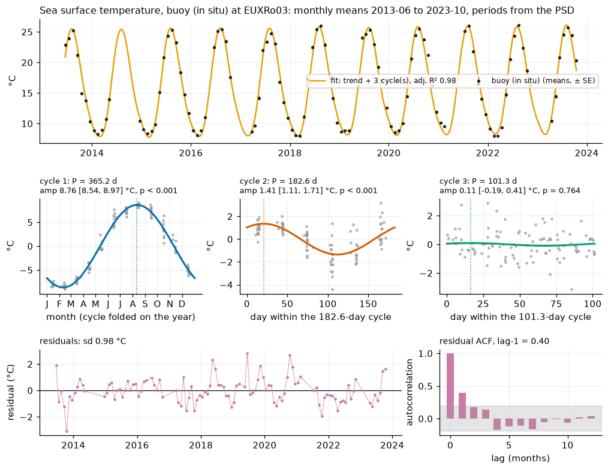

What: buoy (in situ) sea surface temperature at EUXRo03 (monthly means, 2013-06 to 2023-10) follows a 365-day cycle of ± 8.76 °C, highest around 11 Aug; 183 d (± 1.41 °C, p < 0.001), 101 d (± 0.11 °C, p = 0.764). Trend + cycles explain 98% of the variance of the monthly means. So what: anomalies and trends must be read against this cycle; what remains after it is about ± 0.98 °C (monthly residual sd), and it is persistent (lag-1 r = 0.40), so HAC errors are used.

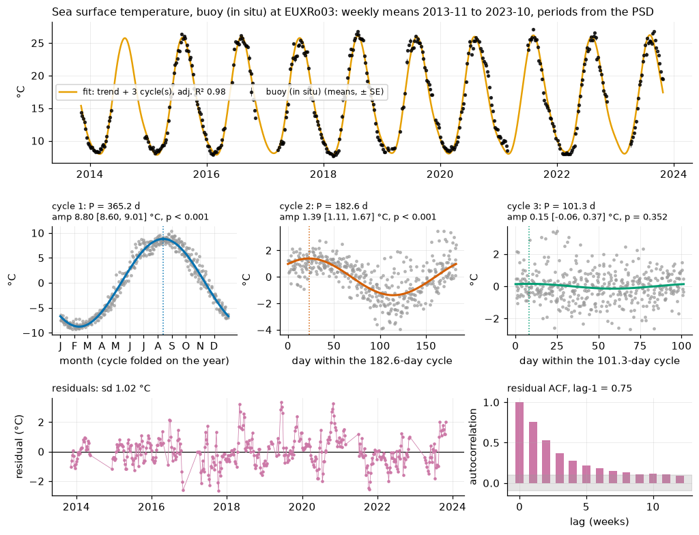

What: buoy (in situ) sea surface temperature at EUXRo03 (weekly means, 2013-11 to 2023-10) follows a 365-day cycle of ± 8.80 °C, highest around 12 Aug; 183 d (± 1.39 °C, p < 0.001), 101 d (± 0.15 °C, p = 0.352). Trend + cycles explain 98% of the variance of the weekly means. So what: anomalies and trends must be read against this cycle; what remains after it is about ± 1.02 °C (weekly residual sd), and it is persistent (lag-1 r = 0.75), so HAC errors are used.

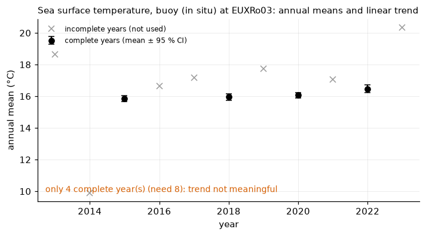

What: buoy (in situ) sea surface temperature at EUXRo03 has 4 complete year(s). So what: too short for an interannual trend (need at least 8 complete years); no slope is given.

What: satellite sea surface temperature at EUXRo03 (monthly means, 2013-06 to 2023-10) follows a 365-day cycle of ± 8.92 °C, highest around 10 Aug; 183 d (± 1.44 °C, p < 0.001), 97 d (± 0.17 °C, p = 0.403). Trend + cycles explain 98% of the variance of the monthly means. So what: anomalies and trends must be read against this cycle; what remains after it is about ± 0.94 °C (monthly residual sd), and it is persistent (lag-1 r = 0.40), so HAC errors are used.

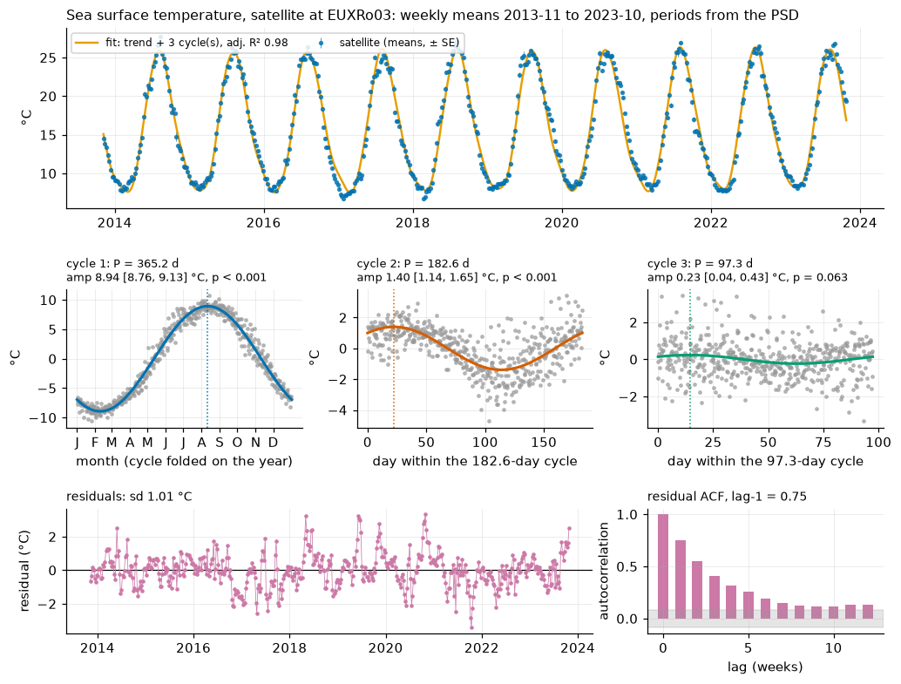

What: satellite sea surface temperature at EUXRo03 (weekly means, 2013-11 to 2023-10) follows a 365-day cycle of ± 8.94 °C, highest around 11 Aug; 183 d (± 1.40 °C, p < 0.001), 97 d (± 0.23 °C, p = 0.063). Trend + cycles explain 98% of the variance of the weekly means. So what: anomalies and trends must be read against this cycle; what remains after it is about ± 1.01 °C (weekly residual sd), and it is persistent (lag-1 r = 0.75), so HAC errors are used.

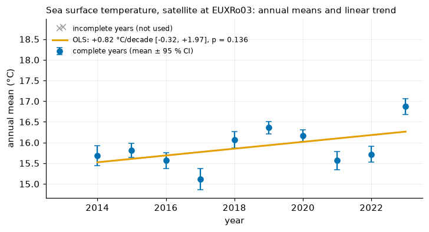

What: annual means of satellite sea surface temperature at EUXRo03 (2014-2023, 10 complete years) change by +0.82 °C per decade (95 % CI -0.32 to +1.97, p = 0.136). So what: the change is not statistically significant; with about 10 points, year-to-year variability dominates any reading of it.

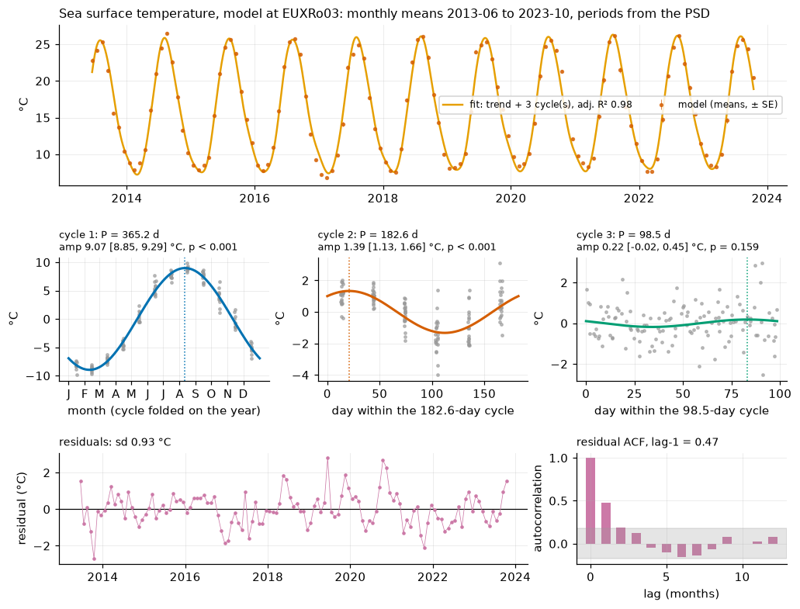

What: model sea surface temperature at EUXRo03 (monthly means, 2013-06 to 2023-10) follows a 365-day cycle of ± 9.07 °C, highest around 11 Aug; 183 d (± 1.39 °C, p < 0.001), 98 d (± 0.22 °C, p = 0.159). Trend + cycles explain 98% of the variance of the monthly means. So what: anomalies and trends must be read against this cycle; what remains after it is about ± 0.93 °C (monthly residual sd), and it is persistent (lag-1 r = 0.47), so HAC errors are used.

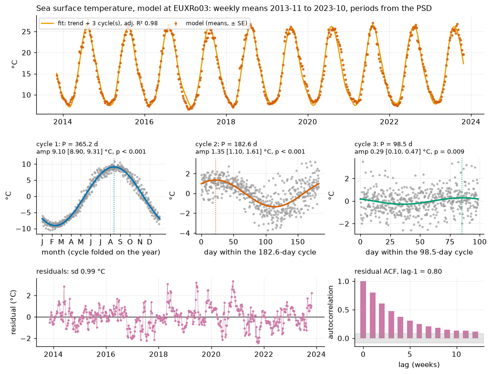

What: model sea surface temperature at EUXRo03 (weekly means, 2013-11 to 2023-10) follows a 365-day cycle of ± 9.10 °C, highest around 12 Aug; 183 d (± 1.35 °C, p < 0.001), 98 d (± 0.29 °C, p = 0.009). Trend + cycles explain 98% of the variance of the weekly means. So what: anomalies and trends must be read against this cycle; what remains after it is about ± 0.99 °C (weekly residual sd), and it is persistent (lag-1 r = 0.80), so HAC errors are used.

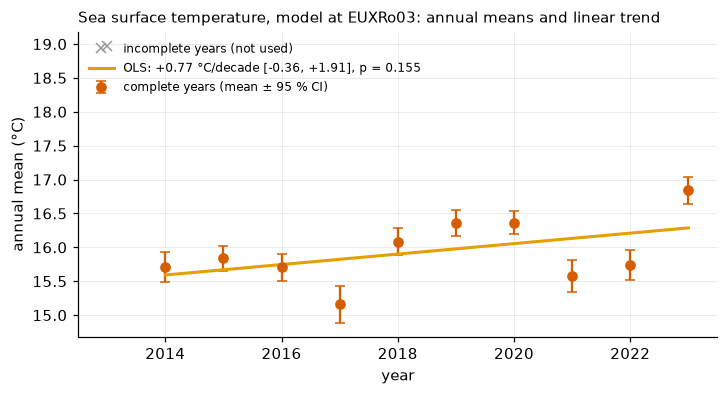

What: annual means of model sea surface temperature at EUXRo03 (2014-2023, 10 complete years) change by +0.77 °C per decade (95 % CI -0.36 to +1.91, p = 0.155). So what: the change is not statistically significant; with about 10 points, year-to-year variability dominates any reading of it.

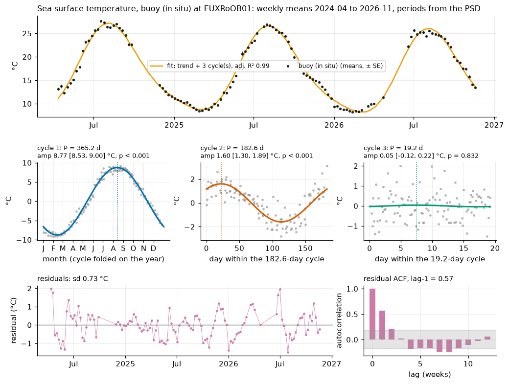

What: buoy (in situ) sea surface temperature at EUXRoOB01 (weekly means, 2024-04 to 2026-11) follows a 365-day cycle of ± 8.77 °C, highest around 13 Aug; 183 d (± 1.60 °C, p < 0.001), 19 d (± 0.05 °C, p = 0.832). Trend + cycles explain 99% of the variance of the weekly means. So what: anomalies and trends must be read against this cycle; what remains after it is about ± 0.73 °C (weekly residual sd), and it is persistent (lag-1 r = 0.57), so HAC errors are used.

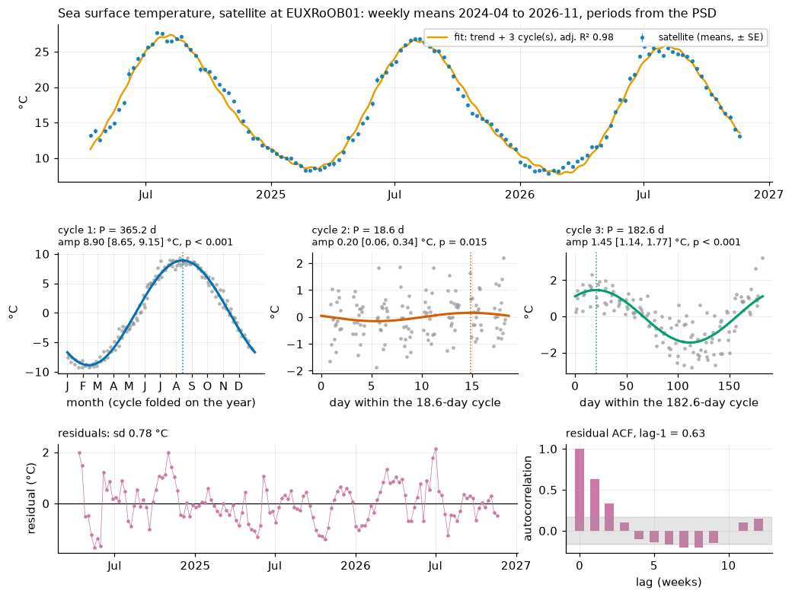

What: satellite sea surface temperature at EUXRoOB01 (weekly means, 2024-04 to 2026-11) follows a 365-day cycle of ± 8.90 °C, highest around 13 Aug; 19 d (± 0.20 °C, p = 0.015), 183 d (± 1.45 °C, p < 0.001). Trend + cycles explain 98% of the variance of the weekly means. So what: anomalies and trends must be read against this cycle; what remains after it is about ± 0.78 °C (weekly residual sd), and it is persistent (lag-1 r = 0.63), so HAC errors are used.

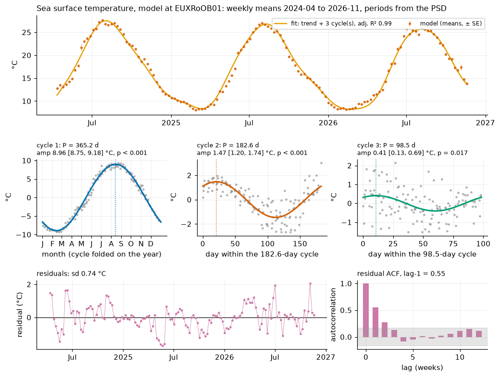

What: model sea surface temperature at EUXRoOB01 (weekly means, 2024-04 to 2026-11) follows a 365-day cycle of ± 8.96 °C, highest around 14 Aug; 183 d (± 1.47 °C, p < 0.001), 98 d (± 0.41 °C, p = 0.017). Trend + cycles explain 99% of the variance of the weekly means. So what: anomalies and trends must be read against this cycle; what remains after it is about ± 0.74 °C (weekly residual sd), and it is persistent (lag-1 r = 0.55), so HAC errors are used.

Other figures: [EUXRoOB01 insitu monthly](figures/fit_EUXRoOB01_sst_insitu_monthly.png), [EUXRoOB01 insitu trend](figures/trend_EUXRoOB01_sst_insitu.png), [EUXRoOB01 satellite monthly](figures/fit_EUXRoOB01_sst_satellite_monthly.png), [EUXRoOB01 satellite trend](figures/trend_EUXRoOB01_sst_satellite.png), [EUXRoOB01 model monthly](figures/fit_EUXRoOB01_sst_model_monthly.png), [EUXRoOB01 model trend](figures/trend_EUXRoOB01_sst_model.png), [EUXRoOB02 insitu monthly](figures/fit_EUXRoOB02_sst_insitu_monthly.png), [EUXRoOB02 insitu weekly](figures/fit_EUXRoOB02_sst_insitu_weekly.png), [EUXRoOB02 insitu trend](figures/trend_EUXRoOB02_sst_insitu.png), [EUXRoOB02 satellite monthly](figures/fit_EUXRoOB02_sst_satellite_monthly.png), [EUXRoOB02 satellite weekly](figures/fit_EUXRoOB02_sst_satellite_weekly.png), [EUXRoOB02 satellite trend](figures/trend_EUXRoOB02_sst_satellite.png), [EUXRoOB02 model monthly](figures/fit_EUXRoOB02_sst_model_monthly.png), [EUXRoOB02 model weekly](figures/fit_EUXRoOB02_sst_model_weekly.png), [EUXRoOB02 model trend](figures/trend_EUXRoOB02_sst_model.png), [EUXRoOB03 insitu monthly](figures/fit_EUXRoOB03_sst_insitu_monthly.png), [EUXRoOB03 insitu weekly](figures/fit_EUXRoOB03_sst_insitu_weekly.png), [EUXRoOB03 insitu trend](figures/trend_EUXRoOB03_sst_insitu.png), [EUXRoOB03 satellite monthly](figures/fit_EUXRoOB03_sst_satellite_monthly.png), [EUXRoOB03 satellite weekly](figures/fit_EUXRoOB03_sst_satellite_weekly.png), [EUXRoOB03 satellite trend](figures/trend_EUXRoOB03_sst_satellite.png), [EUXRoOB03 model monthly](figures/fit_EUXRoOB03_sst_model_monthly.png), [EUXRoOB03 model weekly](figures/fit_EUXRoOB03_sst_model_weekly.png), [EUXRoOB03 model trend](figures/trend_EUXRoOB03_sst_model.png)

Plain-language sentences for these figures

- **EUXRoOB01 insitu monthly**: What: buoy (in situ) sea surface temperature at EUXRoOB01 (monthly means, 2024-04 to 2026-11) follows a 365-day cycle of ± 8.81 °C, highest around 13 Aug; 183 d (± 1.62 °C, p < 0.001), 101 d (± 0.52 °C, p = 0.113). Trend + cycles explain 99% of the variance of the monthly means. So what: anomalies and trends must be read against this cycle; what remains after it is about ± 0.54 °C (monthly residual sd).
- **EUXRoOB01 insitu trend**: What: buoy (in situ) sea surface temperature at EUXRoOB01 has 1 complete year(s). So what: too short for an interannual trend (need at least 8 complete years); no slope is given.
- **EUXRoOB01 satellite monthly**: What: satellite sea surface temperature at EUXRoOB01 (monthly means, 2024-04 to 2026-11) follows a 365-day cycle of ± 8.90 °C, highest around 13 Aug; 183 d (± 1.45 °C, p < 0.001), 97 d (± 0.31 °C, p = 0.261). Trend + cycles explain 99% of the variance of the monthly means. So what: anomalies and trends must be read against this cycle; what remains after it is about ± 0.64 °C (monthly residual sd).
- **EUXRoOB01 satellite trend**: What: satellite sea surface temperature at EUXRoOB01 has 1 complete year(s). So what: too short for an interannual trend (need at least 8 complete years); no slope is given.
- **EUXRoOB01 model monthly**: What: model sea surface temperature at EUXRoOB01 (monthly means, 2024-04 to 2026-11) follows a 365-day cycle of ± 8.95 °C, highest around 14 Aug; 183 d (± 1.46 °C, p < 0.001), 98 d (± 0.36 °C, p = 0.225). Trend + cycles explain 99% of the variance of the monthly means. So what: anomalies and trends must be read against this cycle; what remains after it is about ± 0.66 °C (monthly residual sd).
- **EUXRoOB01 model trend**: What: model sea surface temperature at EUXRoOB01 has 1 complete year(s). So what: too short for an interannual trend (need at least 8 complete years); no slope is given.
- **EUXRoOB02 insitu monthly**: What: buoy (in situ) sea surface temperature at EUXRoOB02 (monthly means, 2024-04 to 2026-07) follows a 365-day cycle of ± 8.72 °C, highest around 14 Aug; 183 d (± 1.45 °C, p < 0.001), 101 d (± 0.53 °C, p = 0.117). Trend + cycles explain 99% of the variance of the monthly means. So what: anomalies and trends must be read against this cycle; what remains after it is about ± 0.64 °C (monthly residual sd).
- **EUXRoOB02 insitu weekly**: What: buoy (in situ) sea surface temperature at EUXRoOB02 (weekly means, 2024-04 to 2026-07) follows a 365-day cycle of ± 8.68 °C, highest around 15 Aug; 183 d (± 1.43 °C, p < 0.001), 101 d (± 0.55 °C, p = 0.003). Trend + cycles explain 99% of the variance of the weekly means. So what: anomalies and trends must be read against this cycle; what remains after it is about ± 0.75 °C (weekly residual sd), and it is persistent (lag-1 r = 0.53), so HAC errors are used.
- **EUXRoOB02 insitu trend**: What: buoy (in situ) sea surface temperature at EUXRoOB02 has 1 complete year(s). So what: too short for an interannual trend (need at least 8 complete years); no slope is given.
- **EUXRoOB02 satellite monthly**: What: satellite sea surface temperature at EUXRoOB02 (monthly means, 2024-04 to 2026-07) follows a 365-day cycle of ± 8.78 °C, highest around 13 Aug; 183 d (± 1.43 °C, p < 0.001), 97 d (± 0.30 °C, p = 0.447). Trend + cycles explain 99% of the variance of the monthly means. So what: anomalies and trends must be read against this cycle; what remains after it is about ± 0.66 °C (monthly residual sd).
- **EUXRoOB02 satellite weekly**: What: satellite sea surface temperature at EUXRoOB02 (weekly means, 2024-04 to 2026-07) follows a 365-day cycle of ± 8.78 °C, highest around 14 Aug; 183 d (± 1.44 °C, p < 0.001), 97 d (± 0.38 °C, p = 0.028). Trend + cycles explain 99% of the variance of the weekly means. So what: anomalies and trends must be read against this cycle; what remains after it is about ± 0.76 °C (weekly residual sd), and it is persistent (lag-1 r = 0.54), so HAC errors are used.
- **EUXRoOB02 satellite trend**: What: satellite sea surface temperature at EUXRoOB02 has 1 complete year(s). So what: too short for an interannual trend (need at least 8 complete years); no slope is given.
- **EUXRoOB02 model monthly**: What: model sea surface temperature at EUXRoOB02 (monthly means, 2024-04 to 2026-07) follows a 365-day cycle of ± 8.87 °C, highest around 14 Aug; 183 d (± 1.41 °C, p < 0.001), 98 d (± 0.38 °C, p = 0.322). Trend + cycles explain 99% of the variance of the monthly means. So what: anomalies and trends must be read against this cycle; what remains after it is about ± 0.69 °C (monthly residual sd).
- **EUXRoOB02 model weekly**: What: model sea surface temperature at EUXRoOB02 (weekly means, 2024-04 to 2026-07) follows a 365-day cycle of ± 8.87 °C, highest around 14 Aug; 183 d (± 1.43 °C, p < 0.001), 25 d (± 0.11 °C, p = 0.276). Trend + cycles explain 98% of the variance of the weekly means. So what: anomalies and trends must be read against this cycle; what remains after it is about ± 0.82 °C (weekly residual sd), and it is persistent (lag-1 r = 0.61), so HAC errors are used.
- **EUXRoOB02 model trend**: What: model sea surface temperature at EUXRoOB02 has 1 complete year(s). So what: too short for an interannual trend (need at least 8 complete years); no slope is given.
- **EUXRoOB03 insitu monthly**: What: buoy (in situ) sea surface temperature at EUXRoOB03 (monthly means, 2024-04 to 2026-11) follows a 365-day cycle of ± 8.69 °C, highest around 14 Aug; 183 d (± 1.57 °C, p < 0.001), 101 d (± 0.53 °C, p = 0.164). Trend + cycles explain 99% of the variance of the monthly means. So what: anomalies and trends must be read against this cycle; what remains after it is about ± 0.73 °C (monthly residual sd).
- **EUXRoOB03 insitu weekly**: What: buoy (in situ) sea surface temperature at EUXRoOB03 (weekly means, 2024-04 to 2026-11) follows a 365-day cycle of ± 8.68 °C, highest around 13 Aug; 17 d (± 0.15 °C, p = 0.204), 16 d (± 0.16 °C, p = 0.200). Trend + cycles explain 95% of the variance of the weekly means. So what: anomalies and trends must be read against this cycle; what remains after it is about ± 1.39 °C (weekly residual sd), and it is persistent (lag-1 r = 0.85), so HAC errors are used.
- **EUXRoOB03 insitu trend**: What: buoy (in situ) sea surface temperature at EUXRoOB03 has 1 complete year(s). So what: too short for an interannual trend (need at least 8 complete years); no slope is given.
- **EUXRoOB03 satellite monthly**: What: satellite sea surface temperature at EUXRoOB03 (monthly means, 2024-04 to 2026-11) follows a 365-day cycle of ± 8.74 °C, highest around 13 Aug; 183 d (± 1.52 °C, p < 0.001), 97 d (± 0.32 °C, p = 0.400). Trend + cycles explain 99% of the variance of the monthly means. So what: anomalies and trends must be read against this cycle; what remains after it is about ± 0.70 °C (monthly residual sd).
- **EUXRoOB03 satellite weekly**: What: satellite sea surface temperature at EUXRoOB03 (weekly means, 2024-04 to 2026-11) follows a 365-day cycle of ± 8.73 °C, highest around 13 Aug; 183 d (± 1.52 °C, p < 0.001), 16 d (± 0.15 °C, p = 0.230). Trend + cycles explain 98% of the variance of the weekly means. So what: anomalies and trends must be read against this cycle; what remains after it is about ± 0.83 °C (weekly residual sd), and it is persistent (lag-1 r = 0.60), so HAC errors are used.
- **EUXRoOB03 satellite trend**: What: satellite sea surface temperature at EUXRoOB03 has 1 complete year(s). So what: too short for an interannual trend (need at least 8 complete years); no slope is given.
- **EUXRoOB03 model monthly**: What: model sea surface temperature at EUXRoOB03 (monthly means, 2024-04 to 2026-11) follows a 365-day cycle of ± 8.88 °C, highest around 14 Aug; 183 d (± 1.46 °C, p < 0.001), 98 d (± 0.35 °C, p = 0.355). Trend + cycles explain 99% of the variance of the monthly means. So what: anomalies and trends must be read against this cycle; what remains after it is about ± 0.71 °C (monthly residual sd).
- **EUXRoOB03 model weekly**: What: model sea surface temperature at EUXRoOB03 (weekly means, 2024-04 to 2026-11) follows a 365-day cycle of ± 8.88 °C, highest around 14 Aug; 183 d (± 1.45 °C, p < 0.001), 18 d (± 0.09 °C, p = 0.544). Trend + cycles explain 98% of the variance of the weekly means. So what: anomalies and trends must be read against this cycle; what remains after it is about ± 0.84 °C (weekly residual sd), and it is persistent (lag-1 r = 0.65), so HAC errors are used.
- **EUXRoOB03 model trend**: What: model sea surface temperature at EUXRoOB03 has 1 complete year(s). So what: too short for an interannual trend (need at least 8 complete years); no slope is given.

## Chlorophyll-a (surface, log10) (log10(mg/m³))

### Seasonal cycles

| station | source | window | n | cycles: amplitude [95 % CI] (log10(mg/m³)), max date ± 95 %, p (HAC) | adj. R² | resid sd (log10(mg/m³)) | dAIC per added cycle | resid lag-1 r | Ljung-Box p |
|---|---|---|---|---|---|---|---|---|---|
| EUXRo03 | buoy (in situ) | monthly 2013-06 to 2023-10 | 106 | 583.9 d: 0.18 [-0.09, 0.45], max day 581 of a 584-d cycle counted from 1 Jan 2013 ± 200 d, p 0.202 365.2 d: 0.24 [-0.03, 0.50], max 9 Jun ± 78 d, p 0.191 182.6 d (PSD 184) (period from satellite): 0.12 [-0.03, 0.28], max 17 Apr, 17 Oct ± 26 d, p 0.283 | 0.09 | 0.74 | +2, -1, +3 | 0.87 | < 0.001 |
| EUXRo03 | buoy (in situ) | weekly 2013-11 to 2023-10 | 411 | 583.9 d: 0.14 [-0.15, 0.42], max day 6 of a 584-d cycle counted from 1 Jan 2013 ± 284 d, p 0.415 365.2 d: 0.28 [0.01, 0.55], max 18 Jun ± 63 d, p 0.108 182.6 d (PSD 184) (period from satellite): 0.12 [-0.01, 0.25], max 27 Apr, 26 Oct ± 25 d, p 0.197 | 0.10 | 0.72 | +0, -24, -2 | 0.95 | < 0.001 |
| EUXRo03 | satellite | monthly 2013-06 to 2023-10 | 125 | 365.2 d (PSD 376): 0.15 [0.11, 0.18], max 31 Dec ± 11 d, p < 0.001 182.6 d (PSD 184): 0.09 [0.06, 0.12], max 24 May, 22 Nov ± 9 d, p < 0.001 122.0 d (period from model): 0.01 [-0.02, 0.04], max 19 Jan, 21 May, 20 Sep ± 42 d, p 0.783 | 0.56 | 0.11 | -65, -32, +3 | 0.32 | 0.016 |
| EUXRo03 | satellite | weekly 2013-11 to 2023-10 | 521 | 365.2 d (PSD 376): 0.14 [0.11, 0.18], max 30 Dec ± 10 d, p < 0.001 182.6 d (PSD 184): 0.08 [0.05, 0.11], max 25 May, 23 Nov ± 10 d, p < 0.001 21.1 d: 0.01 [-0.00, 0.03], max day 14 of a 21-d cycle counted from 1 Jan 2013 ± 4 d, p 0.146 | 0.42 | 0.14 | -195, -80, +2 | 0.57 | < 0.001 |
| EUXRo03 | model | monthly 2013-06 to 2023-10 | 125 | 365.2 d (PSD 388): 0.18 [0.13, 0.24], max 12 Jan ± 26 d, p < 0.001 182.6 d (PSD 182): 0.04 [-0.01, 0.09], max 8 Jun, 7 Dec ± 34 d, p 0.305 122.0 d: 0.03 [-0.02, 0.07], max 30 Jan, 1 Jun, 1 Oct ± 35 d, p 0.492 | 0.32 | 0.21 | -37, +2, +3 | 0.55 | < 0.001 |
| EUXRo03 | model | weekly 2013-11 to 2023-10 | 520 | 365.2 d (PSD 388): 0.18 [0.13, 0.24], max 12 Jan ± 27 d, p < 0.001 182.6 d (PSD 182): 0.04 [-0.01, 0.08], max 14 Jun, 13 Dec ± 37 d, p 0.342 122.0 d: 0.02 [-0.02, 0.06], max 29 Jan, 31 May, 30 Sep ± 46 d, p 0.590 | 0.26 | 0.25 | -121, -1, +2 | 0.72 | < 0.001 |
| EUXRoOB01 | buoy (in situ) | monthly 2024-04 to 2026-11 | 28 | 365.2 d (PSD 301): 0.35 [0.20, 0.50], max 6 Feb ± 40 d, p < 0.001 182.6 d (PSD 184) (period from satellite): 0.30 [0.01, 0.59], max 2 May, 1 Nov ± 11 d, p 0.120 70.2 d (period from buoy (in situ) EUXRoOB02): 0.02 [-0.12, 0.16], max day 0 of a 70-d cycle counted from 1 Jan 2024 ± 64 d, p 0.956 | 0.55 | 0.29 | -11, -10, +4 | 0.45 | 0.011 |
| EUXRoOB01 | buoy (in situ) | weekly 2024-04 to 2026-11 | 118 | 365.2 d (PSD 301): 0.33 [0.23, 0.44], max 3 Feb ± 35 d, p < 0.001 16.6 d: 0.05 [-0.00, 0.09], max day 6 of a 17-d cycle counted from 1 Jan 2024 ± 3 d, p 0.159 182.6 d (PSD 184) (period from satellite): 0.27 [0.08, 0.46], max 5 May, 4 Nov ± 10 d, p 0.020 | 0.53 | 0.31 | -47, +4, -37 | 0.77 | < 0.001 |
| EUXRoOB01 | satellite | monthly 2024-04 to 2026-11 | 32 | 182.6 d (PSD 184): 0.11 [0.02, 0.20], max 28 May, 27 Nov ± 9 d, p 0.032 365.2 d (PSD 320): 0.08 [0.03, 0.13], max 4 Jan ± 40 d, p 0.003 | 0.32 | 0.12 | -6, -3 | 0.02 | 0.866 |
| EUXRoOB01 | satellite | weekly 2024-04 to 2026-11 | 137 | 182.6 d (PSD 184): 0.11 [0.05, 0.17], max 30 May, 29 Nov ± 10 d, p 0.002 365.2 d (PSD 320): 0.08 [0.03, 0.14], max 3 Jan ± 35 d, p 0.004 34.0 d: 0.04 [0.01, 0.07], max day 25 of a 34-d cycle counted from 1 Jan 2024 ± 5 d, p 0.066 | 0.30 | 0.14 | -27, -15, +0 | 0.61 | < 0.001 |
| EUXRoOB01 | model | monthly 2024-04 to 2026-11 | 32 | 182.6 d (PSD 175): 0.12 [0.03, 0.20], max 6 Jun, 6 Dec ± 15 d, p 0.011 365.2 d (PSD 309): 0.18 [0.10, 0.26], max 14 Jan ± 24 d, p < 0.001 122.0 d (period from model EUXRo03): 0.08 [-0.01, 0.16], max 22 Jan, 24 May, 23 Sep ± 16 d, p 0.176 | 0.51 | 0.14 | -2, -16, -1 | 0.18 | 0.817 |
| EUXRoOB01 | model | weekly 2024-04 to 2026-11 | 137 | 182.6 d (PSD 175): 0.13 [0.06, 0.20], max 6 Jun, 5 Dec ± 14 d, p 0.002 365.2 d (PSD 309): 0.18 [0.10, 0.25], max 13 Jan ± 20 d, p < 0.001 19.7 d: 0.03 [-0.01, 0.07], max day 6 of a 20-d cycle counted from 1 Jan 2024 ± 4 d, p 0.330 | 0.39 | 0.18 | -18, -47, +3 | 0.52 | < 0.001 |
| EUXRoOB02 | buoy (in situ) | monthly 2024-04 to 2026-07 | 26 | 523.2 d: 0.52 [0.20, 0.84], max day 285 of a 523-d cycle counted from 1 Jan 2024 ± 22 d, p 0.002 182.6 d (PSD 196): 0.33 [0.08, 0.58], max 2 May, 1 Nov ± 13 d, p 0.031 70.2 d: 0.13 [-0.11, 0.38], max day 31 of a 70-d cycle counted from 1 Jan 2024 ± 10 d, p 0.533 | 0.60 | 0.33 | -11, -8, +2 | 0.39 | 0.230 |
| EUXRoOB02 | buoy (in situ) | weekly 2024-04 to 2026-07 | 107 | 523.2 d: 0.51 [0.27, 0.74], max day 285 of a 523-d cycle counted from 1 Jan 2024 ± 20 d, p < 0.001 182.6 d (PSD 196): 0.32 [0.14, 0.51], max 3 May, 2 Nov ± 12 d, p 0.004 70.2 d: 0.13 [-0.00, 0.26], max day 31 of a 70-d cycle counted from 1 Jan 2024 ± 9 d, p 0.145 | 0.64 | 0.32 | -47, -36, -4 | 0.78 | < 0.001 |
| EUXRoOB02 | satellite | monthly 2024-04 to 2026-07 | 28 | 182.6 d (PSD 190): 0.09 [0.02, 0.15], max 10 May, 8 Nov ± 15 d, p 0.003 365.2 d (PSD 352): 0.15 [0.10, 0.20], max 19 Dec ± 14 d, p < 0.001 70.2 d (period from buoy (in situ)): 0.06 [-0.01, 0.13], max day 25 of a 70-d cycle counted from 1 Jan 2024 ± 14 d, p 0.151 | 0.60 | 0.09 | -0, -21, -0 | -0.06 | 0.405 |
| EUXRoOB02 | satellite | weekly 2024-04 to 2026-07 | 121 | 182.6 d (PSD 190): 0.09 [0.04, 0.14], max 13 May, 12 Nov ± 10 d, p 0.001 365.2 d (PSD 352): 0.15 [0.11, 0.19], max 17 Dec ± 13 d, p < 0.001 70.2 d (period from buoy (in situ)): 0.04 [0.00, 0.08], max day 25 of a 70-d cycle counted from 1 Jan 2024 ± 13 d, p 0.086 | 0.49 | 0.13 | -10, -64, -2 | 0.45 | < 0.001 |
| EUXRoOB02 | model | monthly 2024-04 to 2026-07 | 28 | 365.2 d (PSD 385): 0.16 [0.09, 0.23], max 12 Jan ± 23 d, p < 0.001 216.1 d: 0.09 [0.05, 0.13], max day 73 of a 216-d cycle counted from 1 Jan 2024 ± 28 d, p < 0.001 70.2 d (period from buoy (in situ)): 0.02 [-0.06, 0.09], max day 42 of a 70-d cycle counted from 1 Jan 2024 ± 43 d, p 0.862 | 0.64 | 0.10 | -18, -8, +4 | 0.09 | 0.888 |
| EUXRoOB02 | model | weekly 2024-04 to 2026-07 | 121 | 365.2 d (PSD 385): 0.16 [0.11, 0.21], max 12 Jan ± 20 d, p < 0.001 216.1 d: 0.08 [0.04, 0.13], max day 73 of a 216-d cycle counted from 1 Jan 2024 ± 23 d, p < 0.001 33.4 d: 0.02 [-0.02, 0.06], max day 7 of a 33-d cycle counted from 1 Jan 2024 ± 10 d, p 0.641 | 0.50 | 0.13 | -56, -18, +3 | 0.43 | 0.001 |
| EUXRoOB03 | buoy (in situ) | monthly 2024-04 to 2026-11 | 29 | 248.0 d: 0.46 [-0.02, 0.93], max day 179 of a 248-d cycle counted from 1 Jan 2024 ± 29 d, p 0.139 182.6 d (PSD 192): 0.30 [0.02, 0.59], max 12 Apr, 12 Oct ± 21 d, p 0.112 365.2 d (PSD 367) (period from satellite): 0.66 [0.08, 1.23], max 10 Jan ± 32 d, p 0.084 | 0.34 | 0.59 | +3, +1, -12 | 0.67 | < 0.001 |
| EUXRoOB03 | buoy (in situ) | weekly 2024-04 to 2026-11 | 123 | 248.0 d: 0.39 [-0.20, 0.98], max day 167 of a 248-d cycle counted from 1 Jan 2024 ± 32 d, p 0.421 182.6 d (PSD 192): 0.32 [-0.09, 0.74], max 20 Apr, 20 Oct ± 33 d, p 0.308 44.3 d: 0.09 [-0.05, 0.24], max day 31 of a 44-d cycle counted from 1 Jan 2024 ± 8 d, p 0.405 | 0.15 | 0.71 | -7, -8, +3 | 0.91 | < 0.001 |
| EUXRoOB03 | satellite | monthly 2024-04 to 2026-11 | 32 | 365.2 d (PSD 367): 0.17 [0.15, 0.19], max 26 Dec ± 8 d, p < 0.001 182.6 d (PSD 194): 0.10 [0.08, 0.12], max 12 May, 10 Nov ± 10 d, p < 0.001 248.0 d (period from buoy (in situ)): 0.01 [-0.00, 0.03], max day 45 of a 248-d cycle counted from 1 Jan 2024 ± 79 d, p 0.228 | 0.83 | 0.06 | -30, -26, +3 | -0.38 | 0.330 |
| EUXRoOB03 | satellite | weekly 2024-04 to 2026-11 | 137 | 365.2 d (PSD 367): 0.17 [0.15, 0.20], max 25 Dec ± 9 d, p < 0.001 182.6 d (PSD 194): 0.10 [0.08, 0.12], max 13 May, 12 Nov ± 8 d, p < 0.001 16.7 d: 0.02 [-0.00, 0.05], max day 9 of a 17-d cycle counted from 1 Jan 2024 ± 2 d, p 0.213 | 0.71 | 0.09 | -103, -63, +1 | 0.31 | < 0.001 |
| EUXRoOB03 | model | monthly 2024-04 to 2026-11 | 32 | 365.2 d (PSD 385): 0.17 [0.13, 0.21], max 25 Dec ± 13 d, p < 0.001 182.6 d (PSD 187): 0.11 [0.08, 0.13], max 16 May, 15 Nov ± 16 d, p < 0.001 248.0 d (period from buoy (in situ)): 0.03 [-0.01, 0.07], max day 61 of a 248-d cycle counted from 1 Jan 2024 ± 61 d, p 0.095 | 0.72 | 0.09 | -23, -16, +2 | -0.20 | 0.596 |
| EUXRoOB03 | model | weekly 2024-04 to 2026-11 | 137 | 365.2 d (PSD 385): 0.18 [0.14, 0.21], max 24 Dec ± 13 d, p < 0.001 182.6 d (PSD 187): 0.11 [0.08, 0.14], max 19 May, 18 Nov ± 12 d, p < 0.001 18.1 d: 0.03 [-0.00, 0.06], max day 13 of a 18-d cycle counted from 1 Jan 2024 ± 2 d, p 0.233 | 0.58 | 0.13 | -72, -43, +2 | 0.41 | < 0.001 |

### Interannual linear trend

| station | source | complete years | n years | slope (log10(mg/m³)/decade) [95 % CI] | p | R² | note |
|---|---|---|---|---|---|---|---|
| EUXRo03 | buoy (in situ) | 2015-2022 | 5 | not meaningful |  |  | only 5 complete year(s) (need 8): trend not meaningful |
| EUXRo03 | satellite | 2014-2023 | 10 | +0.07 [-0.06, +0.20] (+18 %/decade) | 0.238 | 0.17 |  |
| EUXRo03 | model | 2014-2023 | 10 | +0.27 [-0.15, +0.69] (+88 %/decade) | 0.170 | 0.22 |  |
| EUXRoOB01 | buoy (in situ) | 2025-2025 | 1 | not meaningful |  |  | only 1 complete year(s) (need 8): trend not meaningful |
| EUXRoOB01 | satellite | 2025-2025 | 1 | not meaningful |  |  | only 1 complete year(s) (need 8): trend not meaningful |
| EUXRoOB01 | model | 2025-2025 | 1 | not meaningful |  |  | only 1 complete year(s) (need 8): trend not meaningful |
| EUXRoOB02 | buoy (in situ) | 2025-2025 | 1 | not meaningful |  |  | only 1 complete year(s) (need 8): trend not meaningful |
| EUXRoOB02 | satellite | 2025-2025 | 1 | not meaningful |  |  | only 1 complete year(s) (need 8): trend not meaningful |
| EUXRoOB02 | model | 2025-2025 | 1 | not meaningful |  |  | only 1 complete year(s) (need 8): trend not meaningful |
| EUXRoOB03 | buoy (in situ) | 2025-2025 | 1 | not meaningful |  |  | only 1 complete year(s) (need 8): trend not meaningful |
| EUXRoOB03 | satellite | 2025-2025 | 1 | not meaningful |  |  | only 1 complete year(s) (need 8): trend not meaningful |
| EUXRoOB03 | model | 2025-2025 | 1 | not meaningful |  |  | only 1 complete year(s) (need 8): trend not meaningful |

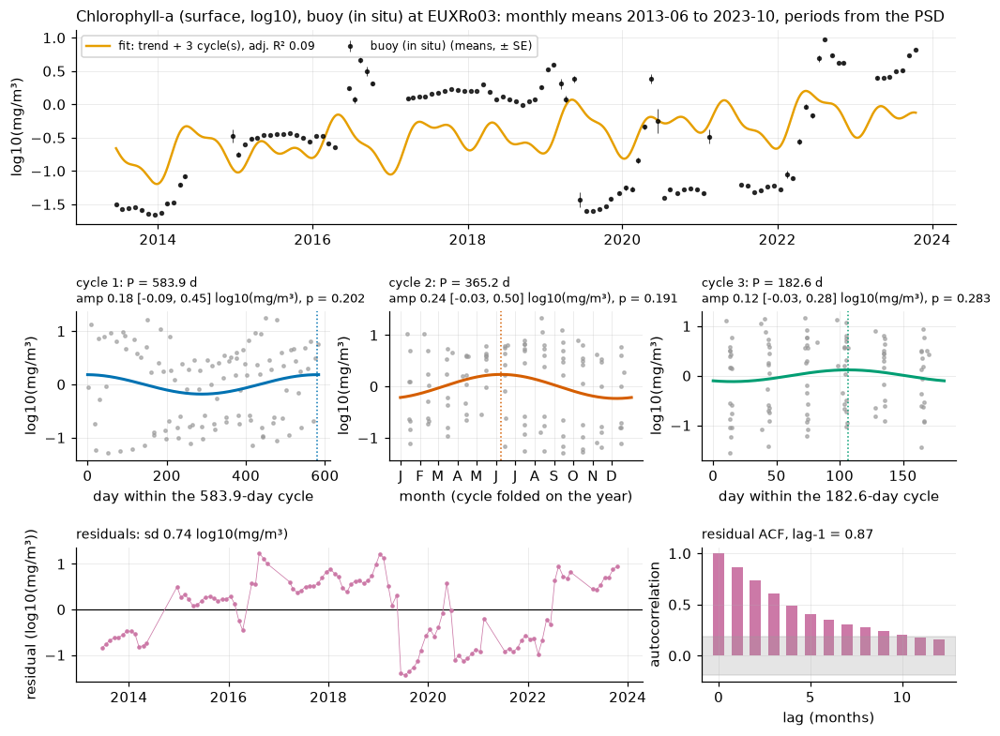

What: buoy (in situ) chlorophyll-a (surface, log10) at EUXRo03 (monthly means, 2013-06 to 2023-10) follows a 584-day cycle of x1.52 above / below the mean (log10 amplitude 0.18), highest around day 581 of a 584-d cycle counted from 1 Jan 2013; 365 d (x1.72 above / below the mean (log10 amplitude 0.24), p = 0.191), 183 d (x1.33 above / below the mean (log10 amplitude 0.12), p = 0.283). Trend + cycles explain 9% of the variance of the monthly means. So what: anomalies and trends must be read against this cycle; what remains after it is about ± 0.74 log10(mg/m³) (monthly residual sd), and it is persistent (lag-1 r = 0.87), so HAC errors are used.

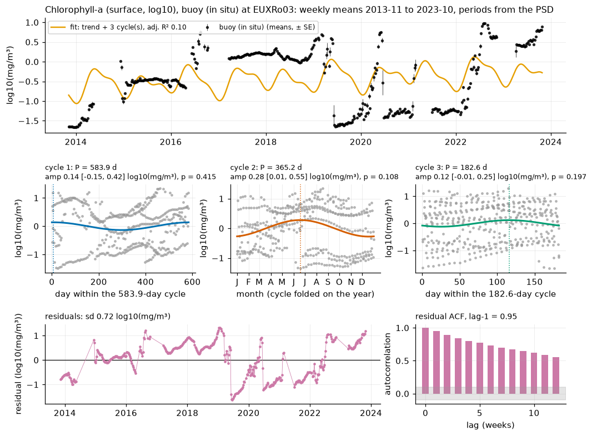

What: buoy (in situ) chlorophyll-a (surface, log10) at EUXRo03 (weekly means, 2013-11 to 2023-10) follows a 584-day cycle of x1.37 above / below the mean (log10 amplitude 0.14), highest around day 6 of a 584-d cycle counted from 1 Jan 2013; 365 d (x1.90 above / below the mean (log10 amplitude 0.28), p = 0.108), 183 d (x1.32 above / below the mean (log10 amplitude 0.12), p = 0.197). Trend + cycles explain 10% of the variance of the weekly means. So what: anomalies and trends must be read against this cycle; what remains after it is about ± 0.72 log10(mg/m³) (weekly residual sd), and it is persistent (lag-1 r = 0.95), so HAC errors are used.

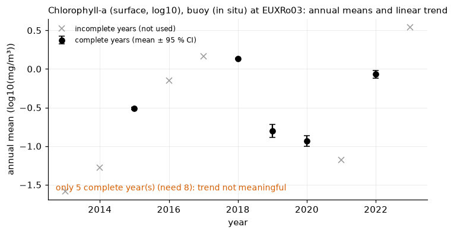

What: buoy (in situ) chlorophyll-a (surface, log10) at EUXRo03 has 5 complete year(s). So what: too short for an interannual trend (need at least 8 complete years); no slope is given.

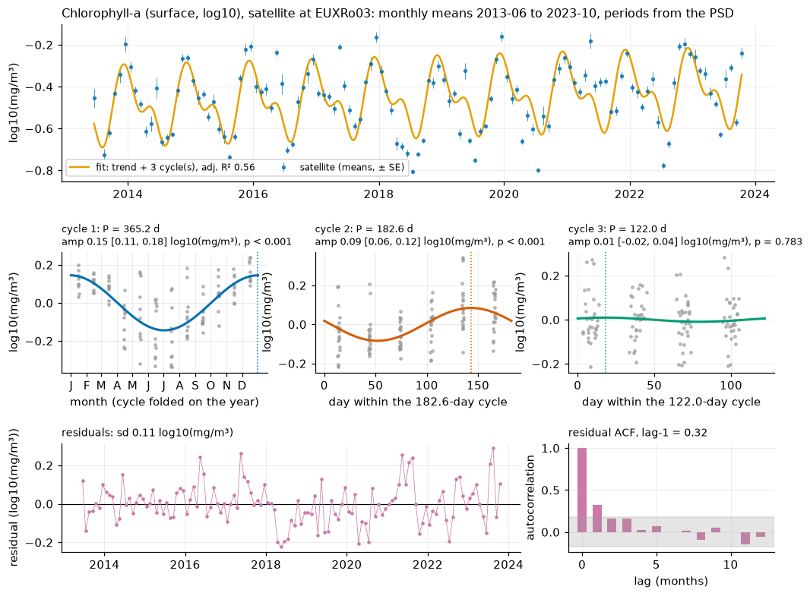

What: satellite chlorophyll-a (surface, log10) at EUXRo03 (monthly means, 2013-06 to 2023-10) follows a 365-day cycle of x1.40 above / below the mean (log10 amplitude 0.15), highest around 31 Dec; 183 d (x1.22 above / below the mean (log10 amplitude 0.09), p < 0.001), 122 d (x1.02 above / below the mean (log10 amplitude 0.01), p = 0.783). Trend + cycles explain 56% of the variance of the monthly means. So what: anomalies and trends must be read against this cycle; what remains after it is about ± 0.11 log10(mg/m³) (monthly residual sd), and it is persistent (lag-1 r = 0.32), so HAC errors are used.

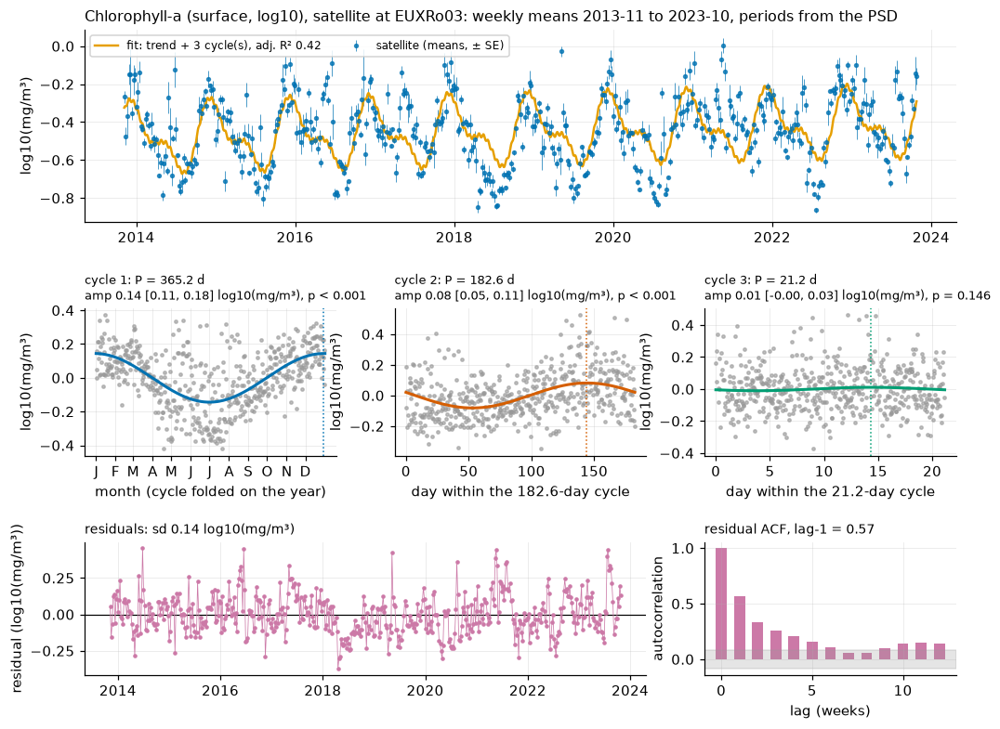

What: satellite chlorophyll-a (surface, log10) at EUXRo03 (weekly means, 2013-11 to 2023-10) follows a 365-day cycle of x1.39 above / below the mean (log10 amplitude 0.14), highest around 30 Dec; 183 d (x1.21 above / below the mean (log10 amplitude 0.08), p < 0.001), 21 d (x1.03 above / below the mean (log10 amplitude 0.01), p = 0.146). Trend + cycles explain 42% of the variance of the weekly means. So what: anomalies and trends must be read against this cycle; what remains after it is about ± 0.14 log10(mg/m³) (weekly residual sd), and it is persistent (lag-1 r = 0.57), so HAC errors are used.

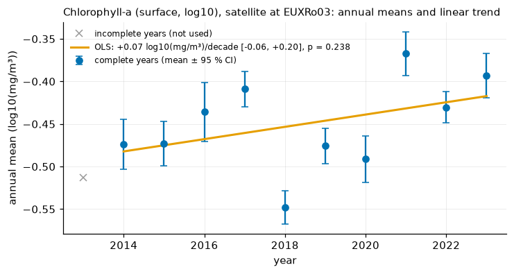

What: annual means of satellite chlorophyll-a (surface, log10) at EUXRo03 (2014-2023, 10 complete years) change by +0.07 log10(mg/m³) per decade (+18 % per decade) (95 % CI -0.06 to +0.20, p = 0.238). So what: the change is not statistically significant; with about 10 points, year-to-year variability dominates any reading of it.

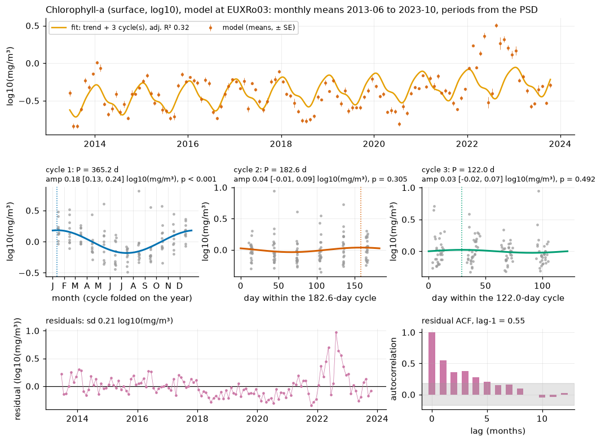

What: model chlorophyll-a (surface, log10) at EUXRo03 (monthly means, 2013-06 to 2023-10) follows a 365-day cycle of x1.53 above / below the mean (log10 amplitude 0.18), highest around 12 Jan; 183 d (x1.09 above / below the mean (log10 amplitude 0.04), p = 0.305), 122 d (x1.06 above / below the mean (log10 amplitude 0.03), p = 0.492). Trend + cycles explain 32% of the variance of the monthly means. So what: anomalies and trends must be read against this cycle; what remains after it is about ± 0.21 log10(mg/m³) (monthly residual sd), and it is persistent (lag-1 r = 0.55), so HAC errors are used.

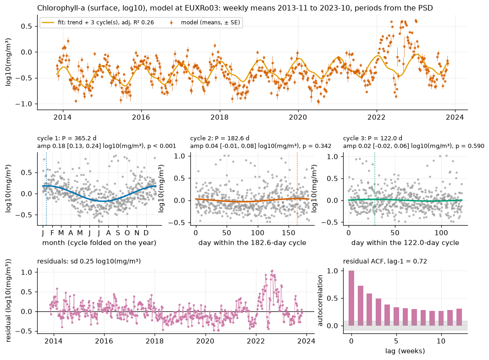

What: model chlorophyll-a (surface, log10) at EUXRo03 (weekly means, 2013-11 to 2023-10) follows a 365-day cycle of x1.52 above / below the mean (log10 amplitude 0.18), highest around 12 Jan; 183 d (x1.08 above / below the mean (log10 amplitude 0.04), p = 0.342), 122 d (x1.05 above / below the mean (log10 amplitude 0.02), p = 0.590). Trend + cycles explain 26% of the variance of the weekly means. So what: anomalies and trends must be read against this cycle; what remains after it is about ± 0.25 log10(mg/m³) (weekly residual sd), and it is persistent (lag-1 r = 0.72), so HAC errors are used.

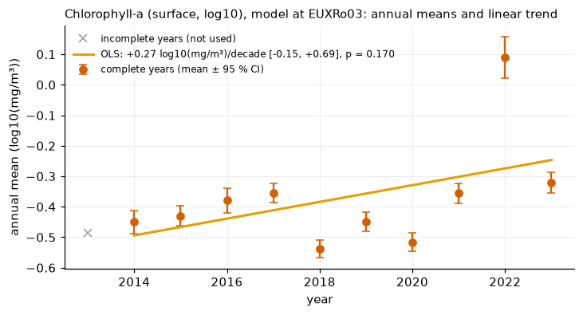

What: annual means of model chlorophyll-a (surface, log10) at EUXRo03 (2014-2023, 10 complete years) change by +0.27 log10(mg/m³) per decade (+88 % per decade) (95 % CI -0.15 to +0.69, p = 0.170). So what: the change is not statistically significant; with about 10 points, year-to-year variability dominates any reading of it.

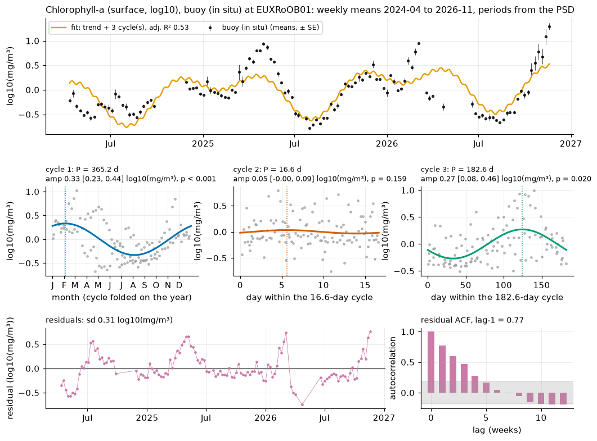

What: buoy (in situ) chlorophyll-a (surface, log10) at EUXRoOB01 (weekly means, 2024-04 to 2026-11) follows a 365-day cycle of x2.15 above / below the mean (log10 amplitude 0.33), highest around 3 Feb; 17 d (x1.11 above / below the mean (log10 amplitude 0.05), p = 0.159), 183 d (x1.87 above / below the mean (log10 amplitude 0.27), p = 0.020). Trend + cycles explain 53% of the variance of the weekly means. So what: anomalies and trends must be read against this cycle; what remains after it is about ± 0.31 log10(mg/m³) (weekly residual sd), and it is persistent (lag-1 r = 0.77), so HAC errors are used.

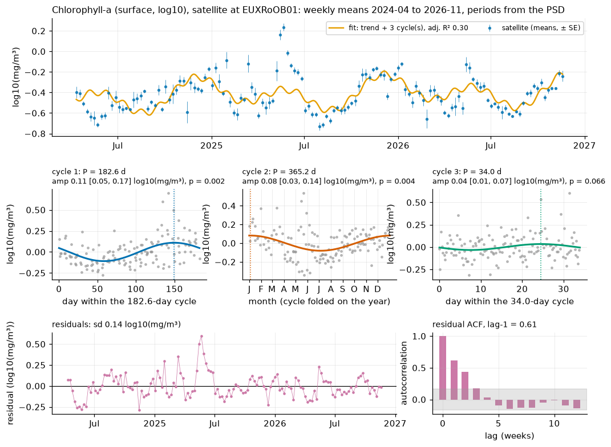

What: satellite chlorophyll-a (surface, log10) at EUXRoOB01 (weekly means, 2024-04 to 2026-11) follows a 183-day cycle of x1.29 above / below the mean (log10 amplitude 0.11), highest around 30 May, 29 Nov; 365 d (x1.21 above / below the mean (log10 amplitude 0.08), p = 0.004), 34 d (x1.09 above / below the mean (log10 amplitude 0.04), p = 0.066). Trend + cycles explain 30% of the variance of the weekly means. So what: anomalies and trends must be read against this cycle; what remains after it is about ± 0.14 log10(mg/m³) (weekly residual sd), and it is persistent (lag-1 r = 0.61), so HAC errors are used.

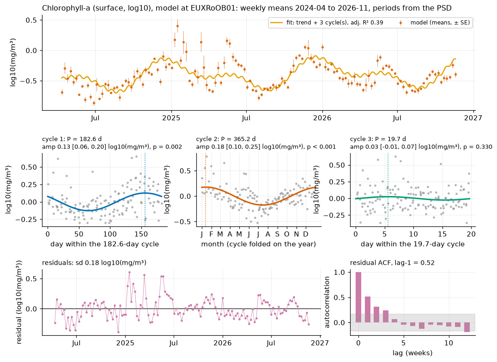

What: model chlorophyll-a (surface, log10) at EUXRoOB01 (weekly means, 2024-04 to 2026-11) follows a 183-day cycle of x1.34 above / below the mean (log10 amplitude 0.13), highest around 6 Jun, 5 Dec; 365 d (x1.50 above / below the mean (log10 amplitude 0.18), p < 0.001), 20 d (x1.08 above / below the mean (log10 amplitude 0.03), p = 0.330). Trend + cycles explain 39% of the variance of the weekly means. So what: anomalies and trends must be read against this cycle; what remains after it is about ± 0.18 log10(mg/m³) (weekly residual sd), and it is persistent (lag-1 r = 0.52), so HAC errors are used.

Other figures: [EUXRoOB01 insitu monthly](figures/fit_EUXRoOB01_chl_insitu_monthly.png), [EUXRoOB01 insitu trend](figures/trend_EUXRoOB01_chl_insitu.png), [EUXRoOB01 satellite monthly](figures/fit_EUXRoOB01_chl_satellite_monthly.png), [EUXRoOB01 satellite trend](figures/trend_EUXRoOB01_chl_satellite.png), [EUXRoOB01 model monthly](figures/fit_EUXRoOB01_chl_model_monthly.png), [EUXRoOB01 model trend](figures/trend_EUXRoOB01_chl_model.png), [EUXRoOB02 insitu monthly](figures/fit_EUXRoOB02_chl_insitu_monthly.png), [EUXRoOB02 insitu weekly](figures/fit_EUXRoOB02_chl_insitu_weekly.png), [EUXRoOB02 insitu trend](figures/trend_EUXRoOB02_chl_insitu.png), [EUXRoOB02 satellite monthly](figures/fit_EUXRoOB02_chl_satellite_monthly.png), [EUXRoOB02 satellite weekly](figures/fit_EUXRoOB02_chl_satellite_weekly.png), [EUXRoOB02 satellite trend](figures/trend_EUXRoOB02_chl_satellite.png), [EUXRoOB02 model monthly](figures/fit_EUXRoOB02_chl_model_monthly.png), [EUXRoOB02 model weekly](figures/fit_EUXRoOB02_chl_model_weekly.png), [EUXRoOB02 model trend](figures/trend_EUXRoOB02_chl_model.png), [EUXRoOB03 insitu monthly](figures/fit_EUXRoOB03_chl_insitu_monthly.png), [EUXRoOB03 insitu weekly](figures/fit_EUXRoOB03_chl_insitu_weekly.png), [EUXRoOB03 insitu trend](figures/trend_EUXRoOB03_chl_insitu.png), [EUXRoOB03 satellite monthly](figures/fit_EUXRoOB03_chl_satellite_monthly.png), [EUXRoOB03 satellite weekly](figures/fit_EUXRoOB03_chl_satellite_weekly.png), [EUXRoOB03 satellite trend](figures/trend_EUXRoOB03_chl_satellite.png), [EUXRoOB03 model monthly](figures/fit_EUXRoOB03_chl_model_monthly.png), [EUXRoOB03 model weekly](figures/fit_EUXRoOB03_chl_model_weekly.png), [EUXRoOB03 model trend](figures/trend_EUXRoOB03_chl_model.png)

Plain-language sentences for these figures

- **EUXRoOB01 insitu monthly**: What: buoy (in situ) chlorophyll-a (surface, log10) at EUXRoOB01 (monthly means, 2024-04 to 2026-11) follows a 365-day cycle of x2.22 above / below the mean (log10 amplitude 0.35), highest around 6 Feb; 183 d (x1.99 above / below the mean (log10 amplitude 0.30), p = 0.120), 70 d (x1.05 above / below the mean (log10 amplitude 0.02), p = 0.956). Trend + cycles explain 55% of the variance of the monthly means. So what: anomalies and trends must be read against this cycle; what remains after it is about ± 0.29 log10(mg/m³) (monthly residual sd), and it is persistent (lag-1 r = 0.45), so HAC errors are used.
- **EUXRoOB01 insitu trend**: What: buoy (in situ) chlorophyll-a (surface, log10) at EUXRoOB01 has 1 complete year(s). So what: too short for an interannual trend (need at least 8 complete years); no slope is given.
- **EUXRoOB01 satellite monthly**: What: satellite chlorophyll-a (surface, log10) at EUXRoOB01 (monthly means, 2024-04 to 2026-11) follows a 183-day cycle of x1.29 above / below the mean (log10 amplitude 0.11), highest around 28 May, 27 Nov; 365 d (x1.20 above / below the mean (log10 amplitude 0.08), p = 0.003). Trend + cycles explain 32% of the variance of the monthly means. So what: anomalies and trends must be read against this cycle; what remains after it is about ± 0.12 log10(mg/m³) (monthly residual sd).
- **EUXRoOB01 satellite trend**: What: satellite chlorophyll-a (surface, log10) at EUXRoOB01 has 1 complete year(s). So what: too short for an interannual trend (need at least 8 complete years); no slope is given.
- **EUXRoOB01 model monthly**: What: model chlorophyll-a (surface, log10) at EUXRoOB01 (monthly means, 2024-04 to 2026-11) follows a 183-day cycle of x1.31 above / below the mean (log10 amplitude 0.12), highest around 6 Jun, 6 Dec; 365 d (x1.51 above / below the mean (log10 amplitude 0.18), p < 0.001), 122 d (x1.19 above / below the mean (log10 amplitude 0.08), p = 0.176). Trend + cycles explain 51% of the variance of the monthly means. So what: anomalies and trends must be read against this cycle; what remains after it is about ± 0.14 log10(mg/m³) (monthly residual sd).
- **EUXRoOB01 model trend**: What: model chlorophyll-a (surface, log10) at EUXRoOB01 has 1 complete year(s). So what: too short for an interannual trend (need at least 8 complete years); no slope is given.
- **EUXRoOB02 insitu monthly**: What: buoy (in situ) chlorophyll-a (surface, log10) at EUXRoOB02 (monthly means, 2024-04 to 2026-07) follows a 523-day cycle of x3.31 above / below the mean (log10 amplitude 0.52), highest around day 285 of a 523-d cycle counted from 1 Jan 2024; 183 d (x2.12 above / below the mean (log10 amplitude 0.33), p = 0.031), 70 d (x1.36 above / below the mean (log10 amplitude 0.13), p = 0.533). Trend + cycles explain 60% of the variance of the monthly means. So what: anomalies and trends must be read against this cycle; what remains after it is about ± 0.33 log10(mg/m³) (monthly residual sd), and it is persistent (lag-1 r = 0.39), so HAC errors are used.
- **EUXRoOB02 insitu weekly**: What: buoy (in situ) chlorophyll-a (surface, log10) at EUXRoOB02 (weekly means, 2024-04 to 2026-07) follows a 523-day cycle of x3.23 above / below the mean (log10 amplitude 0.51), highest around day 285 of a 523-d cycle counted from 1 Jan 2024; 183 d (x2.11 above / below the mean (log10 amplitude 0.32), p = 0.004), 70 d (x1.34 above / below the mean (log10 amplitude 0.13), p = 0.145). Trend + cycles explain 64% of the variance of the weekly means. So what: anomalies and trends must be read against this cycle; what remains after it is about ± 0.32 log10(mg/m³) (weekly residual sd), and it is persistent (lag-1 r = 0.78), so HAC errors are used.
- **EUXRoOB02 insitu trend**: What: buoy (in situ) chlorophyll-a (surface, log10) at EUXRoOB02 has 1 complete year(s). So what: too short for an interannual trend (need at least 8 complete years); no slope is given.
- **EUXRoOB02 satellite monthly**: What: satellite chlorophyll-a (surface, log10) at EUXRoOB02 (monthly means, 2024-04 to 2026-07) follows a 183-day cycle of x1.23 above / below the mean (log10 amplitude 0.09), highest around 10 May, 8 Nov; 365 d (x1.41 above / below the mean (log10 amplitude 0.15), p < 0.001), 70 d (x1.16 above / below the mean (log10 amplitude 0.06), p = 0.151). Trend + cycles explain 60% of the variance of the monthly means. So what: anomalies and trends must be read against this cycle; what remains after it is about ± 0.09 log10(mg/m³) (monthly residual sd).
- **EUXRoOB02 satellite weekly**: What: satellite chlorophyll-a (surface, log10) at EUXRoOB02 (weekly means, 2024-04 to 2026-07) follows a 183-day cycle of x1.23 above / below the mean (log10 amplitude 0.09), highest around 13 May, 12 Nov; 365 d (x1.42 above / below the mean (log10 amplitude 0.15), p < 0.001), 70 d (x1.10 above / below the mean (log10 amplitude 0.04), p = 0.086). Trend + cycles explain 49% of the variance of the weekly means. So what: anomalies and trends must be read against this cycle; what remains after it is about ± 0.13 log10(mg/m³) (weekly residual sd), and it is persistent (lag-1 r = 0.45), so HAC errors are used.
- **EUXRoOB02 satellite trend**: What: satellite chlorophyll-a (surface, log10) at EUXRoOB02 has 1 complete year(s). So what: too short for an interannual trend (need at least 8 complete years); no slope is given.
- **EUXRoOB02 model monthly**: What: model chlorophyll-a (surface, log10) at EUXRoOB02 (monthly means, 2024-04 to 2026-07) follows a 365-day cycle of x1.44 above / below the mean (log10 amplitude 0.16), highest around 12 Jan; 216 d (x1.23 above / below the mean (log10 amplitude 0.09), p < 0.001), 70 d (x1.04 above / below the mean (log10 amplitude 0.02), p = 0.862). Trend + cycles explain 64% of the variance of the monthly means. So what: anomalies and trends must be read against this cycle; what remains after it is about ± 0.10 log10(mg/m³) (monthly residual sd).
- **EUXRoOB02 model weekly**: What: model chlorophyll-a (surface, log10) at EUXRoOB02 (weekly means, 2024-04 to 2026-07) follows a 365-day cycle of x1.44 above / below the mean (log10 amplitude 0.16), highest around 12 Jan; 216 d (x1.22 above / below the mean (log10 amplitude 0.08), p < 0.001), 33 d (x1.04 above / below the mean (log10 amplitude 0.02), p = 0.641). Trend + cycles explain 50% of the variance of the weekly means. So what: anomalies and trends must be read against this cycle; what remains after it is about ± 0.13 log10(mg/m³) (weekly residual sd), and it is persistent (lag-1 r = 0.43), so HAC errors are used.
- **EUXRoOB02 model trend**: What: model chlorophyll-a (surface, log10) at EUXRoOB02 has 1 complete year(s). So what: too short for an interannual trend (need at least 8 complete years); no slope is given.
- **EUXRoOB03 insitu monthly**: What: buoy (in situ) chlorophyll-a (surface, log10) at EUXRoOB03 (monthly means, 2024-04 to 2026-11) follows a 248-day cycle of x2.87 above / below the mean (log10 amplitude 0.46), highest around day 179 of a 248-d cycle counted from 1 Jan 2024; 183 d (x2.02 above / below the mean (log10 amplitude 0.30), p = 0.112), 365 d (x4.53 above / below the mean (log10 amplitude 0.66), p = 0.084). Trend + cycles explain 34% of the variance of the monthly means. So what: anomalies and trends must be read against this cycle; what remains after it is about ± 0.59 log10(mg/m³) (monthly residual sd), and it is persistent (lag-1 r = 0.67), so HAC errors are used.
- **EUXRoOB03 insitu weekly**: What: buoy (in situ) chlorophyll-a (surface, log10) at EUXRoOB03 (weekly means, 2024-04 to 2026-11) follows a 248-day cycle of x2.45 above / below the mean (log10 amplitude 0.39), highest around day 167 of a 248-d cycle counted from 1 Jan 2024; 183 d (x2.11 above / below the mean (log10 amplitude 0.32), p = 0.308), 44 d (x1.24 above / below the mean (log10 amplitude 0.09), p = 0.405). Trend + cycles explain 15% of the variance of the weekly means. So what: anomalies and trends must be read against this cycle; what remains after it is about ± 0.71 log10(mg/m³) (weekly residual sd), and it is persistent (lag-1 r = 0.91), so HAC errors are used.
- **EUXRoOB03 insitu trend**: What: buoy (in situ) chlorophyll-a (surface, log10) at EUXRoOB03 has 1 complete year(s). So what: too short for an interannual trend (need at least 8 complete years); no slope is given.
- **EUXRoOB03 satellite monthly**: What: satellite chlorophyll-a (surface, log10) at EUXRoOB03 (monthly means, 2024-04 to 2026-11) follows a 365-day cycle of x1.48 above / below the mean (log10 amplitude 0.17), highest around 26 Dec; 183 d (x1.26 above / below the mean (log10 amplitude 0.10), p < 0.001), 248 d (x1.03 above / below the mean (log10 amplitude 0.01), p = 0.228). Trend + cycles explain 83% of the variance of the monthly means. So what: anomalies and trends must be read against this cycle; what remains after it is about ± 0.06 log10(mg/m³) (monthly residual sd).
- **EUXRoOB03 satellite weekly**: What: satellite chlorophyll-a (surface, log10) at EUXRoOB03 (weekly means, 2024-04 to 2026-11) follows a 365-day cycle of x1.49 above / below the mean (log10 amplitude 0.17), highest around 25 Dec; 183 d (x1.26 above / below the mean (log10 amplitude 0.10), p < 0.001), 17 d (x1.06 above / below the mean (log10 amplitude 0.02), p = 0.213). Trend + cycles explain 71% of the variance of the weekly means. So what: anomalies and trends must be read against this cycle; what remains after it is about ± 0.09 log10(mg/m³) (weekly residual sd), and it is persistent (lag-1 r = 0.31), so HAC errors are used.
- **EUXRoOB03 satellite trend**: What: satellite chlorophyll-a (surface, log10) at EUXRoOB03 has 1 complete year(s). So what: too short for an interannual trend (need at least 8 complete years); no slope is given.
- **EUXRoOB03 model monthly**: What: model chlorophyll-a (surface, log10) at EUXRoOB03 (monthly means, 2024-04 to 2026-11) follows a 365-day cycle of x1.48 above / below the mean (log10 amplitude 0.17), highest around 25 Dec; 183 d (x1.27 above / below the mean (log10 amplitude 0.11), p < 0.001), 248 d (x1.07 above / below the mean (log10 amplitude 0.03), p = 0.095). Trend + cycles explain 72% of the variance of the monthly means. So what: anomalies and trends must be read against this cycle; what remains after it is about ± 0.09 log10(mg/m³) (monthly residual sd).
- **EUXRoOB03 model weekly**: What: model chlorophyll-a (surface, log10) at EUXRoOB03 (weekly means, 2024-04 to 2026-11) follows a 365-day cycle of x1.50 above / below the mean (log10 amplitude 0.18), highest around 24 Dec; 183 d (x1.29 above / below the mean (log10 amplitude 0.11), p < 0.001), 18 d (x1.07 above / below the mean (log10 amplitude 0.03), p = 0.233). Trend + cycles explain 58% of the variance of the weekly means. So what: anomalies and trends must be read against this cycle; what remains after it is about ± 0.13 log10(mg/m³) (weekly residual sd), and it is persistent (lag-1 r = 0.41), so HAC errors are used.
- **EUXRoOB03 model trend**: What: model chlorophyll-a (surface, log10) at EUXRoOB03 has 1 complete year(s). So what: too short for an interannual trend (need at least 8 complete years); no slope is given.

## Surface salinity (PSU)

### Seasonal cycles

| station | source | window | n | cycles: amplitude [95 % CI] (PSU), max date ± 95 %, p (HAC) | adj. R² | resid sd (PSU) | dAIC per added cycle | resid lag-1 r | Ljung-Box p |
|---|---|---|---|---|---|---|---|---|---|
| EUXRo03 | buoy (in situ) | monthly 2013-06 to 2023-08 | 60 | 365.2 d (PSD 423) (period from buoy (in situ) EUXRoOB02): 0.49 [0.19, 0.79], max 13 Mar ± 37 d, p 0.003 | 0.15 | 0.74 | -7 | 0.25 | 0.171 |
| EUXRo03 | buoy (in situ) | weekly 2013-08 to 2023-08 | 229 | 14.3 d: 0.03 [-0.08, 0.14], max day 12 of a 14-d cycle counted from 1 Jan 2013 ± 9 d, p 0.841 365.2 d (PSD 423) (period from buoy (in situ) EUXRoOB02): 0.52 [0.25, 0.79], max 13 Mar ± 28 d, p < 0.001 | 0.18 | 0.80 | +4, -35 | 0.74 | < 0.001 |
| EUXRo03 | model | monthly 2013-06 to 2023-08 | 123 | 365.2 d (PSD 416) (period from model EUXRoOB01): 0.11 [0.03, 0.19], max 19 Jan ± 37 d, p 0.029 | 0.44 | 0.22 | -11 | 0.55 | < 0.001 |
| EUXRo03 | model | weekly 2013-08 to 2023-08 | 522 | 365.2 d (PSD 416) (period from model EUXRoOB01): 0.10 [0.02, 0.17], max 22 Jan ± 39 d, p 0.041 | 0.32 | 0.26 | -31 | 0.74 | < 0.001 |
| EUXRoOB01 | buoy (in situ) | monthly 2024-04 to 2026-11 | 28 | 365.2 d (PSD 416) (period from model): 1.00 [-0.00, 2.01], max 5 Jan ± 83 d, p 0.039 | 0.06 | 1.74 | -1 | 0.39 | 0.132 |
| EUXRoOB01 | buoy (in situ) | weekly 2024-04 to 2026-11 | 118 | 16.7 d: 0.08 [-0.14, 0.30], max day 10 of a 17-d cycle counted from 1 Jan 2024 ± 6 d, p 0.776 365.2 d (PSD 416) (period from model): 1.04 [0.12, 1.96], max 4 Jan ± 61 d, p 0.027 | 0.13 | 1.73 | +4, -16 | 0.88 | < 0.001 |
| EUXRoOB01 | model | monthly 2024-04 to 2026-11 | 32 | 365.2 d (PSD 416): 0.28 [0.04, 0.51], max 11 Jan ± 27 d, p 0.065 | 0.37 | 0.28 | -9 | 0.41 | 0.120 |
| EUXRoOB01 | model | weekly 2024-04 to 2026-11 | 137 | 365.2 d (PSD 416): 0.28 [0.13, 0.44], max 12 Jan ± 25 d, p 0.002 15.2 d: 0.03 [-0.02, 0.09], max 5 Jan, 20 Jan, 4 Feb, 19 Feb, 6 Mar, 22 Mar, 6 Apr, 21 Apr, 6 May, 22 May, 6 Jun, 21 Jun, 6 Jul, 21 Jul, 6 Aug, 21 Aug, 5 Sep, 20 Sep, 6 Oct, 21 Oct, 5 Nov, 20 Nov, 5 Dec, 21 Dec ± 3 d, p 0.444 | 0.36 | 0.30 | -45, +4 | 0.77 | < 0.001 |
| EUXRoOB02 | buoy (in situ) | monthly 2024-04 to 2026-07 | 22 | 365.2 d (PSD 423): 3.19 [1.20, 5.18], max 20 Apr ± 33 d, p 0.007 | 0.42 | 2.34 | -11 | 0.18 | 0.020 |
| EUXRoOB02 | buoy (in situ) | weekly 2024-04 to 2026-07 | 90 | 365.2 d (PSD 423): 2.81 [1.32, 4.30], max 23 Apr ± 29 d, p 0.001 | 0.42 | 2.20 | -47 | 0.76 | < 0.001 |
| EUXRoOB02 | model | monthly 2024-04 to 2026-07 | 28 | 365.2 d (PSD 423) (period from buoy (in situ)): 0.24 [0.03, 0.46], max 30 Dec ± 31 d, p 0.048 | 0.27 | 0.26 | -7 | 0.40 | 0.105 |
| EUXRoOB02 | model | weekly 2024-04 to 2026-07 | 121 | 33.8 d: 0.04 [-0.01, 0.09], max day 30 of a 34-d cycle counted from 1 Jan 2024 ± 5 d, p 0.245 365.2 d (PSD 423) (period from buoy (in situ)): 0.24 [0.08, 0.40], max 2 Jan ± 33 d, p 0.010 | 0.30 | 0.27 | +3, -37 | 0.80 | < 0.001 |
| EUXRoOB03 | buoy (in situ) | monthly 2024-04 to 2026-11 | 26 | 365.2 d (PSD 441) (period from model): 0.45 [-0.21, 1.11], max 6 May ± 73 d, p 0.383 | 0.01 | 0.87 | +0 | 0.16 | 0.030 |
| EUXRoOB03 | buoy (in situ) | weekly 2024-04 to 2026-11 | 110 | 365.2 d (PSD 441) (period from model): 0.44 [-0.13, 1.00], max 4 May ± 56 d, p 0.300 | 0.08 | 0.88 | -8 | 0.83 | < 0.001 |
| EUXRoOB03 | model | monthly 2024-04 to 2026-11 | 32 | 365.2 d (PSD 441): 0.19 [0.04, 0.34], max 9 Dec ± 32 d, p 0.013 | 0.28 | 0.20 | -9 | 0.28 | 0.493 |
| EUXRoOB03 | model | weekly 2024-04 to 2026-11 | 137 | 365.2 d (PSD 441): 0.20 [0.09, 0.31], max 10 Dec ± 26 d, p < 0.001 | 0.23 | 0.25 | -35 | 0.74 | < 0.001 |

### Interannual linear trend

| station | source | complete years | n years | slope (PSU/decade) [95 % CI] | p | R² | note |
|---|---|---|---|---|---|---|---|
| EUXRo03 | buoy (in situ) | 2015-2015 | 1 | not meaningful |  |  | only 1 complete year(s) (need 8): trend not meaningful |
| EUXRo03 | model | 2014-2022 | 9 | +0.61 [+0.18, +1.03] | 0.012 | 0.62 |  |
| EUXRoOB01 | buoy (in situ) | 2025-2025 | 1 | not meaningful |  |  | only 1 complete year(s) (need 8): trend not meaningful |
| EUXRoOB01 | model | 2025-2025 | 1 | not meaningful |  |  | only 1 complete year(s) (need 8): trend not meaningful |
| EUXRoOB02 | buoy (in situ) | 2025-2025 | 1 | not meaningful |  |  | only 1 complete year(s) (need 8): trend not meaningful |
| EUXRoOB02 | model | 2025-2025 | 1 | not meaningful |  |  | only 1 complete year(s) (need 8): trend not meaningful |
| EUXRoOB03 | buoy (in situ) | 2025-2025 | 1 | not meaningful |  |  | only 1 complete year(s) (need 8): trend not meaningful |
| EUXRoOB03 | model | 2025-2025 | 1 | not meaningful |  |  | only 1 complete year(s) (need 8): trend not meaningful |

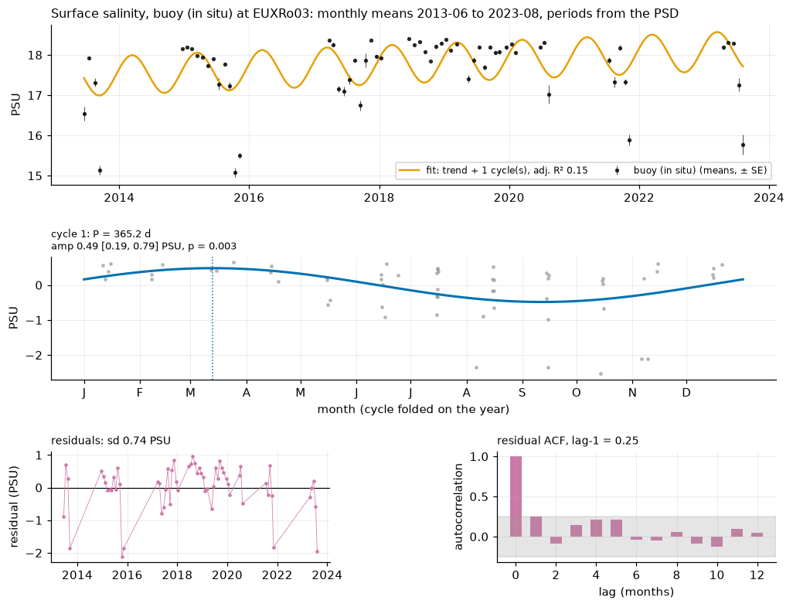

What: buoy (in situ) surface salinity at EUXRo03 (monthly means, 2013-06 to 2023-08) follows a 365-day cycle of ± 0.49 PSU, highest around 13 Mar. Trend + cycles explain 15% of the variance of the monthly means. So what: anomalies and trends must be read against this cycle; what remains after it is about ± 0.74 PSU (monthly residual sd).

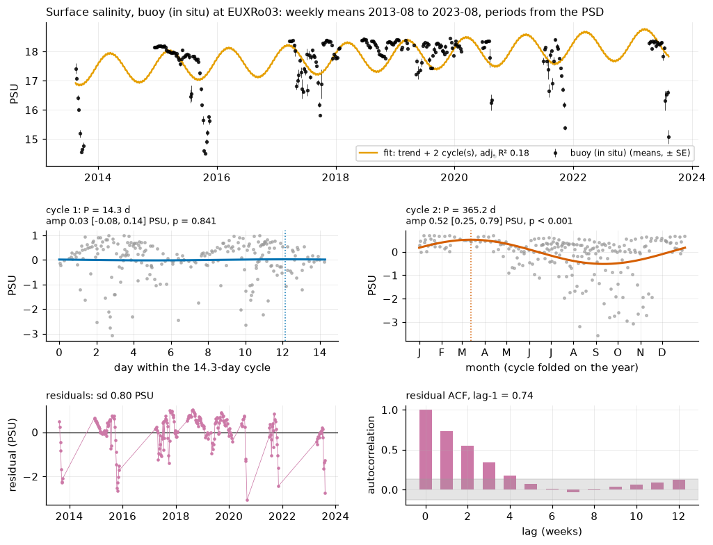

What: buoy (in situ) surface salinity at EUXRo03 (weekly means, 2013-08 to 2023-08) follows a 14-day cycle of ± 0.03 PSU, highest around day 12 of a 14-d cycle counted from 1 Jan 2013; 365 d (± 0.52 PSU, p < 0.001). Trend + cycles explain 18% of the variance of the weekly means. So what: anomalies and trends must be read against this cycle; what remains after it is about ± 0.80 PSU (weekly residual sd), and it is persistent (lag-1 r = 0.74), so HAC errors are used.

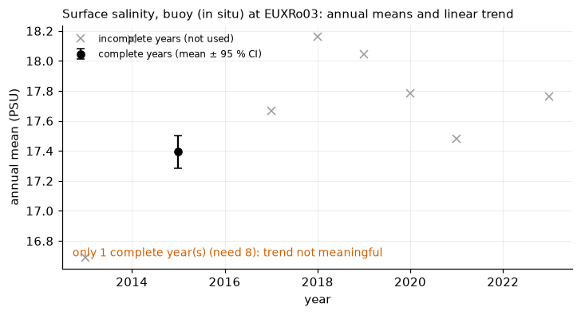

What: buoy (in situ) surface salinity at EUXRo03 has 1 complete year(s). So what: too short for an interannual trend (need at least 8 complete years); no slope is given.

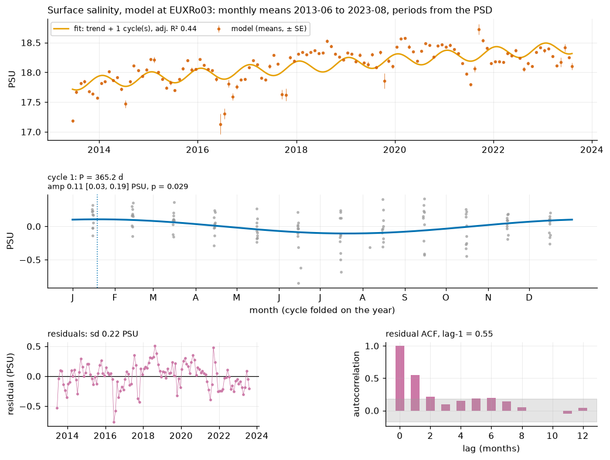

What: model surface salinity at EUXRo03 (monthly means, 2013-06 to 2023-08) follows a 365-day cycle of ± 0.11 PSU, highest around 19 Jan. Trend + cycles explain 44% of the variance of the monthly means. So what: anomalies and trends must be read against this cycle; what remains after it is about ± 0.22 PSU (monthly residual sd), and it is persistent (lag-1 r = 0.55), so HAC errors are used.

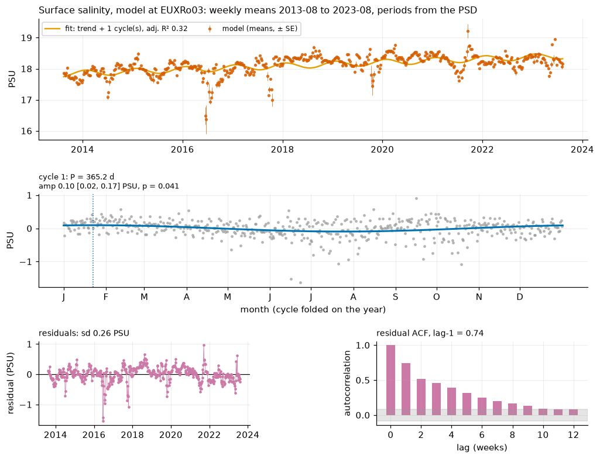

What: model surface salinity at EUXRo03 (weekly means, 2013-08 to 2023-08) follows a 365-day cycle of ± 0.10 PSU, highest around 22 Jan. Trend + cycles explain 32% of the variance of the weekly means. So what: anomalies and trends must be read against this cycle; what remains after it is about ± 0.26 PSU (weekly residual sd), and it is persistent (lag-1 r = 0.74), so HAC errors are used.

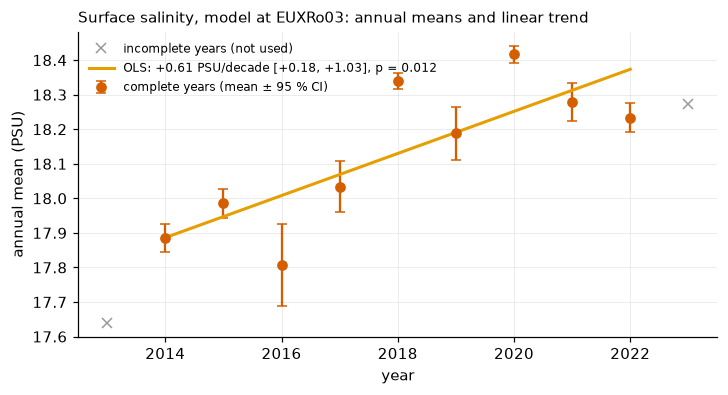

What: annual means of model surface salinity at EUXRo03 (2014-2022, 9 complete years) change by +0.61 PSU per decade (95 % CI +0.18 to +1.03, p = 0.012). So what: the change is statistically significant; with about 9 points, year-to-year variability dominates any reading of it.

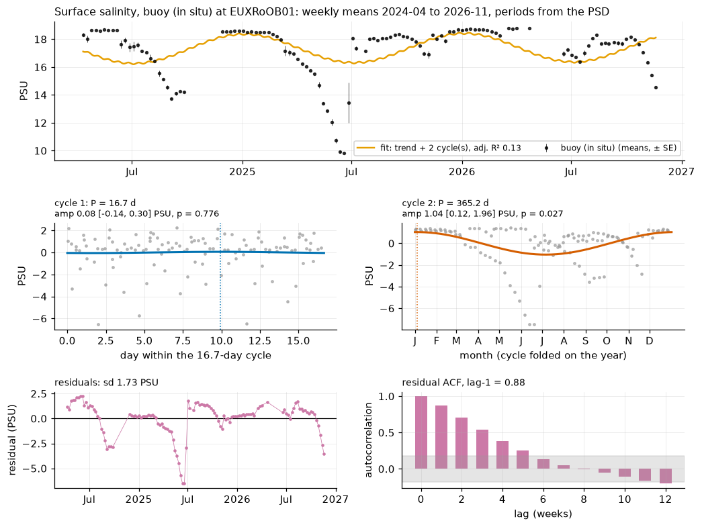

What: buoy (in situ) surface salinity at EUXRoOB01 (weekly means, 2024-04 to 2026-11) follows a 17-day cycle of ± 0.08 PSU, highest around day 10 of a 17-d cycle counted from 1 Jan 2024; 365 d (± 1.04 PSU, p = 0.027). Trend + cycles explain 13% of the variance of the weekly means. So what: anomalies and trends must be read against this cycle; what remains after it is about ± 1.73 PSU (weekly residual sd), and it is persistent (lag-1 r = 0.88), so HAC errors are used.

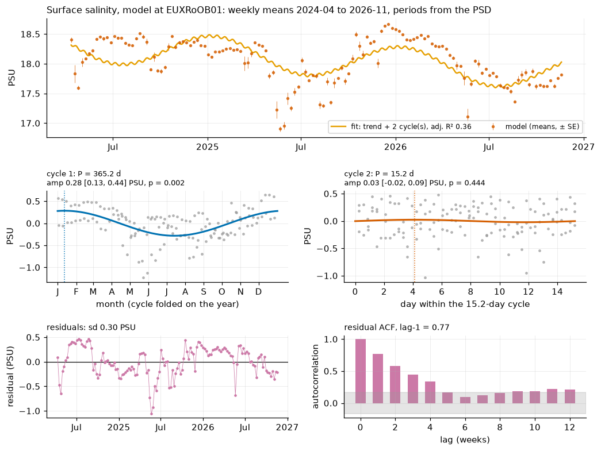

What: model surface salinity at EUXRoOB01 (weekly means, 2024-04 to 2026-11) follows a 365-day cycle of ± 0.28 PSU, highest around 12 Jan; 15 d (± 0.03 PSU, p = 0.444). Trend + cycles explain 36% of the variance of the weekly means. So what: anomalies and trends must be read against this cycle; what remains after it is about ± 0.30 PSU (weekly residual sd), and it is persistent (lag-1 r = 0.77), so HAC errors are used.

Other figures: [EUXRoOB01 insitu monthly](figures/fit_EUXRoOB01_sal_insitu_monthly.png), [EUXRoOB01 insitu trend](figures/trend_EUXRoOB01_sal_insitu.png), [EUXRoOB01 model monthly](figures/fit_EUXRoOB01_sal_model_monthly.png), [EUXRoOB01 model trend](figures/trend_EUXRoOB01_sal_model.png), [EUXRoOB02 insitu monthly](figures/fit_EUXRoOB02_sal_insitu_monthly.png), [EUXRoOB02 insitu weekly](figures/fit_EUXRoOB02_sal_insitu_weekly.png), [EUXRoOB02 insitu trend](figures/trend_EUXRoOB02_sal_insitu.png), [EUXRoOB02 model monthly](figures/fit_EUXRoOB02_sal_model_monthly.png), [EUXRoOB02 model weekly](figures/fit_EUXRoOB02_sal_model_weekly.png), [EUXRoOB02 model trend](figures/trend_EUXRoOB02_sal_model.png), [EUXRoOB03 insitu monthly](figures/fit_EUXRoOB03_sal_insitu_monthly.png), [EUXRoOB03 insitu weekly](figures/fit_EUXRoOB03_sal_insitu_weekly.png), [EUXRoOB03 insitu trend](figures/trend_EUXRoOB03_sal_insitu.png), [EUXRoOB03 model monthly](figures/fit_EUXRoOB03_sal_model_monthly.png), [EUXRoOB03 model weekly](figures/fit_EUXRoOB03_sal_model_weekly.png), [EUXRoOB03 model trend](figures/trend_EUXRoOB03_sal_model.png)

Plain-language sentences for these figures

- **EUXRoOB01 insitu monthly**: What: buoy (in situ) surface salinity at EUXRoOB01 (monthly means, 2024-04 to 2026-11) follows a 365-day cycle of ± 1.00 PSU, highest around 5 Jan. Trend + cycles explain 6% of the variance of the monthly means. So what: anomalies and trends must be read against this cycle; what remains after it is about ± 1.74 PSU (monthly residual sd), and it is persistent (lag-1 r = 0.39), so HAC errors are used.
- **EUXRoOB01 insitu trend**: What: buoy (in situ) surface salinity at EUXRoOB01 has 1 complete year(s). So what: too short for an interannual trend (need at least 8 complete years); no slope is given.
- **EUXRoOB01 model monthly**: What: model surface salinity at EUXRoOB01 (monthly means, 2024-04 to 2026-11) follows a 365-day cycle of ± 0.28 PSU, highest around 11 Jan. Trend + cycles explain 37% of the variance of the monthly means. So what: anomalies and trends must be read against this cycle; what remains after it is about ± 0.28 PSU (monthly residual sd), and it is persistent (lag-1 r = 0.41), so HAC errors are used.
- **EUXRoOB01 model trend**: What: model surface salinity at EUXRoOB01 has 1 complete year(s). So what: too short for an interannual trend (need at least 8 complete years); no slope is given.
- **EUXRoOB02 insitu monthly**: What: buoy (in situ) surface salinity at EUXRoOB02 (monthly means, 2024-04 to 2026-07) follows a 365-day cycle of ± 3.19 PSU, highest around 20 Apr. Trend + cycles explain 42% of the variance of the monthly means. So what: anomalies and trends must be read against this cycle; what remains after it is about ± 2.34 PSU (monthly residual sd).
- **EUXRoOB02 insitu weekly**: What: buoy (in situ) surface salinity at EUXRoOB02 (weekly means, 2024-04 to 2026-07) follows a 365-day cycle of ± 2.81 PSU, highest around 23 Apr. Trend + cycles explain 42% of the variance of the weekly means. So what: anomalies and trends must be read against this cycle; what remains after it is about ± 2.20 PSU (weekly residual sd), and it is persistent (lag-1 r = 0.76), so HAC errors are used.
- **EUXRoOB02 insitu trend**: What: buoy (in situ) surface salinity at EUXRoOB02 has 1 complete year(s). So what: too short for an interannual trend (need at least 8 complete years); no slope is given.
- **EUXRoOB02 model monthly**: What: model surface salinity at EUXRoOB02 (monthly means, 2024-04 to 2026-07) follows a 365-day cycle of ± 0.24 PSU, highest around 30 Dec. Trend + cycles explain 27% of the variance of the monthly means. So what: anomalies and trends must be read against this cycle; what remains after it is about ± 0.26 PSU (monthly residual sd), and it is persistent (lag-1 r = 0.40), so HAC errors are used.
- **EUXRoOB02 model weekly**: What: model surface salinity at EUXRoOB02 (weekly means, 2024-04 to 2026-07) follows a 34-day cycle of ± 0.04 PSU, highest around day 30 of a 34-d cycle counted from 1 Jan 2024; 365 d (± 0.24 PSU, p = 0.010). Trend + cycles explain 30% of the variance of the weekly means. So what: anomalies and trends must be read against this cycle; what remains after it is about ± 0.27 PSU (weekly residual sd), and it is persistent (lag-1 r = 0.80), so HAC errors are used.
- **EUXRoOB02 model trend**: What: model surface salinity at EUXRoOB02 has 1 complete year(s). So what: too short for an interannual trend (need at least 8 complete years); no slope is given.
- **EUXRoOB03 insitu monthly**: What: buoy (in situ) surface salinity at EUXRoOB03 (monthly means, 2024-04 to 2026-11) follows a 365-day cycle of ± 0.45 PSU, highest around 6 May. Trend + cycles explain 1% of the variance of the monthly means. So what: anomalies and trends must be read against this cycle; what remains after it is about ± 0.87 PSU (monthly residual sd).
- **EUXRoOB03 insitu weekly**: What: buoy (in situ) surface salinity at EUXRoOB03 (weekly means, 2024-04 to 2026-11) follows a 365-day cycle of ± 0.44 PSU, highest around 4 May. Trend + cycles explain 8% of the variance of the weekly means. So what: anomalies and trends must be read against this cycle; what remains after it is about ± 0.88 PSU (weekly residual sd), and it is persistent (lag-1 r = 0.83), so HAC errors are used.
- **EUXRoOB03 insitu trend**: What: buoy (in situ) surface salinity at EUXRoOB03 has 1 complete year(s). So what: too short for an interannual trend (need at least 8 complete years); no slope is given.
- **EUXRoOB03 model monthly**: What: model surface salinity at EUXRoOB03 (monthly means, 2024-04 to 2026-11) follows a 365-day cycle of ± 0.19 PSU, highest around 9 Dec. Trend + cycles explain 28% of the variance of the monthly means. So what: anomalies and trends must be read against this cycle; what remains after it is about ± 0.20 PSU (monthly residual sd).
- **EUXRoOB03 model weekly**: What: model surface salinity at EUXRoOB03 (weekly means, 2024-04 to 2026-11) follows a 365-day cycle of ± 0.20 PSU, highest around 10 Dec. Trend + cycles explain 23% of the variance of the weekly means. So what: anomalies and trends must be read against this cycle; what remains after it is about ± 0.25 PSU (weekly residual sd), and it is persistent (lag-1 r = 0.74), so HAC errors are used.
- **EUXRoOB03 model trend**: What: model surface salinity at EUXRoOB03 has 1 complete year(s). So what: too short for an interannual trend (need at least 8 complete years); no slope is given.

## Surface dissolved oxygen (mg/L)

### Seasonal cycles

| station | source | window | n | cycles: amplitude [95 % CI] (mg/L), max date ± 95 %, p (HAC) | adj. R² | resid sd (mg/L) | dAIC per added cycle | resid lag-1 r | Ljung-Box p |
|---|---|---|---|---|---|---|---|---|---|
| EUXRo03 | buoy (in situ) | monthly 2013-06 to 2023-10 | 64 | 365.2 d (PSD 408): 1.51 [1.08, 1.93], max 20 Feb ± 12 d, p < 0.001 182.6 d: 0.42 [0.15, 0.70], max 1 May, 30 Oct ± 19 d, p 0.013 141.2 d: 0.26 [0.01, 0.52], max day 42 of a 141-d cycle counted from 1 Jan 2013 ± 21 d, p 0.094 | 0.71 | 0.72 | -67, -6, +0 | 0.54 | < 0.001 |
| EUXRo03 | buoy (in situ) | weekly 2013-10 to 2023-10 | 237 | 365.2 d (PSD 408): 1.56 [1.19, 1.93], max 23 Feb ± 11 d, p < 0.001 182.6 d: 0.38 [0.13, 0.63], max 5 May, 4 Nov ± 19 d, p 0.011 141.2 d: 0.20 [-0.03, 0.44], max day 45 of a 141-d cycle counted from 1 Jan 2013 ± 22 d, p 0.237 | 0.71 | 0.75 | -242, -27, -4 | 0.78 | < 0.001 |
| EUXRo03 | model | monthly 2013-06 to 2023-10 | 125 | 365.2 d (PSD 366): 1.42 [1.39, 1.46], max 21 Feb ± 3 d, p < 0.001 182.6 d: 0.30 [0.25, 0.36], max 21 Apr, 21 Oct ± 5 d, p < 0.001 126.0 d: 0.07 [0.01, 0.12], max day 32 of a 126-d cycle counted from 1 Jan 2013 ± 16 d, p 0.065 | 0.96 | 0.20 | -318, -86, -2 | 0.32 | 0.001 |
| EUXRo03 | model | weekly 2013-10 to 2023-10 | 521 | 365.2 d (PSD 366): 1.43 [1.39, 1.48], max 22 Feb ± 3 d, p < 0.001 182.6 d: 0.30 [0.25, 0.36], max 22 Apr, 22 Oct ± 5 d, p < 0.001 126.0 d: 0.07 [0.02, 0.12], max day 32 of a 126-d cycle counted from 1 Jan 2013 ± 15 d, p 0.028 | 0.96 | 0.22 | -1269, -328, -19 | 0.81 | < 0.001 |
| EUXRoOB01 | buoy (in situ) | monthly 2024-04 to 2026-11 | 28 | 365.2 d (PSD 426): 1.30 [1.19, 1.40], max 25 Feb ± 7 d, p < 0.001 182.6 d (PSD 194): 0.36 [0.24, 0.48], max 18 Apr, 17 Oct ± 9 d, p < 0.001 141.2 d (period from buoy (in situ) EUXRo03): 0.05 [-0.05, 0.16], max day 84 of a 141-d cycle counted from 1 Jan 2024 ± 41 d, p 0.527 | 0.97 | 0.18 | -64, -31, +3 | 0.28 | 0.366 |
| EUXRoOB01 | buoy (in situ) | weekly 2024-04 to 2026-11 | 118 | 365.2 d (PSD 426): 1.29 [1.20, 1.38], max 25 Feb ± 4 d, p < 0.001 182.6 d (PSD 194): 0.34 [0.26, 0.42], max 18 Apr, 18 Oct ± 8 d, p < 0.001 141.2 d (period from buoy (in situ) EUXRo03): 0.07 [-0.02, 0.15], max day 81 of a 141-d cycle counted from 1 Jan 2024 ± 27 d, p 0.256 | 0.96 | 0.21 | -265, -96, -2 | 0.64 | < 0.001 |
| EUXRoOB01 | model | monthly 2024-04 to 2026-11 | 32 | 365.2 d (PSD 385): 0.99 [0.61, 1.37], max 9 Feb ± 12 d, p < 0.001 182.6 d (PSD 194) (period from buoy (in situ)): 0.19 [-0.03, 0.41], max 9 Apr, 8 Oct ± 38 d, p 0.218 126.0 d (period from model EUXRo03): 0.04 [-0.14, 0.22], max day 50 of a 126-d cycle counted from 1 Jan 2024 ± 81 d, p 0.895 | 0.78 | 0.42 | -41, +1, +4 | 0.71 | < 0.001 |
| EUXRoOB01 | model | weekly 2024-04 to 2026-11 | 137 | 365.2 d (PSD 385): 1.00 [0.69, 1.30], max 10 Feb ± 10 d, p < 0.001 57.1 d: 0.06 [-0.03, 0.15], max day 45 of a 57-d cycle counted from 1 Jan 2024 ± 10 d, p 0.420 182.6 d (PSD 194) (period from buoy (in situ)): 0.18 [-0.03, 0.38], max 9 Apr, 9 Oct ± 35 d, p 0.231 | 0.80 | 0.40 | -178, +2, -9 | 0.87 | < 0.001 |
| EUXRoOB02 | buoy (in situ) | monthly 2024-04 to 2026-07 | 26 | 365.2 d (PSD 424): 1.57 [1.22, 1.91], max 27 Feb ± 7 d, p < 0.001 182.6 d (PSD 174): 0.29 [0.06, 0.52], max 16 May, 14 Nov ± 31 d, p 0.040 141.2 d (period from buoy (in situ) EUXRo03): 0.20 [-0.15, 0.54], max day 57 of a 141-d cycle counted from 1 Jan 2024 ± 19 d, p 0.508 | 0.87 | 0.43 | -49, -1, +1 | 0.13 | 0.729 |
| EUXRoOB02 | buoy (in situ) | weekly 2024-04 to 2026-07 | 104 | 365.2 d (PSD 424): 1.50 [1.29, 1.72], max 27 Feb ± 6 d, p < 0.001 182.6 d (PSD 174): 0.27 [0.12, 0.41], max 12 May, 11 Nov ± 24 d, p < 0.001 141.2 d (period from buoy (in situ) EUXRo03): 0.17 [-0.04, 0.38], max day 61 of a 141-d cycle counted from 1 Jan 2024 ± 15 d, p 0.293 | 0.89 | 0.37 | -202, -13, -6 | 0.82 | < 0.001 |
| EUXRoOB02 | model | monthly 2024-04 to 2026-07 | 28 | 365.2 d (PSD 396): 0.94 [0.43, 1.44], max 12 Feb ± 13 d, p 0.001 182.6 d (PSD 174) (period from buoy (in situ)): 0.18 [-0.08, 0.45], max 30 Mar, 29 Sep ± 49 d, p 0.361 126.0 d (period from model EUXRo03): 0.07 [-0.13, 0.27], max day 82 of a 126-d cycle counted from 1 Jan 2024 ± 51 d, p 0.756 | 0.71 | 0.45 | -32, +1, +4 | 0.78 | < 0.001 |
| EUXRoOB02 | model | weekly 2024-04 to 2026-07 | 121 | 365.2 d (PSD 396): 0.94 [0.56, 1.33], max 13 Feb ± 12 d, p < 0.001 182.6 d (PSD 174) (period from buoy (in situ)): 0.19 [-0.03, 0.41], max 1 Apr, 1 Oct ± 40 d, p 0.245 126.0 d (period from model EUXRo03): 0.08 [-0.09, 0.25], max day 86 of a 126-d cycle counted from 1 Jan 2024 ± 39 d, p 0.630 | 0.76 | 0.41 | -146, -8, +2 | 0.92 | < 0.001 |
| EUXRoOB03 | buoy (in situ) | monthly 2024-04 to 2026-11 | 29 | 365.2 d (PSD 403): 1.49 [1.42, 1.56], max 1 Mar ± 5 d, p < 0.001 182.6 d (period from buoy (in situ) EUXRo03): 0.25 [0.17, 0.33], max 18 Apr, 17 Oct ± 14 d, p < 0.001 141.2 d (period from buoy (in situ) EUXRo03): 0.10 [-0.04, 0.23], max day 53 of a 141-d cycle counted from 1 Jan 2024 ± 15 d, p 0.272 | 0.97 | 0.20 | -82, -13, +0 | -0.13 | 0.949 |
| EUXRoOB03 | buoy (in situ) | weekly 2024-04 to 2026-11 | 117 | 365.2 d (PSD 403): 1.45 [1.39, 1.51], max 1 Mar ± 4 d, p < 0.001 21.8 d: 0.02 [-0.03, 0.07], max day 21 of a 22-d cycle counted from 1 Jan 2024 ± 6 d, p 0.671 182.6 d (period from buoy (in situ) EUXRo03): 0.22 [0.14, 0.30], max 15 Apr, 14 Oct ± 11 d, p < 0.001 | 0.96 | 0.21 | -329, +4, -50 | 0.60 | < 0.001 |
| EUXRoOB03 | model | monthly 2024-04 to 2026-11 | 32 | 365.2 d (PSD 391): 0.95 [0.52, 1.38], max 9 Feb ± 14 d, p < 0.001 182.6 d (period from model EUXRo03): 0.21 [-0.05, 0.46], max 8 Apr, 8 Oct ± 37 d, p 0.211 126.0 d (period from model EUXRo03): 0.06 [-0.11, 0.24], max day 62 of a 126-d cycle counted from 1 Jan 2024 ± 50 d, p 0.758 | 0.73 | 0.45 | -35, +1, +4 | 0.74 | < 0.001 |
| EUXRoOB03 | model | weekly 2024-04 to 2026-11 | 137 | 365.2 d (PSD 391): 0.96 [0.62, 1.31], max 9 Feb ± 14 d, p < 0.001 38.0 d: 0.06 [0.01, 0.11], max day 21 of a 38-d cycle counted from 1 Jan 2024 ± 5 d, p 0.086 20.4 d: 0.03 [-0.01, 0.07], max day 8 of a 20-d cycle counted from 1 Jan 2024 ± 4 d, p 0.266 | 0.75 | 0.44 | -163, +3, +4 | 0.95 | < 0.001 |

### Interannual linear trend

| station | source | complete years | n years | slope (mg/L/decade) [95 % CI] | p | R² | note |
|---|---|---|---|---|---|---|---|
| EUXRo03 | buoy (in situ) | 2020-2020 | 1 | not meaningful |  |  | only 1 complete year(s) (need 8): trend not meaningful |
| EUXRo03 | model | 2014-2023 | 10 | +0.05 [-0.17, +0.26] | 0.630 | 0.03 |  |
| EUXRoOB01 | buoy (in situ) | 2025-2025 | 1 | not meaningful |  |  | only 1 complete year(s) (need 8): trend not meaningful |
| EUXRoOB01 | model | 2025-2025 | 1 | not meaningful |  |  | only 1 complete year(s) (need 8): trend not meaningful |
| EUXRoOB02 | buoy (in situ) | 2025-2025 | 1 | not meaningful |  |  | only 1 complete year(s) (need 8): trend not meaningful |
| EUXRoOB02 | model | 2025-2025 | 1 | not meaningful |  |  | only 1 complete year(s) (need 8): trend not meaningful |
| EUXRoOB03 | buoy (in situ) | 2025-2025 | 1 | not meaningful |  |  | only 1 complete year(s) (need 8): trend not meaningful |
| EUXRoOB03 | model | 2025-2025 | 1 | not meaningful |  |  | only 1 complete year(s) (need 8): trend not meaningful |

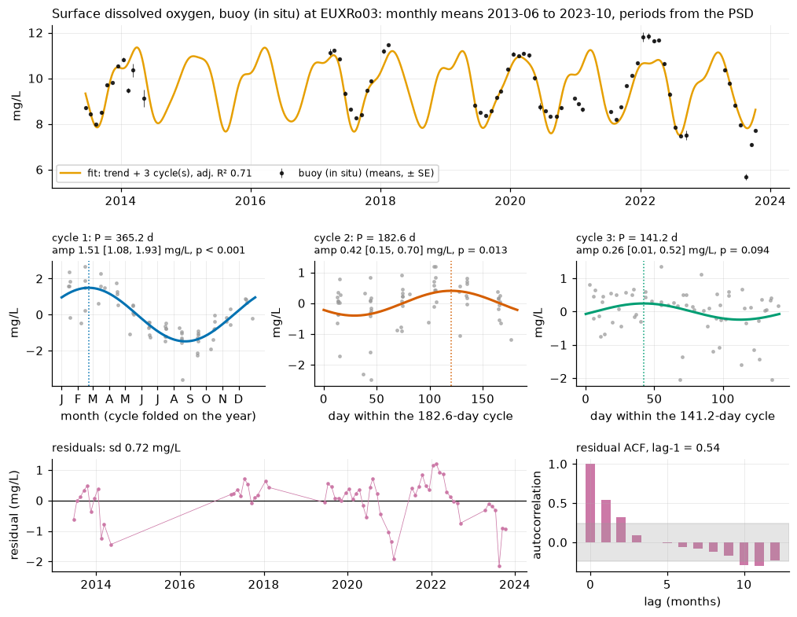

What: buoy (in situ) surface dissolved oxygen at EUXRo03 (monthly means, 2013-06 to 2023-10) follows a 365-day cycle of ± 1.51 mg/L, highest around 20 Feb; 183 d (± 0.42 mg/L, p = 0.013), 141 d (± 0.26 mg/L, p = 0.094). Trend + cycles explain 71% of the variance of the monthly means. So what: anomalies and trends must be read against this cycle; what remains after it is about ± 0.72 mg/L (monthly residual sd), and it is persistent (lag-1 r = 0.54), so HAC errors are used.

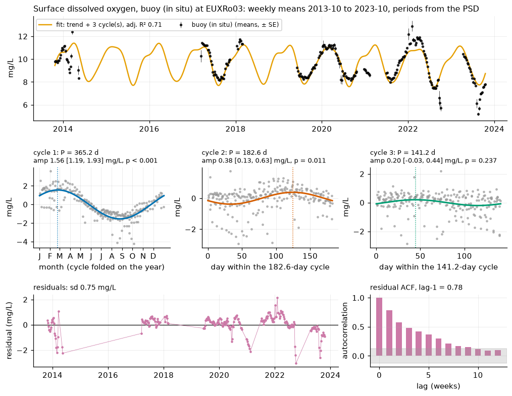

What: buoy (in situ) surface dissolved oxygen at EUXRo03 (weekly means, 2013-10 to 2023-10) follows a 365-day cycle of ± 1.56 mg/L, highest around 23 Feb; 183 d (± 0.38 mg/L, p = 0.011), 141 d (± 0.20 mg/L, p = 0.237). Trend + cycles explain 71% of the variance of the weekly means. So what: anomalies and trends must be read against this cycle; what remains after it is about ± 0.75 mg/L (weekly residual sd), and it is persistent (lag-1 r = 0.78), so HAC errors are used.

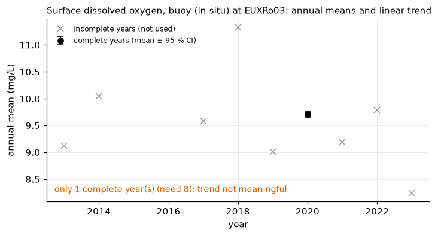

What: buoy (in situ) surface dissolved oxygen at EUXRo03 has 1 complete year(s). So what: too short for an interannual trend (need at least 8 complete years); no slope is given.

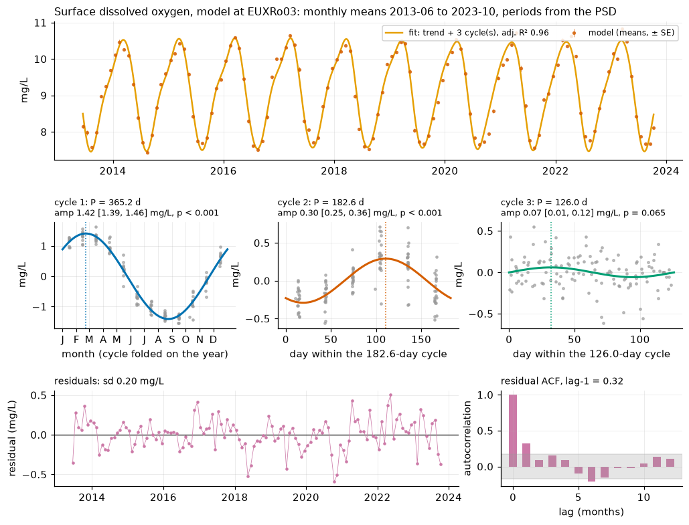

What: model surface dissolved oxygen at EUXRo03 (monthly means, 2013-06 to 2023-10) follows a 365-day cycle of ± 1.42 mg/L, highest around 21 Feb; 183 d (± 0.30 mg/L, p < 0.001), 126 d (± 0.07 mg/L, p = 0.065). Trend + cycles explain 96% of the variance of the monthly means. So what: anomalies and trends must be read against this cycle; what remains after it is about ± 0.20 mg/L (monthly residual sd), and it is persistent (lag-1 r = 0.32), so HAC errors are used.

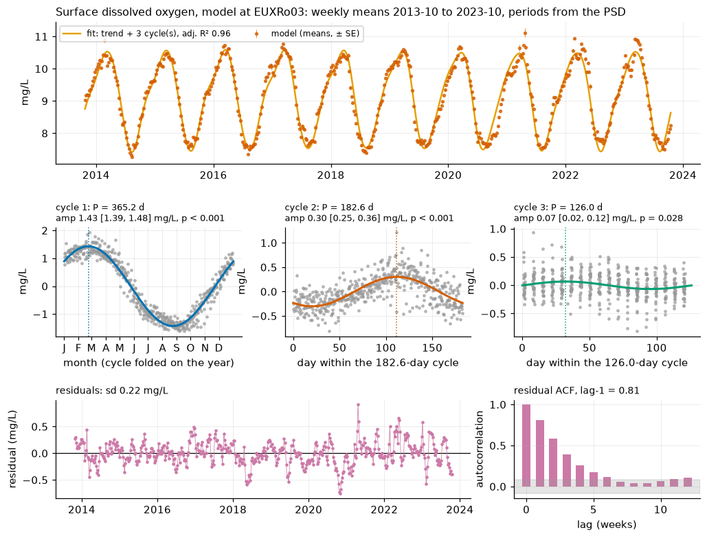

What: model surface dissolved oxygen at EUXRo03 (weekly means, 2013-10 to 2023-10) follows a 365-day cycle of ± 1.43 mg/L, highest around 22 Feb; 183 d (± 0.30 mg/L, p < 0.001), 126 d (± 0.07 mg/L, p = 0.028). Trend + cycles explain 96% of the variance of the weekly means. So what: anomalies and trends must be read against this cycle; what remains after it is about ± 0.22 mg/L (weekly residual sd), and it is persistent (lag-1 r = 0.81), so HAC errors are used.

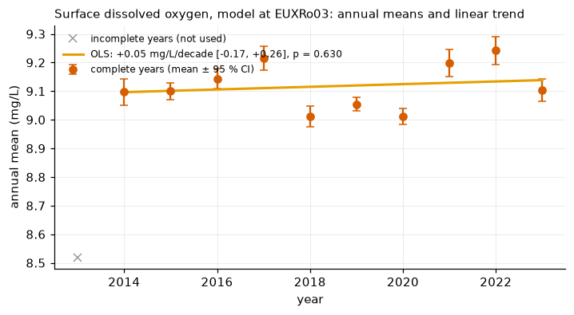

What: annual means of model surface dissolved oxygen at EUXRo03 (2014-2023, 10 complete years) change by +0.05 mg/L per decade (95 % CI -0.17 to +0.26, p = 0.630). So what: the change is not statistically significant; with about 10 points, year-to-year variability dominates any reading of it.

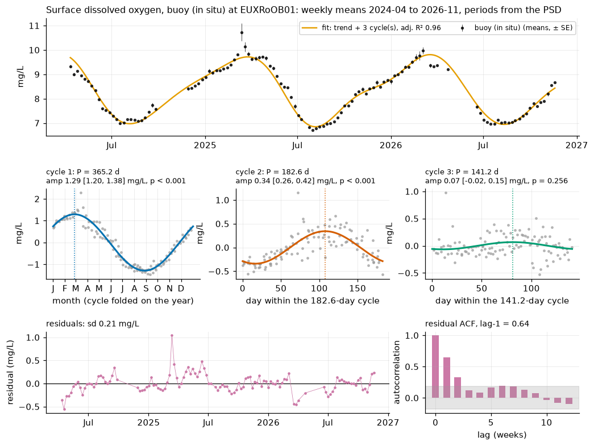

What: buoy (in situ) surface dissolved oxygen at EUXRoOB01 (weekly means, 2024-04 to 2026-11) follows a 365-day cycle of ± 1.29 mg/L, highest around 25 Feb; 183 d (± 0.34 mg/L, p < 0.001), 141 d (± 0.07 mg/L, p = 0.256). Trend + cycles explain 96% of the variance of the weekly means. So what: anomalies and trends must be read against this cycle; what remains after it is about ± 0.21 mg/L (weekly residual sd), and it is persistent (lag-1 r = 0.64), so HAC errors are used.

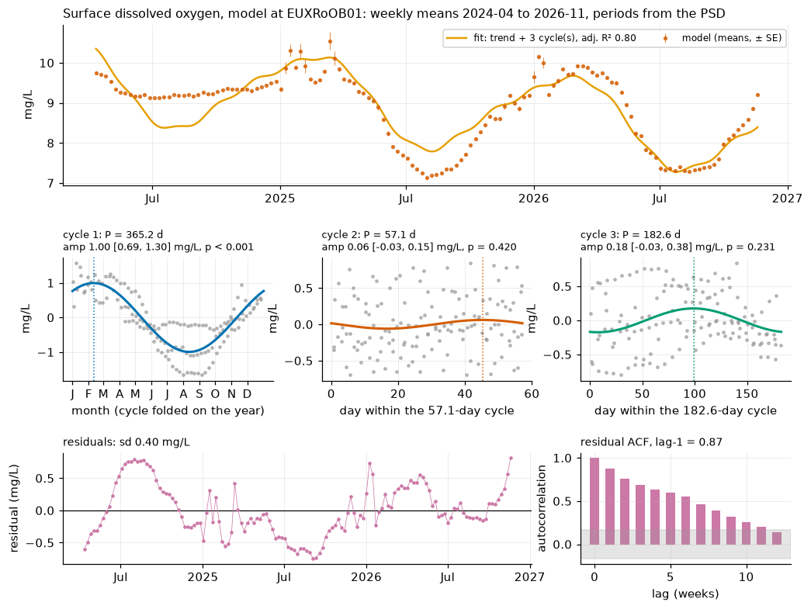

What: model surface dissolved oxygen at EUXRoOB01 (weekly means, 2024-04 to 2026-11) follows a 365-day cycle of ± 1.00 mg/L, highest around 10 Feb; 57 d (± 0.06 mg/L, p = 0.420), 183 d (± 0.18 mg/L, p = 0.231). Trend + cycles explain 80% of the variance of the weekly means. So what: anomalies and trends must be read against this cycle; what remains after it is about ± 0.40 mg/L (weekly residual sd), and it is persistent (lag-1 r = 0.87), so HAC errors are used.

Other figures: [EUXRoOB01 insitu monthly](figures/fit_EUXRoOB01_o2_insitu_monthly.png), [EUXRoOB01 insitu trend](figures/trend_EUXRoOB01_o2_insitu.png), [EUXRoOB01 model monthly](figures/fit_EUXRoOB01_o2_model_monthly.png), [EUXRoOB01 model trend](figures/trend_EUXRoOB01_o2_model.png), [EUXRoOB02 insitu monthly](figures/fit_EUXRoOB02_o2_insitu_monthly.png), [EUXRoOB02 insitu weekly](figures/fit_EUXRoOB02_o2_insitu_weekly.png), [EUXRoOB02 insitu trend](figures/trend_EUXRoOB02_o2_insitu.png), [EUXRoOB02 model monthly](figures/fit_EUXRoOB02_o2_model_monthly.png), [EUXRoOB02 model weekly](figures/fit_EUXRoOB02_o2_model_weekly.png), [EUXRoOB02 model trend](figures/trend_EUXRoOB02_o2_model.png), [EUXRoOB03 insitu monthly](figures/fit_EUXRoOB03_o2_insitu_monthly.png), [EUXRoOB03 insitu weekly](figures/fit_EUXRoOB03_o2_insitu_weekly.png), [EUXRoOB03 insitu trend](figures/trend_EUXRoOB03_o2_insitu.png), [EUXRoOB03 model monthly](figures/fit_EUXRoOB03_o2_model_monthly.png), [EUXRoOB03 model weekly](figures/fit_EUXRoOB03_o2_model_weekly.png), [EUXRoOB03 model trend](figures/trend_EUXRoOB03_o2_model.png)

Plain-language sentences for these figures

- **EUXRoOB01 insitu monthly**: What: buoy (in situ) surface dissolved oxygen at EUXRoOB01 (monthly means, 2024-04 to 2026-11) follows a 365-day cycle of ± 1.30 mg/L, highest around 25 Feb; 183 d (± 0.36 mg/L, p < 0.001), 141 d (± 0.05 mg/L, p = 0.527). Trend + cycles explain 97% of the variance of the monthly means. So what: anomalies and trends must be read against this cycle; what remains after it is about ± 0.18 mg/L (monthly residual sd).
- **EUXRoOB01 insitu trend**: What: buoy (in situ) surface dissolved oxygen at EUXRoOB01 has 1 complete year(s). So what: too short for an interannual trend (need at least 8 complete years); no slope is given.
- **EUXRoOB01 model monthly**: What: model surface dissolved oxygen at EUXRoOB01 (monthly means, 2024-04 to 2026-11) follows a 365-day cycle of ± 0.99 mg/L, highest around 9 Feb; 183 d (± 0.19 mg/L, p = 0.218), 126 d (± 0.04 mg/L, p = 0.895). Trend + cycles explain 78% of the variance of the monthly means. So what: anomalies and trends must be read against this cycle; what remains after it is about ± 0.42 mg/L (monthly residual sd), and it is persistent (lag-1 r = 0.71), so HAC errors are used.
- **EUXRoOB01 model trend**: What: model surface dissolved oxygen at EUXRoOB01 has 1 complete year(s). So what: too short for an interannual trend (need at least 8 complete years); no slope is given.
- **EUXRoOB02 insitu monthly**: What: buoy (in situ) surface dissolved oxygen at EUXRoOB02 (monthly means, 2024-04 to 2026-07) follows a 365-day cycle of ± 1.57 mg/L, highest around 27 Feb; 183 d (± 0.29 mg/L, p = 0.040), 141 d (± 0.20 mg/L, p = 0.508). Trend + cycles explain 87% of the variance of the monthly means. So what: anomalies and trends must be read against this cycle; what remains after it is about ± 0.43 mg/L (monthly residual sd).
- **EUXRoOB02 insitu weekly**: What: buoy (in situ) surface dissolved oxygen at EUXRoOB02 (weekly means, 2024-04 to 2026-07) follows a 365-day cycle of ± 1.50 mg/L, highest around 27 Feb; 183 d (± 0.27 mg/L, p < 0.001), 141 d (± 0.17 mg/L, p = 0.293). Trend + cycles explain 89% of the variance of the weekly means. So what: anomalies and trends must be read against this cycle; what remains after it is about ± 0.37 mg/L (weekly residual sd), and it is persistent (lag-1 r = 0.82), so HAC errors are used.
- **EUXRoOB02 insitu trend**: What: buoy (in situ) surface dissolved oxygen at EUXRoOB02 has 1 complete year(s). So what: too short for an interannual trend (need at least 8 complete years); no slope is given.
- **EUXRoOB02 model monthly**: What: model surface dissolved oxygen at EUXRoOB02 (monthly means, 2024-04 to 2026-07) follows a 365-day cycle of ± 0.94 mg/L, highest around 12 Feb; 183 d (± 0.18 mg/L, p = 0.361), 126 d (± 0.07 mg/L, p = 0.756). Trend + cycles explain 71% of the variance of the monthly means. So what: anomalies and trends must be read against this cycle; what remains after it is about ± 0.45 mg/L (monthly residual sd), and it is persistent (lag-1 r = 0.78), so HAC errors are used.
- **EUXRoOB02 model weekly**: What: model surface dissolved oxygen at EUXRoOB02 (weekly means, 2024-04 to 2026-07) follows a 365-day cycle of ± 0.94 mg/L, highest around 13 Feb; 183 d (± 0.19 mg/L, p = 0.245), 126 d (± 0.08 mg/L, p = 0.630). Trend + cycles explain 76% of the variance of the weekly means. So what: anomalies and trends must be read against this cycle; what remains after it is about ± 0.41 mg/L (weekly residual sd), and it is persistent (lag-1 r = 0.92), so HAC errors are used.
- **EUXRoOB02 model trend**: What: model surface dissolved oxygen at EUXRoOB02 has 1 complete year(s). So what: too short for an interannual trend (need at least 8 complete years); no slope is given.
- **EUXRoOB03 insitu monthly**: What: buoy (in situ) surface dissolved oxygen at EUXRoOB03 (monthly means, 2024-04 to 2026-11) follows a 365-day cycle of ± 1.49 mg/L, highest around 1 Mar; 183 d (± 0.25 mg/L, p < 0.001), 141 d (± 0.10 mg/L, p = 0.272). Trend + cycles explain 97% of the variance of the monthly means. So what: anomalies and trends must be read against this cycle; what remains after it is about ± 0.20 mg/L (monthly residual sd).
- **EUXRoOB03 insitu weekly**: What: buoy (in situ) surface dissolved oxygen at EUXRoOB03 (weekly means, 2024-04 to 2026-11) follows a 365-day cycle of ± 1.45 mg/L, highest around 1 Mar; 22 d (± 0.02 mg/L, p = 0.671), 183 d (± 0.22 mg/L, p < 0.001). Trend + cycles explain 96% of the variance of the weekly means. So what: anomalies and trends must be read against this cycle; what remains after it is about ± 0.21 mg/L (weekly residual sd), and it is persistent (lag-1 r = 0.60), so HAC errors are used.
- **EUXRoOB03 insitu trend**: What: buoy (in situ) surface dissolved oxygen at EUXRoOB03 has 1 complete year(s). So what: too short for an interannual trend (need at least 8 complete years); no slope is given.
- **EUXRoOB03 model monthly**: What: model surface dissolved oxygen at EUXRoOB03 (monthly means, 2024-04 to 2026-11) follows a 365-day cycle of ± 0.95 mg/L, highest around 9 Feb; 183 d (± 0.21 mg/L, p = 0.211), 126 d (± 0.06 mg/L, p = 0.758). Trend + cycles explain 73% of the variance of the monthly means. So what: anomalies and trends must be read against this cycle; what remains after it is about ± 0.45 mg/L (monthly residual sd), and it is persistent (lag-1 r = 0.74), so HAC errors are used.
- **EUXRoOB03 model weekly**: What: model surface dissolved oxygen at EUXRoOB03 (weekly means, 2024-04 to 2026-11) follows a 365-day cycle of ± 0.96 mg/L, highest around 9 Feb; 38 d (± 0.06 mg/L, p = 0.086), 20 d (± 0.03 mg/L, p = 0.266). Trend + cycles explain 75% of the variance of the weekly means. So what: anomalies and trends must be read against this cycle; what remains after it is about ± 0.44 mg/L (weekly residual sd), and it is persistent (lag-1 r = 0.95), so HAC errors are used.
- **EUXRoOB03 model trend**: What: model surface dissolved oxygen at EUXRoOB03 has 1 complete year(s). So what: too short for an interannual trend (need at least 8 complete years); no slope is given.

## Files

- `cycles.csv`: one row per fitted cycle (period from the PSD and used, amplitude, HAC and OLS SE, 95 % CI, time and date of the maximum with SE and CI, HAC and OLS p, WLS amplitude and date).
- `models.csv`: one row per fit (R², adj. R², residual sd, AIC, BIC, trend term, residual checks, WLS adj. R²).
- `nested.csv`: models with 0..K cycles per fit (R², AIC, BIC, dAIC, dBIC, F, p_F, p_hac).
- `trends.csv`, `annual_means.csv`: interannual trend and the annual means with completeness and reason.
- `synthetic_check.csv`: the method check above.
- Code: `scripts/seasonal/harmonic.py` (aggregate, fit_harmonics, compare_nested, select_periods), `scripts/seasonal/trend.py` (annual_means, linear_trend), `scripts/seasonal/run_seasonal.py` (this report). The functions take a pandas Series and a list of periods and return a dict / DataFrame, ready to move into a marinekit analysis package for a Research page.
