# Power spectra: which cycles exist before trend detection

Romanian Black Sea shelf, offshore buoys. Generated by `scripts/spectra/psd.py` on 2026-11-23 19:43 from cached data only (`MARINEKIT_OFFLINE=1`). Re-run the script to refresh numbers and figures.

Second analysis step: after the source validation (`docs/indicators/validation/`), before trends. The question: which cycles are real in each series, and does the model reproduce them? The answer tells the trend step what to remove first (seasonal cycle) and which time scales are worth a trend.

Real data are labelled by station and source. Everything marked **SYNTHETIC** is generated, not measured: it covers the long-period and sub-daily parts not downloaded yet, and checks the method.

## Key findings

- Annual cycle: significant in the full spectrum for chl buoy (in situ) (1 of 4 stations); chl model (4 of 4 stations); chl satellite (3 of 4 stations); o2 buoy (in situ) (4 of 4 stations); o2 model (4 of 4 stations); sal model (2 of 4 stations); sst buoy (in situ) (3 of 4 stations); sst model (4 of 4 stations); sst satellite (4 of 4 stations).
- Semi-annual: chl buoy (in situ) (1); chl model (3); chl satellite (4); o2 buoy (in situ) (2); o2 model (1); sst model (2); sst satellite (2) (mostly the non-sinusoidal shape of the annual cycle, a harmonic, not a separate process).
- Does the source reproduce the buoy's variability? Median over stations of the variance ratio source / buoy per band (about 1 = similar; < 0.5 much smoother; > 2 much more variable). Table below the findings. Part of a buoy excess can be sensor noise, drift or fouling, and point vs grid-cell sampling (sub-grid patchiness); the gap check rules out the gaps. In short: SST is reproduced at every scale by both satellite and model. For salinity and oxygen the model has far less variance than the buoys below one season, consistent with the validation step's finding that buoy salinity suffers from conductivity fouling and drift (`docs/indicators/validation/interpretation.md`), so the excess is at least partly instrumental. For chlorophyll the buoy has about 10 times more seasonal variance than satellite and model (fluorometer drift or calibration, also flagged in the validation step), while the model is noisier than the buoy at 2-10 days.
- 3-4 month peaks (EUXRo03 chl model, EUXRo03 o2 model, EUXRo03 sst buoy (in situ), EUXRo03 sst model, EUXRo03 sst satellite): higher harmonics of the seasonal cycle (121.8 d, 91.3 d), i.e. its shape is not two sinusoids; a day-of-year climatology removes them, two harmonics do not.
- Between 2 days and about 3 months, 603 of 7160 frequency bins of the anomaly spectra (8.4 %) are above the 95 % level, a little more than the 5 % expected by chance. Periods significant in more series than chance allows (binomial test across the 40 spectra, Bonferroni over 178 bins): 73.0 d (14 of 40 spectra, Bonferroni p = 7.3e-07; 5th harmonic of the year, likely the seasonal-cycle shape or its year-to-year changes); 36.5 d (13 of 40 spectra, Bonferroni p = 7.3e-06; 10th harmonic of the year, likely the seasonal-cycle shape or its year-to-year changes); 4.0 d (9 of 40 spectra, Bonferroni p = 0.023; not a harmonic of the year). The harmonics mean that two sinusoids do not capture the seasonal cycle; a day-of-year climatology does. Apart from them, short-term variability is broadband red noise (weather, river-plume pulses, blooms), not a cycle; the non-harmonic period(s) above (4.0 d) pass only a test that treats correlated spectra as independent, so they are borderline (synoptic weather systems), not a robust cycle. Isolated peaks in the table are not to be read as cycles.
- Gap check: the model and satellite resampled on the buoy's days and run through the same Lomb-Scargle give the same band variance as their gap-free Welch spectra (ratio, median over stations and variables: model synoptic 1.04 (range 0.83-1.41); model short 1.01 (range 0.74-1.32); satellite synoptic 0.96 (range 0.84-1.09); satellite short 1.01 (range 0.83-1.06)), so the buoy-model differences above are not made by the gaps.
- Method check on SYNTHETIC series: 11 of 11 checks passed (all planted periods recovered, Lomb-Scargle = Welch on gap-free data).

Variance ratio source / buoy, median over the stations (seasonal band from the full spectrum, shorter bands from the anomaly spectrum; chlorophyll in log10):

| variable | source | seasonal (> 120 d) | intraseasonal (10-120 d) | synoptic (3-10 d) | short (2-3 d) |
|---|---|---|---|---|---|
| sst | satellite | 0.87 (similar) | 0.95 (similar) | 1.46 (similar) | 1.83 (similar) |
| sst | model | 0.90 (similar) | 0.81 (similar) | 0.83 (similar) | 1.11 (similar) |
| chl | satellite | 0.09 (much smoother) | 0.34 (much smoother) | 1.13 (similar) | 2.61 (much more variable) |
| chl | model | 0.12 (much smoother) | 0.58 (similar) | 2.04 (much more variable) | 3.16 (much more variable) |
| sal | model | 0.04 (much smoother) | 0.11 (much smoother) | 0.20 (much smoother) | 0.12 (much smoother) |
| o2 | model | 0.72 (similar) | 0.15 (much smoother) | 0.19 (much smoother) | 0.08 (much smoother) |

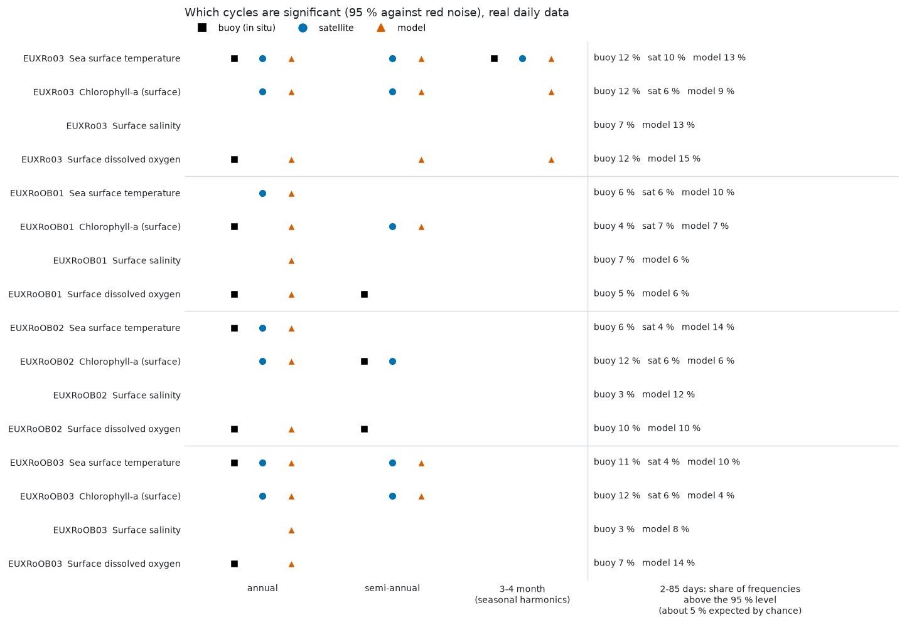

## Method

- **Data**: the same trusted series as the validation step, loaded through its own code (`compare_sources.fetch_insitu` / `fetch_other`, imported read-only), with the same QC (deployment start, spike removal, O2 saturation check). Buoy daily means: EUXRo03 2013-06 to 2023-10 (Copernicus In Situ TAC), EUXRoOB01-03 2024-04 to 2026-11 (GeoEcoMar). Satellite (SST L4, chl L4 gap-free) and model (CMEMS Black Sea 2.5 km daily) at the buoy position over the buoy period, every day (not only buoy days). Satellite salinity and O2 do not exist, so those panels have buoy and model only. Chlorophyll is analysed as log10 (as in the validation step).
- **Gap-free series (satellite, model) -> Welch**: Hann window, 50 % overlap, segment mean removed, one-sided PSD (`scipy.signal.welch`, density scaling). Holes of at most 5 days covering at most 1 % of the record are filled by linear interpolation first; otherwise the series goes to Lomb-Scargle.
- **Gappy series (buoys, 10-56 % missing days) -> Lomb-Scargle**: classical Lomb-Scargle (Scargle 1982) on the same 50 %-overlapping Hann-tapered segments, on the Welch frequency grid f_k = k / segment length (k = 1 .. segment length / 2 days), scaled like Welch's density and averaged over segments (WOSA, as REDFIT, Schulz and Mudelsee 2002). Segments with less than 40 % of their days are skipped. Gaps let the large low-frequency power leak to short periods (without correction the 2-10 day band came out up to 40 times too high in the gap check), so the series is prewhitened first (z_t = y_t - rho y_(t-1 day), on days whose previous day exists) and the spectrum recoloured by 1 / |1 - rho exp(-2 pi i f)|^2 (Percival and Walden 1993). On a gap-free series the result equals Welch (method check below).
- **Two spectra per series**: *full* = linear trend removed, segment = record length up to 1096 days (3 years, resolves the annual cycle; the 2.6-year buoys give a single segment, 2 degrees of freedom, so their full spectra are noisy); *anomalies* = linear trend plus annual (365.25 d) and semi-annual (182.6 d) harmonics removed by least squares, segment = 365 days (more averaging, for 2 to 180 days).
- **Significance**: robust red-noise background (Mann and Lees 1996): the PSD is median-smoothed over +-0.15 decade of frequency (lines barely move a median) and converted to a mean. For the *full* spectra an AR(1) spectrum is fitted to that smoothed curve (least squares in log space), which carries the background under the annual line. For the *anomaly* spectra the smoothed curve itself is the background, because the real continuum is not AR(1)-shaped (it falls faster than AR(1) at 2-5 days, and a fitted AR(1) flagged 20-30 % of frequencies). A peak is significant when it is a local maximum above the 95 % chi-square level with the Welch/WOSA equivalent degrees of freedom (dof = 2K / (1 + 2 c^2 (1 - 1/K)), K segments, c = 0.167 for 50 % Hann). The period is refined by a parabola through the log-PSD.
- **Which spectrum answers what**: peaks are reported from the full spectrum for periods of 120 days and longer (seasonal), and from the anomaly spectrum for 2 to 120 days (more degrees of freedom). The level is per frequency, so about 5 % of frequency bins exceed it by chance in every spectrum; the false-alarm table and an across-series consistency test (binomial, Bonferroni) say whether the short-period exceedances are more than chance.
- **Resolvable band** with daily means: 2 days (Nyquist) to about 1.5 years (half a 3-year segment). Marked on the figures: annual (365 d), semi-annual (182 d), synoptic band (3-10 days, weather).
- **Band variance** (table below): PSD integrated over period bands of the full spectrum, per source; the row *model on buoy days* recomputes the model spectrum through Lomb-Scargle on the buoy's days only, to show how much of a buoy-model difference comes from the gaps rather than the physics.
- Band names and limits are OURS, for labelling only.

## Method check on SYNTHETIC series

Built by `scripts/spectra/synthetic.py` in the same shape as `datahub.get_series()` output (DatetimeIndex named `time`, one column, attrs with `label` starting `SYNTHETIC`, and the planted values in `attrs['planted']`), so a real series replaces it with one line. The same checks run as unit tests in `tests/test_spectra.py`.

| series | method | planted | planted_value | recovered_value | rel_error_pct | significant | ok |
|---|---|---|---|---|---|---|---|
| SYNTHETIC 40-year daily | Welch | annual | 365.2 d | 365.2 d | 0 | yes (11877 x background) | True |
| SYNTHETIC 40-year daily | Welch | semi-annual | 182.6 d | 182.4 d | 0.1 | yes (225 x background) | True |
| SYNTHETIC 40-year daily | Welch | 6-year oscillation | 2191.5 d | 2208.0 d | 0.8 | yes (21 x background) | True |
| SYNTHETIC 40-year daily | OLS | linear trend | 0.40 °C/decade | 0.44 °C/decade | 10.6 | n/a | True |
| SYNTHETIC hourly, gap-free | Welch | diurnal 24 h | 24.00 h | 23.99 h | 0 | yes (58 x background) | True |
| SYNTHETIC hourly, gap-free | Welch | inertial 44 N | 17.27 h | 17.28 h | 0 | yes (16 x background) | True |
| SYNTHETIC hourly, gap-free | Welch | M2 tide | 12.42 h | 12.42 h | 0 | yes (6 x background) | True |
| SYNTHETIC hourly, 15% gaps | Lomb-Scargle | diurnal 24 h | 24.00 h | 24.02 h | 0.1 | yes (34 x background) | True |
| SYNTHETIC hourly, 15% gaps | Lomb-Scargle | inertial 44 N | 17.27 h | 17.29 h | 0.1 | yes (13 x background) | True |
| SYNTHETIC hourly, 15% gaps | Lomb-Scargle | M2 tide | 12.42 h | 12.42 h | 0 | yes (4 x background) | True |
| SYNTHETIC hourly, gap-free | Lomb-Scargle vs Welch | same spectrum | ratio 1 | median ratio 1.000 | 0 | n/a | True |

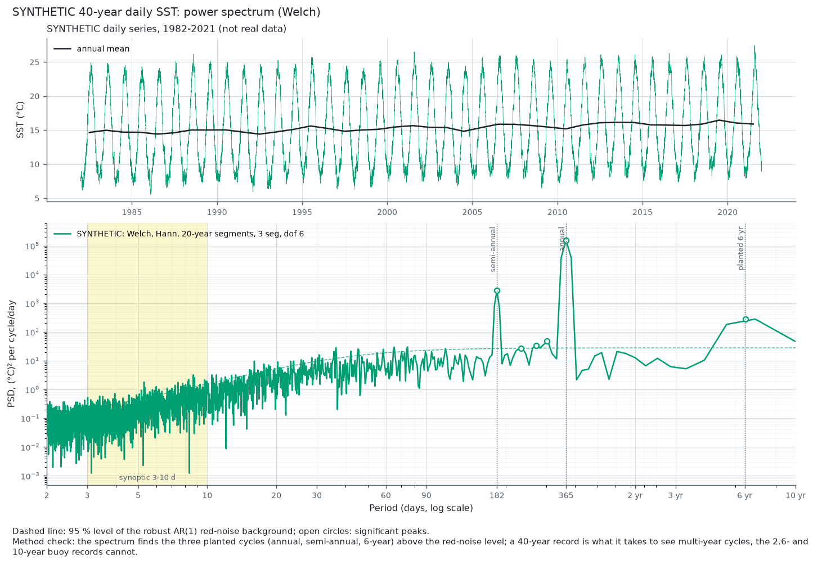

Method check: the spectrum finds the three planted cycles (annual, semi-annual, 6-year) above the red-noise level; a 40-year record is what it takes to see multi-year cycles, the 2.6- and 10-year buoy records cannot.

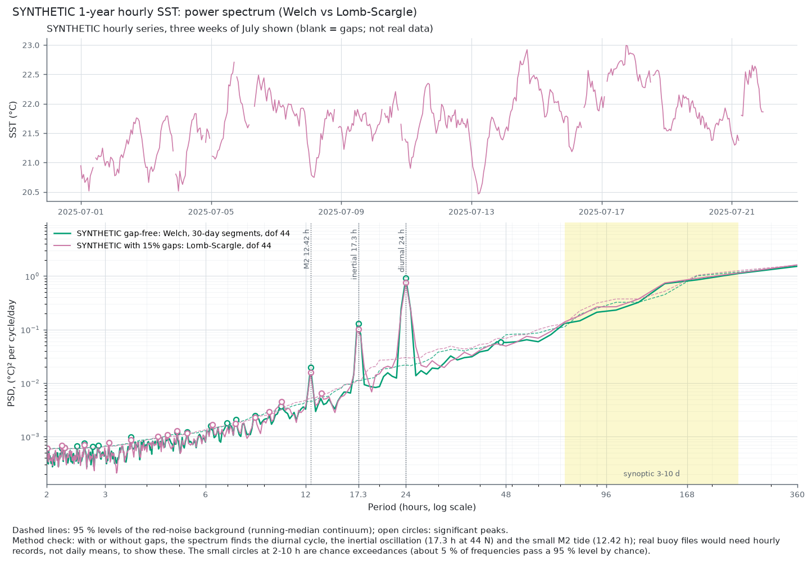

Method check: with or without gaps, the spectrum finds the diurnal cycle, the inertial oscillation (17.3 h at 44 N) and the small M2 tide (12.42 h); real buoy files would need hourly records, not daily means, to show these. The small circles at 2-10 h are chance exceedances (about 5 % of frequencies pass a 95 % level by chance).

## Significant peaks per station, variable and source (real data)

Up to 4 strongest per spectrum, sorted by PSD / red-noise background. All rows are in `peaks.csv`. `x bg` = PSD over the AR(1) background; `x 95 %` = PSD over the 95 % level (> 1 = significant).

| station | variable | source | spectrum | method | period (d) | cycle | x bg | x 95 % | dof |
|---|---|---|---|---|---|---|---|---|---|
| EUXRo03 | chl | insitu | anomalies | Lomb-Scargle | 2.99 | 2-3 day | 1.9 | 1.35 | 36.1 |
| EUXRo03 | chl | insitu | anomalies | Lomb-Scargle | 2.9 | 2-3 day | 1.8 | 1.28 | 36.1 |
| EUXRo03 | chl | insitu | anomalies | Lomb-Scargle | 2.77 | 2-3 day | 1.7 | 1.18 | 36.1 |
| EUXRo03 | chl | insitu | anomalies | Lomb-Scargle | 6.1 | synoptic | 1.7 | 1.21 | 36.1 |
| EUXRo03 | chl | insitu | full | Lomb-Scargle | 584 | other | 2.4 | 1.3 | 9.6 |
| EUXRo03 | chl | model | anomalies | Welch | 2.37 | 2-3 day | 1.7 | 1.21 | 36.1 |
| EUXRo03 | chl | model | anomalies | Welch | 6.66 | synoptic | 1.7 | 1.19 | 36.1 |
| EUXRo03 | chl | model | anomalies | Welch | 6.32 | synoptic | 1.7 | 1.22 | 36.1 |
| EUXRo03 | chl | model | anomalies | Welch | 4.56 | synoptic | 1.5 | 1.07 | 36.1 |
| EUXRo03 | chl | model | full | Welch | 388 | annual | 30.5 | 16.5 | 9.6 |
| EUXRo03 | chl | model | full | Welch | 182 | semi-annual | 4.6 | 2.47 | 9.6 |
| EUXRo03 | chl | model | full | Welch | 122 | 3-4 month (seasonal harmonics) | 3.3 | 1.8 | 9.6 |
| EUXRo03 | chl | satellite | anomalies | Welch | 5.4 | synoptic | 1.8 | 1.27 | 36.1 |
| EUXRo03 | chl | satellite | anomalies | Welch | 4.95 | synoptic | 1.6 | 1.13 | 36.1 |
| EUXRo03 | chl | satellite | anomalies | Welch | 10.1 | intraseasonal | 1.6 | 1.16 | 36.1 |
| EUXRo03 | chl | satellite | anomalies | Welch | 5.7 | synoptic | 1.5 | 1.06 | 36.1 |
| EUXRo03 | chl | satellite | full | Welch | 376 | annual | 27.7 | 15 | 9.6 |
| EUXRo03 | chl | satellite | full | Welch | 184 | semi-annual | 11.3 | 6.1 | 9.6 |
| EUXRo03 | o2 | insitu | anomalies | Lomb-Scargle | 2.37 | 2-3 day | 3.8 | 2.46 | 20.9 |
| EUXRo03 | o2 | insitu | anomalies | Lomb-Scargle | 2.33 | 2-3 day | 2.5 | 1.58 | 20.9 |
| EUXRo03 | o2 | insitu | anomalies | Lomb-Scargle | 3.35 | synoptic | 2 | 1.3 | 20.9 |
| EUXRo03 | o2 | insitu | anomalies | Lomb-Scargle | 2.72 | 2-3 day | 1.9 | 1.21 | 20.9 |
| EUXRo03 | o2 | insitu | full | Lomb-Scargle | 408 | annual | 51.7 | 21.6 | 3.9 |
| EUXRo03 | o2 | insitu | full | Lomb-Scargle | 141 | other | 3.1 | 1.31 | 3.9 |
| EUXRo03 | o2 | model | anomalies | Welch | 4.25 | synoptic | 2 | 1.39 | 36.1 |
| EUXRo03 | o2 | model | anomalies | Welch | 10.9 | intraseasonal | 1.9 | 1.37 | 36.1 |
| EUXRo03 | o2 | model | anomalies | Welch | 4.55 | synoptic | 1.9 | 1.31 | 36.1 |
| EUXRo03 | o2 | model | anomalies | Welch | 2.97 | 2-3 day | 1.7 | 1.18 | 36.1 |
| EUXRo03 | o2 | model | full | Welch | 366 | annual | 41.8 | 22.6 | 9.6 |
| EUXRo03 | o2 | model | full | Welch | 182 | semi-annual | 6.7 | 3.6 | 9.6 |
| EUXRo03 | o2 | model | full | Welch | 126 | 3-4 month (seasonal harmonics) | 2.8 | 1.54 | 9.6 |
| EUXRo03 | sal | insitu | anomalies | Lomb-Scargle | 5.07 | synoptic | 2.2 | 1.35 | 17.1 |
| EUXRo03 | sal | insitu | anomalies | Lomb-Scargle | 4.46 | synoptic | 2.2 | 1.38 | 17.1 |
| EUXRo03 | sal | insitu | anomalies | Lomb-Scargle | 7.91 | synoptic | 2.1 | 1.29 | 17.1 |
| EUXRo03 | sal | insitu | anomalies | Lomb-Scargle | 11.6 | intraseasonal | 2 | 1.25 | 17.1 |
| EUXRo03 | sal | model | anomalies | Welch | 2.8 | 2-3 day | 2.1 | 1.48 | 36.1 |
| EUXRo03 | sal | model | anomalies | Welch | 3.25 | synoptic | 2.1 | 1.45 | 36.1 |
| EUXRo03 | sal | model | anomalies | Welch | 6 | synoptic | 2 | 1.39 | 36.1 |
| EUXRo03 | sal | model | anomalies | Welch | 7.84 | synoptic | 1.9 | 1.35 | 36.1 |
| EUXRo03 | sst | insitu | anomalies | Lomb-Scargle | 3.84 | synoptic | 2 | 1.43 | 36.1 |
| EUXRo03 | sst | insitu | anomalies | Lomb-Scargle | 101 | 3-4 month (seasonal harmonics) | 1.9 | 1.33 | 36.1 |
| EUXRo03 | sst | insitu | anomalies | Lomb-Scargle | 9.01 | synoptic | 1.8 | 1.27 | 36.1 |
| EUXRo03 | sst | insitu | anomalies | Lomb-Scargle | 9.26 | synoptic | 1.7 | 1.18 | 36.1 |
| EUXRo03 | sst | insitu | full | Lomb-Scargle | 397 | annual | 43 | 23.2 | 9.6 |
| EUXRo03 | sst | model | anomalies | Welch | 7.27 | synoptic | 1.8 | 1.24 | 36.1 |
| EUXRo03 | sst | model | anomalies | Welch | 2.67 | 2-3 day | 1.8 | 1.24 | 36.1 |
| EUXRo03 | sst | model | anomalies | Welch | 4.03 | synoptic | 1.7 | 1.22 | 36.1 |
| EUXRo03 | sst | model | anomalies | Welch | 5.07 | synoptic | 1.6 | 1.12 | 36.1 |
| EUXRo03 | sst | model | full | Welch | 365 | annual | 97 | 52.4 | 9.6 |
| EUXRo03 | sst | model | full | Welch | 181 | semi-annual | 7.8 | 4.2 | 9.6 |
| EUXRo03 | sst | satellite | anomalies | Welch | 3.86 | synoptic | 2.2 | 1.56 | 36.1 |
| EUXRo03 | sst | satellite | anomalies | Welch | 97.3 | 3-4 month (seasonal harmonics) | 1.8 | 1.29 | 36.1 |
| EUXRo03 | sst | satellite | anomalies | Welch | 4.09 | synoptic | 1.8 | 1.26 | 36.1 |
| EUXRo03 | sst | satellite | anomalies | Welch | 8.99 | synoptic | 1.8 | 1.26 | 36.1 |
| EUXRo03 | sst | satellite | full | Welch | 365 | annual | 37.6 | 20.3 | 9.6 |
| EUXRo03 | sst | satellite | full | Welch | 181 | semi-annual | 3.4 | 1.86 | 9.6 |
| EUXRoOB01 | chl | insitu | anomalies | Lomb-Scargle | 4.8 | synoptic | 2.6 | 1.32 | 7.7 |
| EUXRoOB01 | chl | insitu | anomalies | Lomb-Scargle | 4.61 | synoptic | 2.5 | 1.26 | 7.7 |
| EUXRoOB01 | chl | insitu | anomalies | Lomb-Scargle | 16.6 | intraseasonal | 2.4 | 1.24 | 7.7 |
| EUXRoOB01 | chl | insitu | anomalies | Lomb-Scargle | 10.6 | intraseasonal | 2.3 | 1.17 | 7.7 |
| EUXRoOB01 | chl | insitu | full | Lomb-Scargle | 301 | annual | 4.8 | 1.61 | 2 |
| EUXRoOB01 | chl | model | anomalies | Welch | 19.7 | intraseasonal | 2.8 | 1.43 | 7.7 |
| EUXRoOB01 | chl | model | anomalies | Welch | 4.96 | synoptic | 2.6 | 1.32 | 7.7 |
| EUXRoOB01 | chl | model | anomalies | Welch | 3.88 | synoptic | 2.4 | 1.23 | 7.7 |
| EUXRoOB01 | chl | model | anomalies | Welch | 3.47 | synoptic | 2.2 | 1.11 | 7.7 |
| EUXRoOB01 | chl | model | full | Welch | 175 | semi-annual | 7 | 2.34 | 2 |
| EUXRoOB01 | chl | model | full | Welch | 309 | annual | 6.7 | 2.24 | 2 |
| EUXRoOB01 | chl | satellite | anomalies | Welch | 34 | intraseasonal | 3.9 | 1.98 | 7.7 |
| EUXRoOB01 | chl | satellite | anomalies | Welch | 3.23 | synoptic | 2.8 | 1.42 | 7.7 |
| EUXRoOB01 | chl | satellite | anomalies | Welch | 9.96 | synoptic | 2.5 | 1.28 | 7.7 |
| EUXRoOB01 | chl | satellite | anomalies | Welch | 16.3 | intraseasonal | 2.5 | 1.3 | 7.7 |
| EUXRoOB01 | chl | satellite | full | Welch | 184 | semi-annual | 21.1 | 7.06 | 2 |
| EUXRoOB01 | o2 | insitu | anomalies | Lomb-Scargle | 3.23 | synoptic | 2.6 | 1.32 | 7.7 |
| EUXRoOB01 | o2 | insitu | anomalies | Lomb-Scargle | 3.15 | synoptic | 2.4 | 1.22 | 7.7 |
| EUXRoOB01 | o2 | insitu | anomalies | Lomb-Scargle | 6.37 | synoptic | 2.2 | 1.1 | 7.7 |
| EUXRoOB01 | o2 | insitu | anomalies | Lomb-Scargle | 3.35 | synoptic | 2.1 | 1.07 | 7.7 |
| EUXRoOB01 | o2 | insitu | full | Lomb-Scargle | 426 | annual | 20.3 | 6.79 | 2 |
| EUXRoOB01 | o2 | insitu | full | Lomb-Scargle | 194 | semi-annual | 3.4 | 1.13 | 2 |
| EUXRoOB01 | o2 | model | anomalies | Welch | 4.56 | synoptic | 2.9 | 1.48 | 7.7 |
| EUXRoOB01 | o2 | model | anomalies | Welch | 3.98 | synoptic | 2.4 | 1.22 | 7.7 |
| EUXRoOB01 | o2 | model | anomalies | Welch | 8.36 | synoptic | 2.4 | 1.24 | 7.7 |
| EUXRoOB01 | o2 | model | anomalies | Welch | 3.17 | synoptic | 2.2 | 1.11 | 7.7 |
| EUXRoOB01 | o2 | model | full | Welch | 385 | annual | 8.8 | 2.94 | 2 |
| EUXRoOB01 | sal | insitu | anomalies | Lomb-Scargle | 3.16 | synoptic | 4.2 | 2.15 | 7.7 |
| EUXRoOB01 | sal | insitu | anomalies | Lomb-Scargle | 2.57 | 2-3 day | 3 | 1.54 | 7.7 |
| EUXRoOB01 | sal | insitu | anomalies | Lomb-Scargle | 3.22 | synoptic | 2.9 | 1.5 | 7.7 |
| EUXRoOB01 | sal | insitu | anomalies | Lomb-Scargle | 8.42 | synoptic | 2.6 | 1.3 | 7.7 |
| EUXRoOB01 | sal | model | anomalies | Welch | 4.3 | synoptic | 3.7 | 1.88 | 7.7 |
| EUXRoOB01 | sal | model | anomalies | Welch | 4.78 | synoptic | 2.9 | 1.5 | 7.7 |
| EUXRoOB01 | sal | model | anomalies | Welch | 2.97 | 2-3 day | 2.9 | 1.46 | 7.7 |
| EUXRoOB01 | sal | model | anomalies | Welch | 15.2 | intraseasonal | 2.4 | 1.2 | 7.7 |
| EUXRoOB01 | sal | model | full | Welch | 416 | annual | 4.7 | 1.57 | 2 |
| EUXRoOB01 | sst | insitu | anomalies | Lomb-Scargle | 3.94 | synoptic | 2.7 | 1.36 | 7.7 |
| EUXRoOB01 | sst | insitu | anomalies | Lomb-Scargle | 4.19 | synoptic | 2.2 | 1.11 | 7.7 |
| EUXRoOB01 | sst | insitu | anomalies | Lomb-Scargle | 10.8 | intraseasonal | 2.1 | 1.07 | 7.7 |
| EUXRoOB01 | sst | insitu | anomalies | Lomb-Scargle | 7.05 | synoptic | 2.1 | 1.08 | 7.7 |
| EUXRoOB01 | sst | model | anomalies | Welch | 4.04 | synoptic | 3.2 | 1.62 | 7.7 |
| EUXRoOB01 | sst | model | anomalies | Welch | 3.2 | synoptic | 2.7 | 1.37 | 7.7 |
| EUXRoOB01 | sst | model | anomalies | Welch | 10.8 | intraseasonal | 2.6 | 1.32 | 7.7 |
| EUXRoOB01 | sst | model | anomalies | Welch | 3.64 | synoptic | 2.3 | 1.19 | 7.7 |
| EUXRoOB01 | sst | model | full | Welch | 358 | annual | 46.1 | 15.4 | 2 |
| EUXRoOB01 | sst | satellite | anomalies | Welch | 6.51 | synoptic | 3.1 | 1.6 | 7.7 |
| EUXRoOB01 | sst | satellite | anomalies | Welch | 2.08 | 2-3 day | 2.6 | 1.31 | 7.7 |
| EUXRoOB01 | sst | satellite | anomalies | Welch | 18.6 | intraseasonal | 2.4 | 1.21 | 7.7 |
| EUXRoOB01 | sst | satellite | anomalies | Welch | 3.78 | synoptic | 2 | 1.02 | 7.7 |
| EUXRoOB01 | sst | satellite | full | Welch | 359 | annual | 32.2 | 10.8 | 2 |
| EUXRoOB02 | chl | insitu | anomalies | Lomb-Scargle | 70.2 | intraseasonal | 4.4 | 2.06 | 5.8 |
| EUXRoOB02 | chl | insitu | anomalies | Lomb-Scargle | 5.61 | synoptic | 4.1 | 1.92 | 5.8 |
| EUXRoOB02 | chl | insitu | anomalies | Lomb-Scargle | 8.79 | synoptic | 3.9 | 1.84 | 5.8 |
| EUXRoOB02 | chl | insitu | anomalies | Lomb-Scargle | 5.03 | synoptic | 3.7 | 1.74 | 5.8 |
| EUXRoOB02 | chl | insitu | full | Lomb-Scargle | 523 | other | 4.3 | 1.42 | 2 |
| EUXRoOB02 | chl | insitu | full | Lomb-Scargle | 196 | semi-annual | 3.3 | 1.09 | 2 |
| EUXRoOB02 | chl | model | anomalies | Welch | 4.99 | synoptic | 3.8 | 1.79 | 5.8 |
| EUXRoOB02 | chl | model | anomalies | Welch | 33.4 | intraseasonal | 3.6 | 1.67 | 5.8 |
| EUXRoOB02 | chl | model | anomalies | Welch | 3.77 | synoptic | 3.5 | 1.64 | 5.8 |
| EUXRoOB02 | chl | model | anomalies | Welch | 7.82 | synoptic | 3.2 | 1.5 | 5.8 |
| EUXRoOB02 | chl | model | full | Welch | 385 | annual | 14.9 | 4.96 | 2 |
| EUXRoOB02 | chl | model | full | Welch | 216 | other | 7.8 | 2.6 | 2 |
| EUXRoOB02 | chl | satellite | anomalies | Welch | 3.96 | synoptic | 3.2 | 1.5 | 5.8 |
| EUXRoOB02 | chl | satellite | anomalies | Welch | 2.17 | 2-3 day | 2.6 | 1.22 | 5.8 |
| EUXRoOB02 | chl | satellite | anomalies | Welch | 2.05 | 2-3 day | 2.5 | 1.19 | 5.8 |
| EUXRoOB02 | chl | satellite | anomalies | Welch | 6.08 | synoptic | 2.3 | 1.07 | 5.8 |
| EUXRoOB02 | chl | satellite | full | Welch | 190 | semi-annual | 12 | 4 | 2 |
| EUXRoOB02 | chl | satellite | full | Welch | 352 | annual | 10.7 | 3.58 | 2 |
| EUXRoOB02 | o2 | insitu | anomalies | Lomb-Scargle | 2.08 | 2-3 day | 6.3 | 2.96 | 5.8 |
| EUXRoOB02 | o2 | insitu | anomalies | Lomb-Scargle | 2.83 | 2-3 day | 3.4 | 1.58 | 5.8 |
| EUXRoOB02 | o2 | insitu | anomalies | Lomb-Scargle | 2.65 | 2-3 day | 2.8 | 1.32 | 5.8 |
| EUXRoOB02 | o2 | insitu | anomalies | Lomb-Scargle | 3.39 | synoptic | 2.7 | 1.26 | 5.8 |
| EUXRoOB02 | o2 | insitu | full | Lomb-Scargle | 424 | annual | 4.3 | 1.43 | 2 |
| EUXRoOB02 | o2 | insitu | full | Lomb-Scargle | 174 | semi-annual | 3.4 | 1.14 | 2 |
| EUXRoOB02 | o2 | model | anomalies | Welch | 3.8 | synoptic | 4.6 | 2.18 | 5.8 |
| EUXRoOB02 | o2 | model | anomalies | Welch | 2.44 | 2-3 day | 3.3 | 1.57 | 5.8 |
| EUXRoOB02 | o2 | model | anomalies | Welch | 5.68 | synoptic | 3 | 1.39 | 5.8 |
| EUXRoOB02 | o2 | model | anomalies | Welch | 10.8 | intraseasonal | 3 | 1.43 | 5.8 |
| EUXRoOB02 | o2 | model | full | Welch | 396 | annual | 9 | 3 | 2 |
| EUXRoOB02 | sal | insitu | anomalies | Lomb-Scargle | 2.99 | 2-3 day | 3 | 1.42 | 5.8 |
| EUXRoOB02 | sal | insitu | anomalies | Lomb-Scargle | 2.83 | 2-3 day | 2.6 | 1.23 | 5.8 |
| EUXRoOB02 | sal | insitu | anomalies | Lomb-Scargle | 2.79 | 2-3 day | 2.4 | 1.15 | 5.8 |
| EUXRoOB02 | sal | insitu | anomalies | Lomb-Scargle | 2.89 | 2-3 day | 2.4 | 1.13 | 5.8 |
| EUXRoOB02 | sal | model | anomalies | Welch | 5.2 | synoptic | 6.1 | 2.9 | 5.8 |
| EUXRoOB02 | sal | model | anomalies | Welch | 3.53 | synoptic | 3.8 | 1.77 | 5.8 |
| EUXRoOB02 | sal | model | anomalies | Welch | 33.8 | intraseasonal | 3.6 | 1.69 | 5.8 |
| EUXRoOB02 | sal | model | anomalies | Welch | 4.67 | synoptic | 3.3 | 1.57 | 5.8 |
| EUXRoOB02 | sst | insitu | anomalies | Lomb-Scargle | 2.09 | 2-3 day | 4.5 | 2.13 | 5.8 |
| EUXRoOB02 | sst | insitu | anomalies | Lomb-Scargle | 3.76 | synoptic | 3.1 | 1.45 | 5.8 |
| EUXRoOB02 | sst | insitu | anomalies | Lomb-Scargle | 2.79 | 2-3 day | 2.6 | 1.2 | 5.8 |
| EUXRoOB02 | sst | insitu | anomalies | Lomb-Scargle | 5.63 | synoptic | 2.6 | 1.2 | 5.8 |
| EUXRoOB02 | sst | insitu | full | Lomb-Scargle | 433 | annual | 28.3 | 9.44 | 2 |
| EUXRoOB02 | sst | model | anomalies | Welch | 2.07 | 2-3 day | 3.9 | 1.85 | 5.8 |
| EUXRoOB02 | sst | model | anomalies | Welch | 3.32 | synoptic | 3.8 | 1.77 | 5.8 |
| EUXRoOB02 | sst | model | anomalies | Welch | 3.74 | synoptic | 3.7 | 1.74 | 5.8 |
| EUXRoOB02 | sst | model | anomalies | Welch | 2.1 | 2-3 day | 3.7 | 1.77 | 5.8 |
| EUXRoOB02 | sst | model | full | Welch | 366 | annual | 26.7 | 8.91 | 2 |
| EUXRoOB02 | sst | satellite | anomalies | Welch | 3.54 | synoptic | 2.8 | 1.32 | 5.8 |
| EUXRoOB02 | sst | satellite | anomalies | Welch | 5.71 | synoptic | 2.8 | 1.3 | 5.8 |
| EUXRoOB02 | sst | satellite | anomalies | Welch | 2.08 | 2-3 day | 2.6 | 1.23 | 5.8 |
| EUXRoOB02 | sst | satellite | anomalies | Welch | 3.83 | synoptic | 2.5 | 1.18 | 5.8 |
| EUXRoOB02 | sst | satellite | full | Welch | 364 | annual | 16.6 | 5.53 | 2 |
| EUXRoOB03 | chl | insitu | anomalies | Lomb-Scargle | 21.6 | intraseasonal | 3.8 | 1.93 | 7.7 |
| EUXRoOB03 | chl | insitu | anomalies | Lomb-Scargle | 5 | synoptic | 3.5 | 1.8 | 7.7 |
| EUXRoOB03 | chl | insitu | anomalies | Lomb-Scargle | 3.12 | synoptic | 3.4 | 1.72 | 7.7 |
| EUXRoOB03 | chl | insitu | anomalies | Lomb-Scargle | 7.14 | synoptic | 3.1 | 1.58 | 7.7 |
| EUXRoOB03 | chl | insitu | full | Lomb-Scargle | 248 | other | 4.1 | 1.38 | 2 |
| EUXRoOB03 | chl | model | anomalies | Welch | 3.22 | synoptic | 4.1 | 2.09 | 7.7 |
| EUXRoOB03 | chl | model | anomalies | Welch | 9.12 | synoptic | 3 | 1.55 | 7.7 |
| EUXRoOB03 | chl | model | anomalies | Welch | 2.75 | 2-3 day | 3 | 1.54 | 7.7 |
| EUXRoOB03 | chl | model | anomalies | Welch | 18.1 | intraseasonal | 2.4 | 1.21 | 7.7 |
| EUXRoOB03 | chl | model | full | Welch | 385 | annual | 19.7 | 6.58 | 2 |
| EUXRoOB03 | chl | model | full | Welch | 187 | semi-annual | 11.1 | 3.71 | 2 |
| EUXRoOB03 | chl | satellite | anomalies | Welch | 16.7 | intraseasonal | 3 | 1.55 | 7.7 |
| EUXRoOB03 | chl | satellite | anomalies | Welch | 3.22 | synoptic | 2.9 | 1.48 | 7.7 |
| EUXRoOB03 | chl | satellite | anomalies | Welch | 6.07 | synoptic | 2.4 | 1.25 | 7.7 |
| EUXRoOB03 | chl | satellite | anomalies | Welch | 3.98 | synoptic | 2.3 | 1.19 | 7.7 |
| EUXRoOB03 | chl | satellite | full | Welch | 367 | annual | 50.1 | 16.7 | 2 |
| EUXRoOB03 | chl | satellite | full | Welch | 194 | semi-annual | 20.6 | 6.86 | 2 |
| EUXRoOB03 | o2 | insitu | anomalies | Lomb-Scargle | 3.65 | synoptic | 3 | 1.52 | 7.7 |
| EUXRoOB03 | o2 | insitu | anomalies | Lomb-Scargle | 21.8 | intraseasonal | 3 | 1.55 | 7.7 |
| EUXRoOB03 | o2 | insitu | anomalies | Lomb-Scargle | 8.25 | synoptic | 2.8 | 1.45 | 7.7 |
| EUXRoOB03 | o2 | insitu | anomalies | Lomb-Scargle | 5.63 | synoptic | 2.2 | 1.14 | 7.7 |
| EUXRoOB03 | o2 | insitu | full | Lomb-Scargle | 403 | annual | 31 | 10.3 | 2 |
| EUXRoOB03 | o2 | model | anomalies | Welch | 7.07 | synoptic | 4.3 | 2.2 | 7.7 |
| EUXRoOB03 | o2 | model | anomalies | Welch | 4.46 | synoptic | 4.1 | 2.07 | 7.7 |
| EUXRoOB03 | o2 | model | anomalies | Welch | 4.37 | synoptic | 4.1 | 2.11 | 7.7 |
| EUXRoOB03 | o2 | model | anomalies | Welch | 2.8 | 2-3 day | 3.2 | 1.62 | 7.7 |
| EUXRoOB03 | o2 | model | full | Welch | 391 | annual | 8.1 | 2.72 | 2 |
| EUXRoOB03 | sal | insitu | anomalies | Lomb-Scargle | 2.21 | 2-3 day | 2.4 | 1.24 | 7.7 |
| EUXRoOB03 | sal | insitu | anomalies | Lomb-Scargle | 3.3 | synoptic | 2.3 | 1.19 | 7.7 |
| EUXRoOB03 | sal | insitu | anomalies | Lomb-Scargle | 2.08 | 2-3 day | 2.1 | 1.05 | 7.7 |
| EUXRoOB03 | sal | insitu | anomalies | Lomb-Scargle | 2.35 | 2-3 day | 2 | 1.03 | 7.7 |
| EUXRoOB03 | sal | model | anomalies | Welch | 3.54 | synoptic | 5 | 2.57 | 7.7 |
| EUXRoOB03 | sal | model | anomalies | Welch | 3.43 | synoptic | 4.6 | 2.37 | 7.7 |
| EUXRoOB03 | sal | model | anomalies | Welch | 4.57 | synoptic | 3.3 | 1.68 | 7.7 |
| EUXRoOB03 | sal | model | anomalies | Welch | 9.42 | synoptic | 2.5 | 1.28 | 7.7 |
| EUXRoOB03 | sal | model | full | Welch | 441 | annual | 8.6 | 2.87 | 2 |
| EUXRoOB03 | sst | insitu | anomalies | Lomb-Scargle | 7.97 | synoptic | 3.6 | 1.82 | 7.7 |
| EUXRoOB03 | sst | insitu | anomalies | Lomb-Scargle | 3.19 | synoptic | 3.1 | 1.6 | 7.7 |
| EUXRoOB03 | sst | insitu | anomalies | Lomb-Scargle | 2.85 | 2-3 day | 2.7 | 1.37 | 7.7 |
| EUXRoOB03 | sst | insitu | anomalies | Lomb-Scargle | 4.44 | synoptic | 2.7 | 1.36 | 7.7 |
| EUXRoOB03 | sst | insitu | full | Lomb-Scargle | 434 | annual | 21.8 | 7.28 | 2 |
| EUXRoOB03 | sst | model | anomalies | Welch | 2.09 | 2-3 day | 3 | 1.51 | 7.7 |
| EUXRoOB03 | sst | model | anomalies | Welch | 4.03 | synoptic | 2.8 | 1.4 | 7.7 |
| EUXRoOB03 | sst | model | anomalies | Welch | 2.87 | 2-3 day | 2.7 | 1.36 | 7.7 |
| EUXRoOB03 | sst | model | anomalies | Welch | 2.26 | 2-3 day | 2.4 | 1.23 | 7.7 |
| EUXRoOB03 | sst | model | full | Welch | 364 | annual | 38.5 | 12.8 | 2 |
| EUXRoOB03 | sst | model | full | Welch | 173 | semi-annual | 3.6 | 1.19 | 2 |
| EUXRoOB03 | sst | satellite | anomalies | Welch | 7.18 | synoptic | 2.6 | 1.32 | 7.7 |
| EUXRoOB03 | sst | satellite | anomalies | Welch | 3.35 | synoptic | 2.3 | 1.2 | 7.7 |
| EUXRoOB03 | sst | satellite | anomalies | Welch | 16 | intraseasonal | 2.1 | 1.09 | 7.7 |
| EUXRoOB03 | sst | satellite | anomalies | Welch | 5.72 | synoptic | 2 | 1.01 | 7.7 |
| EUXRoOB03 | sst | satellite | full | Welch | 364 | annual | 35.3 | 11.8 | 2 |
| EUXRoOB03 | sst | satellite | full | Welch | 174 | semi-annual | 3.4 | 1.15 | 2 |

## False-alarm check and lag-1 autocorrelation (anomaly spectra, 2-120 days)

Across-series consistency test: for each frequency bin from 2 to 85 days (178 bins), the number of the 40 anomaly spectra above their 95 % level, against a binomial with p = 0.05 (Bonferroni over bins; liberal, since sources at one station are correlated). Bins with corrected p < 0.05:

| period_d | n_exceed | n_spectra | share | p_bonferroni | year / period |
|---|---|---|---|---|---|
| 73 | 14 | 40 | 0.35 | 7.3e-07 | 5 |
| 36.5 | 13 | 40 | 0.325 | 7.28e-06 | 10 |
| 3.97 | 9 | 40 | 0.225 | 0.0231 | 92.1 |

Per spectrum: bins tested, bins above the 95 % level and their share (5 % expected by chance). `rho_lag1` = lag-1 autocorrelation of the daily anomalies (for the trend step).

| station | variable | source | method | n_tested | bins_above_95 | share_above_95 | dof | rho_lag1 |
|---|---|---|---|---|---|---|---|---|
| EUXRo03 | sst | insitu | Lomb-Scargle | 179 | 22 | 0.123 | 36.1 | 0.962 |
| EUXRo03 | sst | satellite | Welch | 179 | 18 | 0.101 | 36.1 | 0.946 |
| EUXRo03 | sst | model | Welch | 179 | 24 | 0.134 | 36.1 | 0.974 |
| EUXRo03 | chl | insitu | Lomb-Scargle | 179 | 22 | 0.123 | 36.1 | 0.994 |
| EUXRo03 | chl | satellite | Welch | 179 | 10 | 0.056 | 36.1 | 0.72 |
| EUXRo03 | chl | model | Welch | 179 | 16 | 0.089 | 36.1 | 0.838 |
| EUXRo03 | sal | insitu | Lomb-Scargle | 179 | 12 | 0.067 | 17.1 | 0.97 |
| EUXRo03 | sal | model | Welch | 179 | 24 | 0.134 | 36.1 | 0.942 |
| EUXRo03 | o2 | insitu | Lomb-Scargle | 179 | 22 | 0.123 | 20.9 | 0.921 |
| EUXRo03 | o2 | model | Welch | 179 | 28 | 0.156 | 36.1 | 0.967 |
| EUXRoOB01 | sst | insitu | Lomb-Scargle | 179 | 10 | 0.056 | 7.7 | 0.92 |
| EUXRoOB01 | sst | satellite | Welch | 179 | 12 | 0.067 | 7.7 | 0.893 |
| EUXRoOB01 | sst | model | Welch | 179 | 18 | 0.101 | 7.7 | 0.911 |
| EUXRoOB01 | chl | insitu | Lomb-Scargle | 179 | 7 | 0.039 | 7.7 | 0.889 |
| EUXRoOB01 | chl | satellite | Welch | 179 | 13 | 0.073 | 7.7 | 0.703 |
| EUXRoOB01 | chl | model | Welch | 179 | 12 | 0.067 | 7.7 | 0.742 |
| EUXRoOB01 | sal | insitu | Lomb-Scargle | 179 | 12 | 0.067 | 7.7 | 0.982 |
| EUXRoOB01 | sal | model | Welch | 179 | 11 | 0.061 | 7.7 | 0.954 |
| EUXRoOB01 | o2 | insitu | Lomb-Scargle | 179 | 9 | 0.05 | 7.7 | 0.8 |
| EUXRoOB01 | o2 | model | Welch | 179 | 10 | 0.056 | 7.7 | 0.974 |
| EUXRoOB02 | sst | insitu | Lomb-Scargle | 179 | 11 | 0.061 | 5.8 | 0.926 |
| EUXRoOB02 | sst | satellite | Welch | 179 | 7 | 0.039 | 5.8 | 0.89 |
| EUXRoOB02 | sst | model | Welch | 179 | 25 | 0.14 | 5.8 | 0.917 |
| EUXRoOB02 | chl | insitu | Lomb-Scargle | 179 | 21 | 0.117 | 5.8 | 0.957 |
| EUXRoOB02 | chl | satellite | Welch | 179 | 10 | 0.056 | 5.8 | 0.667 |
| EUXRoOB02 | chl | model | Welch | 179 | 11 | 0.061 | 5.8 | 0.64 |
| EUXRoOB02 | sal | insitu | Lomb-Scargle | 179 | 5 | 0.028 | 5.8 | 0.989 |
| EUXRoOB02 | sal | model | Welch | 179 | 22 | 0.123 | 5.8 | 0.96 |
| EUXRoOB02 | o2 | insitu | Lomb-Scargle | 179 | 17 | 0.095 | 5.8 | 0.916 |
| EUXRoOB02 | o2 | model | Welch | 179 | 17 | 0.095 | 5.8 | 0.982 |
| EUXRoOB03 | sst | insitu | Lomb-Scargle | 179 | 19 | 0.106 | 7.7 | 0.935 |
| EUXRoOB03 | sst | satellite | Welch | 179 | 7 | 0.039 | 7.7 | 0.903 |
| EUXRoOB03 | sst | model | Welch | 179 | 19 | 0.106 | 7.7 | 0.921 |
| EUXRoOB03 | chl | insitu | Lomb-Scargle | 179 | 22 | 0.123 | 7.7 | 0.983 |
| EUXRoOB03 | chl | satellite | Welch | 179 | 11 | 0.061 | 7.7 | 0.542 |
| EUXRoOB03 | chl | model | Welch | 179 | 8 | 0.045 | 7.7 | 0.642 |
| EUXRoOB03 | sal | insitu | Lomb-Scargle | 179 | 6 | 0.034 | 7.7 | 0.961 |
| EUXRoOB03 | sal | model | Welch | 179 | 15 | 0.084 | 7.7 | 0.936 |
| EUXRoOB03 | o2 | insitu | Lomb-Scargle | 179 | 13 | 0.073 | 7.7 | 0.862 |
| EUXRoOB03 | o2 | model | Welch | 179 | 25 | 0.14 | 7.7 | 0.985 |

## Variance per band

Units: variable units squared (chlorophyll in (log10 mg/m³)²). Seasonal band from the full spectrum, the shorter bands from the anomaly spectrum. Compare sources within a station and variable: a model that reproduces the variability has about the buoy's variance in each band. Rows *... on buoy days* are the gap check (same source, buoy days only, Lomb-Scargle).

| station | variable | source | method | variance_total | seasonal (> 120 d) | intraseasonal (10-120 d) | synoptic (3-10 d) | short (2-3 d) |
|---|---|---|---|---|---|---|---|---|
| EUXRo03 | sst | insitu | Lomb-Scargle | 40.9 | 45.8 | 0.548 | 0.0462 | 0.00534 |
| EUXRo03 | sst | satellite | Welch | 42.5 | 41.4 | 0.545 | 0.0678 | 0.0103 |
| EUXRo03 | sst | satellite on buoy days | Lomb-Scargle | 41.9 | 46.2 | 0.517 | 0.0665 | 0.0103 |
| EUXRo03 | sst | model | Welch | 43.7 | 43.3 | 0.454 | 0.032 | 0.00289 |
| EUXRo03 | sst | model on buoy days | Lomb-Scargle | 43.1 | 49.5 | 0.432 | 0.0323 | 0.00271 |
| EUXRo03 | chl | insitu | Lomb-Scargle | 0.568 | 0.346 | 0.0391 | 0.00296 | 0.000758 |
| EUXRo03 | chl | satellite | Welch | 0.0438 | 0.0208 | 0.0144 | 0.00519 | 0.00231 |
| EUXRo03 | chl | satellite on buoy days | Lomb-Scargle | 0.0437 | 0.0203 | 0.0131 | 0.00499 | 0.00241 |
| EUXRo03 | chl | model | Welch | 0.0957 | 0.029 | 0.0291 | 0.00964 | 0.00282 |
| EUXRo03 | chl | model on buoy days | Lomb-Scargle | 0.096 | 0.0311 | 0.0283 | 0.0103 | 0.00281 |
| EUXRo03 | sal | insitu | Lomb-Scargle | 0.765 | 0.564 | 0.115 | 0.012 | 0.00199 |
| EUXRo03 | sal | model | Welch | 0.0881 | 0.0483 | 0.0331 | 0.006 | 0.000391 |
| EUXRo03 | sal | model on buoy days | Lomb-Scargle | 0.0946 | 0.0375 | 0.0373 | 0.0065 | 0.0004 |
| EUXRo03 | o2 | insitu | Lomb-Scargle | 1.91 | 1.11 | 0.267 | 0.0288 | 0.0119 |
| EUXRo03 | o2 | model | Welch | 1.13 | 1.1 | 0.0223 | 0.00171 | 0.000174 |
| EUXRo03 | o2 | model on buoy days | Lomb-Scargle | 1.12 | 1.17 | 0.0233 | 0.00197 | 0.000185 |
| EUXRoOB01 | sst | insitu | Lomb-Scargle | 42.4 | 55.3 | 0.332 | 0.0411 | 0.00603 |
| EUXRoOB01 | sst | satellite | Welch | 40.1 | 41 | 0.357 | 0.0698 | 0.0141 |
| EUXRoOB01 | sst | satellite on buoy days | Lomb-Scargle | 43.6 | 49.3 | 0.346 | 0.0658 | 0.0117 |
| EUXRoOB01 | sst | model | Welch | 40.6 | 41.5 | 0.346 | 0.0432 | 0.00772 |
| EUXRoOB01 | sst | model on buoy days | Lomb-Scargle | 44.2 | 51.8 | 0.3 | 0.0394 | 0.00786 |
| EUXRoOB01 | chl | insitu | Lomb-Scargle | 0.207 | 0.167 | 0.0366 | 0.00598 | 0.00181 |
| EUXRoOB01 | chl | satellite | Welch | 0.0414 | 0.0269 | 0.0183 | 0.00693 | 0.00264 |
| EUXRoOB01 | chl | satellite on buoy days | Lomb-Scargle | 0.0417 | 0.0276 | 0.0163 | 0.00647 | 0.00244 |
| EUXRoOB01 | chl | model | Welch | 0.0775 | 0.0413 | 0.0307 | 0.0126 | 0.00372 |
| EUXRoOB01 | chl | model on buoy days | Lomb-Scargle | 0.083 | 0.0431 | 0.031 | 0.012 | 0.00351 |
| EUXRoOB01 | sal | insitu | Lomb-Scargle | 3.6 | 4.29 | 0.512 | 0.0402 | 0.00493 |
| EUXRoOB01 | sal | model | Welch | 0.137 | 0.152 | 0.0443 | 0.00589 | 0.000467 |
| EUXRoOB01 | sal | model on buoy days | Lomb-Scargle | 0.143 | 0.151 | 0.0377 | 0.0049 | 0.000392 |
| EUXRoOB01 | o2 | insitu | Lomb-Scargle | 0.984 | 1.4 | 0.0446 | 0.017 | 0.0043 |
| EUXRoOB01 | o2 | model | Welch | 0.657 | 0.924 | 0.036 | 0.00481 | 0.000646 |
| EUXRoOB01 | o2 | model on buoy days | Lomb-Scargle | 0.669 | 1.23 | 0.043 | 0.00542 | 0.000712 |
| EUXRoOB02 | sst | insitu | Lomb-Scargle | 38.7 | 51.5 | 0.403 | 0.0564 | 0.00813 |
| EUXRoOB02 | sst | satellite | Welch | 39 | 42.6 | 0.306 | 0.0732 | 0.0118 |
| EUXRoOB02 | sst | satellite on buoy days | Lomb-Scargle | 39.6 | 53.8 | 0.331 | 0.0773 | 0.0125 |
| EUXRoOB02 | sst | model | Welch | 39.8 | 43.8 | 0.285 | 0.0409 | 0.00769 |
| EUXRoOB02 | sst | model on buoy days | Lomb-Scargle | 40.5 | 56.6 | 0.318 | 0.0409 | 0.0083 |
| EUXRoOB02 | chl | insitu | Lomb-Scargle | 0.263 | 0.156 | 0.04 | 0.005 | 0.000777 |
| EUXRoOB02 | chl | satellite | Welch | 0.0401 | 0.0187 | 0.0129 | 0.00548 | 0.00249 |
| EUXRoOB02 | chl | satellite on buoy days | Lomb-Scargle | 0.0431 | 0.019 | 0.0133 | 0.0053 | 0.00255 |
| EUXRoOB02 | chl | model | Welch | 0.0496 | 0.0234 | 0.0166 | 0.00982 | 0.00253 |
| EUXRoOB02 | chl | model on buoy days | Lomb-Scargle | 0.0522 | 0.0225 | 0.0179 | 0.0106 | 0.00259 |
| EUXRoOB02 | sal | insitu | Lomb-Scargle | 8.73 | 6.67 | 0.245 | 0.0285 | 0.00653 |
| EUXRoOB02 | sal | model | Welch | 0.114 | 0.0853 | 0.0336 | 0.00344 | 0.000187 |
| EUXRoOB02 | sal | model on buoy days | Lomb-Scargle | 0.12 | 0.11 | 0.0366 | 0.00355 | 0.000181 |
| EUXRoOB02 | o2 | insitu | Lomb-Scargle | 1.23 | 1.55 | 0.104 | 0.011 | 0.00387 |
| EUXRoOB02 | o2 | model | Welch | 0.622 | 0.815 | 0.016 | 0.00188 | 0.000178 |
| EUXRoOB02 | o2 | model on buoy days | Lomb-Scargle | 0.629 | 1.29 | 0.015 | 0.00199 | 0.00018 |
| EUXRoOB03 | sst | insitu | Lomb-Scargle | 39.1 | 41.6 | 0.426 | 0.0471 | 0.00683 |
| EUXRoOB03 | sst | satellite | Welch | 38.9 | 39.8 | 0.382 | 0.0683 | 0.0118 |
| EUXRoOB03 | sst | satellite on buoy days | Lomb-Scargle | 39.9 | 41.6 | 0.4 | 0.0571 | 0.0106 |
| EUXRoOB03 | sst | model | Welch | 40 | 40.7 | 0.336 | 0.0441 | 0.00921 |
| EUXRoOB03 | sst | model on buoy days | Lomb-Scargle | 41.2 | 43.4 | 0.34 | 0.0401 | 0.00916 |
| EUXRoOB03 | chl | insitu | Lomb-Scargle | 0.584 | 0.82 | 0.0607 | 0.00499 | 0.000887 |
| EUXRoOB03 | chl | satellite | Welch | 0.0375 | 0.0203 | 0.00758 | 0.00486 | 0.00192 |
| EUXRoOB03 | chl | satellite on buoy days | Lomb-Scargle | 0.0389 | 0.0165 | 0.00762 | 0.00531 | 0.00195 |
| EUXRoOB03 | chl | model | Welch | 0.0504 | 0.0232 | 0.0151 | 0.00884 | 0.00271 |
| EUXRoOB03 | chl | model on buoy days | Lomb-Scargle | 0.0528 | 0.0199 | 0.0171 | 0.00963 | 0.003 |
| EUXRoOB03 | sal | insitu | Lomb-Scargle | 0.975 | 0.745 | 0.399 | 0.0187 | 0.00206 |
| EUXRoOB03 | sal | model | Welch | 0.0917 | 0.0394 | 0.0264 | 0.00488 | 0.000305 |
| EUXRoOB03 | sal | model on buoy days | Lomb-Scargle | 0.103 | 0.0509 | 0.0348 | 0.00494 | 0.000227 |
| EUXRoOB03 | o2 | insitu | Lomb-Scargle | 1.21 | 1.12 | 0.0908 | 0.0148 | 0.00243 |
| EUXRoOB03 | o2 | model | Welch | 0.622 | 0.882 | 0.0127 | 0.00296 | 0.000275 |
| EUXRoOB03 | o2 | model on buoy days | Lomb-Scargle | 0.619 | 1.14 | 0.0176 | 0.00417 | 0.000365 |

## Figures (real data)

Each figure: left = full spectrum, right = anomaly spectrum. Black = buoy (Lomb-Scargle), blue = satellite (Welch), vermillion = model (Welch); dashed = 95 % red-noise level of the same source; open circles = significant peaks; yellow band = synoptic 3-10 days.

### EUXRo03, Sea surface temperature

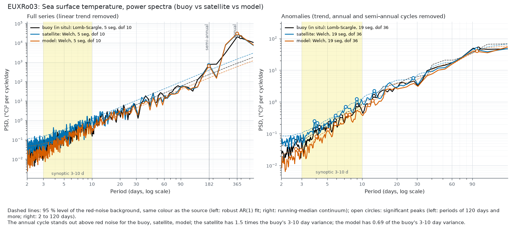

The annual cycle stands out above red noise for the buoy, satellite, model; the satellite has 1.5 times the buoy's 3-10 day variance; the model has 0.69 of the buoy's 3-10 day variance.

### EUXRo03, Chlorophyll-a (surface)

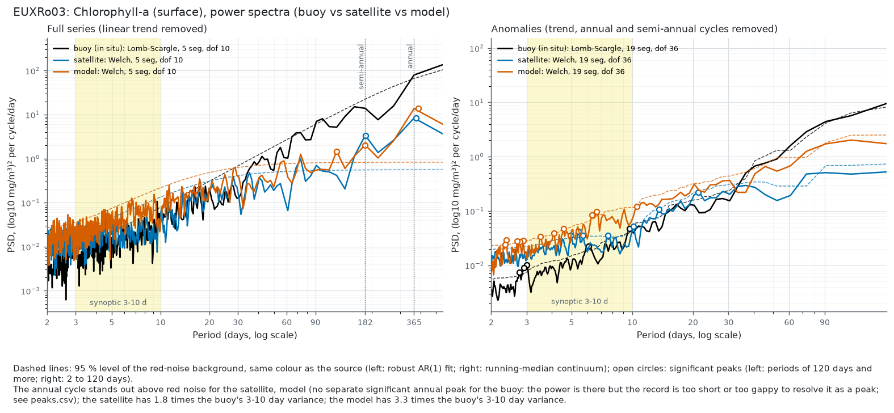

The annual cycle stands out above red noise for the satellite, model (no separate significant annual peak for the buoy: the power is there but the record is too short or too gappy to resolve it as a peak; see peaks.csv); the satellite has 1.8 times the buoy's 3-10 day variance; the model has 3.3 times the buoy's 3-10 day variance.

### EUXRo03, Surface salinity

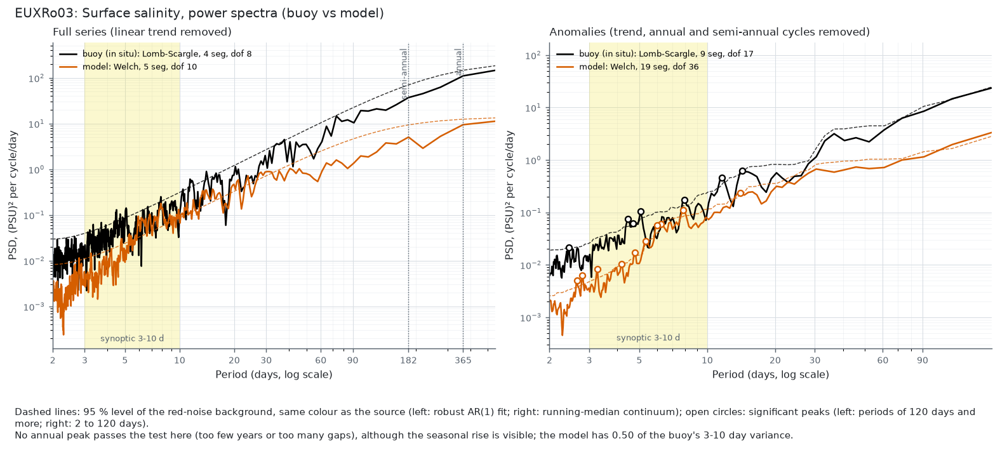

No annual peak passes the test here (too few years or too many gaps), although the seasonal rise is visible; the model has 0.50 of the buoy's 3-10 day variance.

### EUXRo03, Surface dissolved oxygen

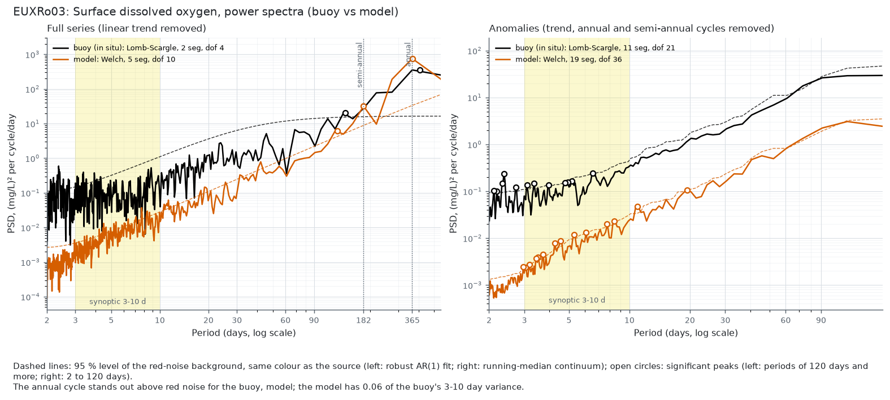

The annual cycle stands out above red noise for the buoy, model; the model has 0.06 of the buoy's 3-10 day variance.

### EUXRoOB01, Sea surface temperature

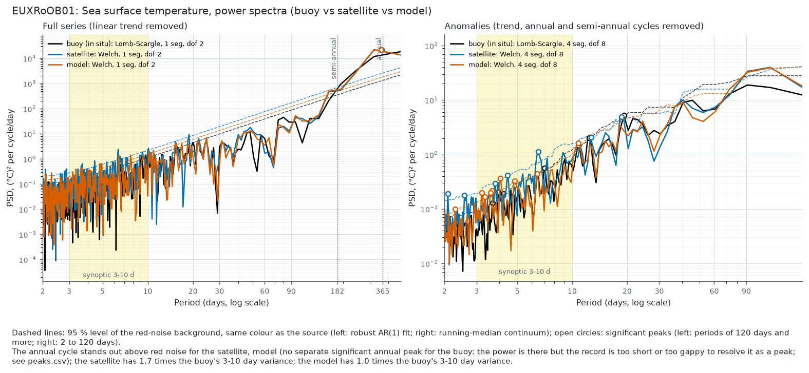

The annual cycle stands out above red noise for the satellite, model (no separate significant annual peak for the buoy: the power is there but the record is too short or too gappy to resolve it as a peak; see peaks.csv); the satellite has 1.7 times the buoy's 3-10 day variance; the model has 1.0 times the buoy's 3-10 day variance.

### EUXRoOB01, Chlorophyll-a (surface)

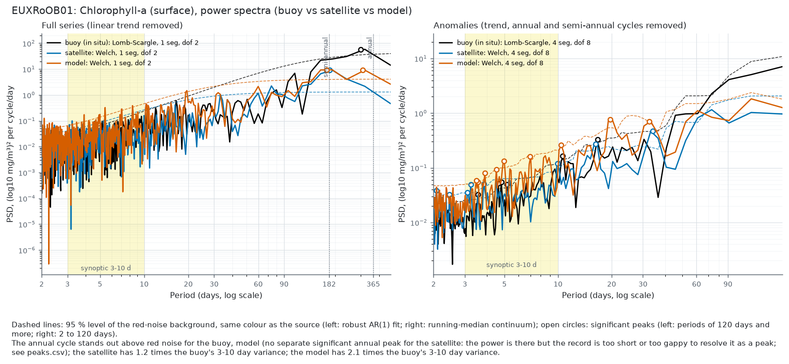

The annual cycle stands out above red noise for the buoy, model (no separate significant annual peak for the satellite: the power is there but the record is too short or too gappy to resolve it as a peak; see peaks.csv); the satellite has 1.2 times the buoy's 3-10 day variance; the model has 2.1 times the buoy's 3-10 day variance.

### EUXRoOB01, Surface salinity

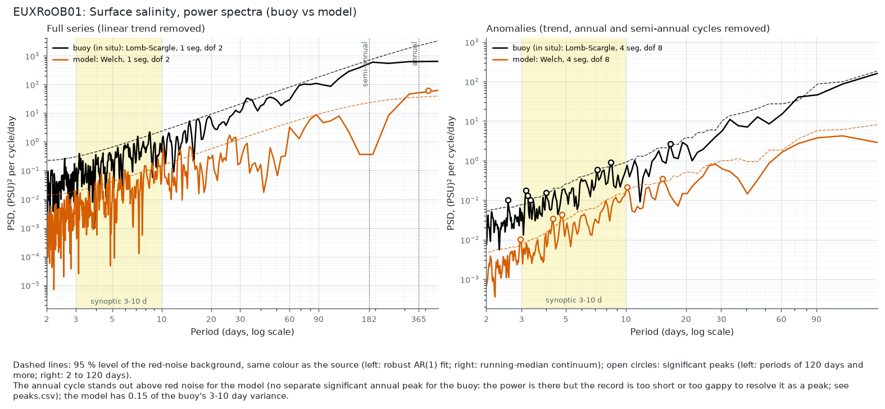

The annual cycle stands out above red noise for the model (no separate significant annual peak for the buoy: the power is there but the record is too short or too gappy to resolve it as a peak; see peaks.csv); the model has 0.15 of the buoy's 3-10 day variance.

### EUXRoOB01, Surface dissolved oxygen

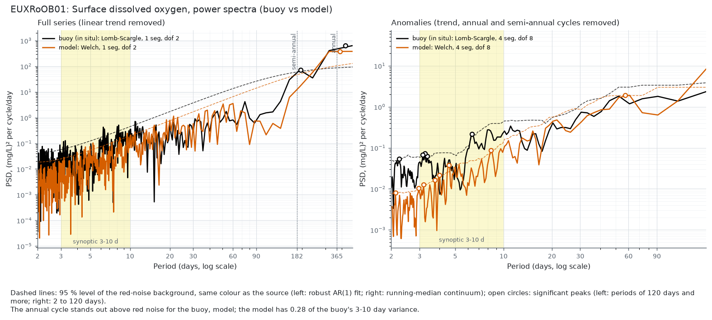

The annual cycle stands out above red noise for the buoy, model; the model has 0.28 of the buoy's 3-10 day variance.

### EUXRoOB02, Sea surface temperature

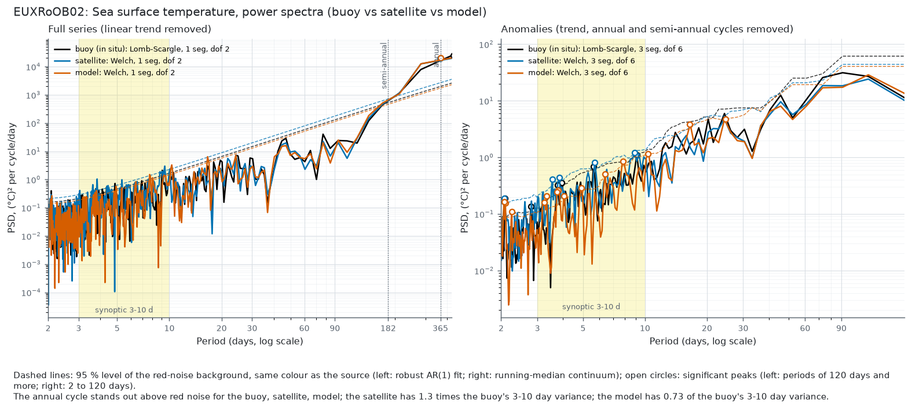

The annual cycle stands out above red noise for the buoy, satellite, model; the satellite has 1.3 times the buoy's 3-10 day variance; the model has 0.73 of the buoy's 3-10 day variance.

### EUXRoOB02, Chlorophyll-a (surface)

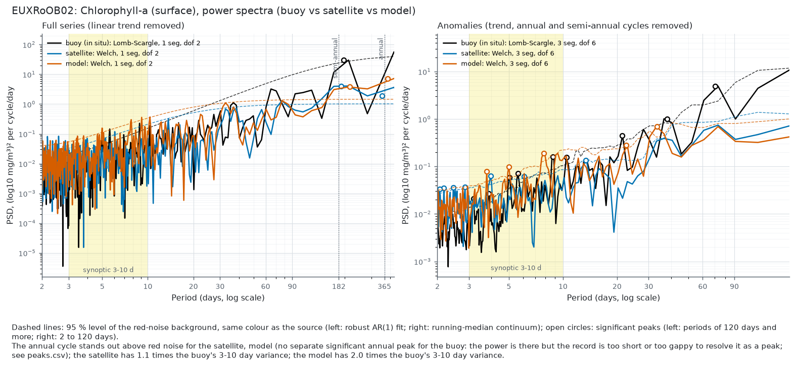

The annual cycle stands out above red noise for the satellite, model (no separate significant annual peak for the buoy: the power is there but the record is too short or too gappy to resolve it as a peak; see peaks.csv); the satellite has 1.1 times the buoy's 3-10 day variance; the model has 2.0 times the buoy's 3-10 day variance.

### EUXRoOB02, Surface salinity

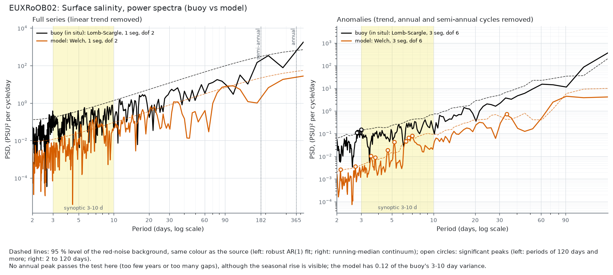

No annual peak passes the test here (too few years or too many gaps), although the seasonal rise is visible; the model has 0.12 of the buoy's 3-10 day variance.

### EUXRoOB02, Surface dissolved oxygen

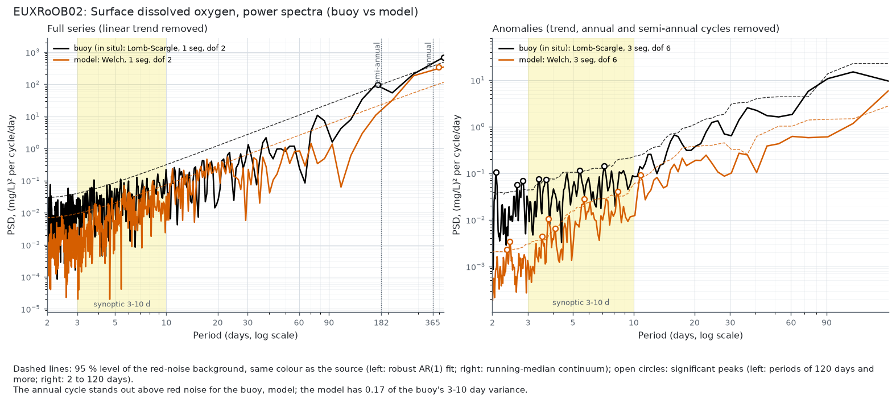

The annual cycle stands out above red noise for the buoy, model; the model has 0.17 of the buoy's 3-10 day variance.

### EUXRoOB03, Sea surface temperature

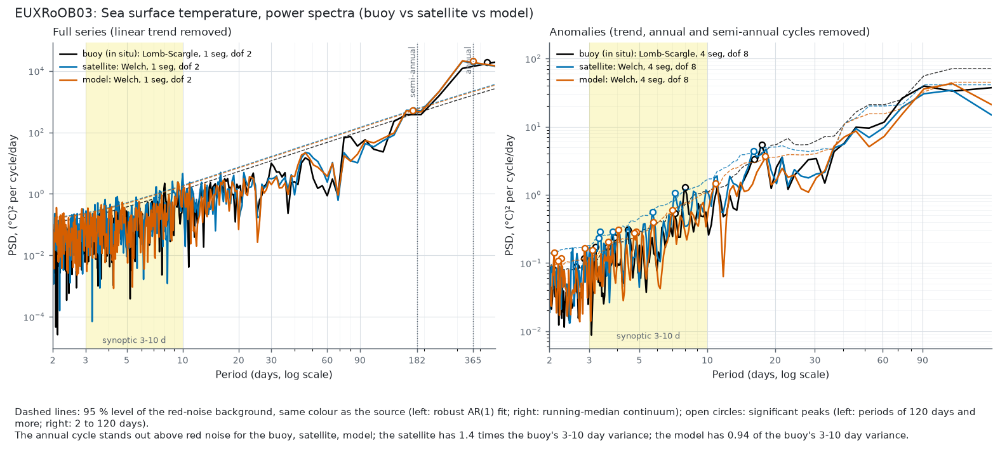

The annual cycle stands out above red noise for the buoy, satellite, model; the satellite has 1.4 times the buoy's 3-10 day variance; the model has 0.94 of the buoy's 3-10 day variance.

### EUXRoOB03, Chlorophyll-a (surface)

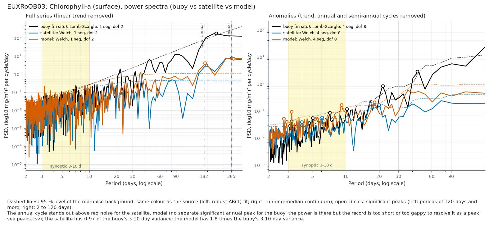

The annual cycle stands out above red noise for the satellite, model (no separate significant annual peak for the buoy: the power is there but the record is too short or too gappy to resolve it as a peak; see peaks.csv); the satellite has 0.97 of the buoy's 3-10 day variance; the model has 1.8 times the buoy's 3-10 day variance.

### EUXRoOB03, Surface salinity

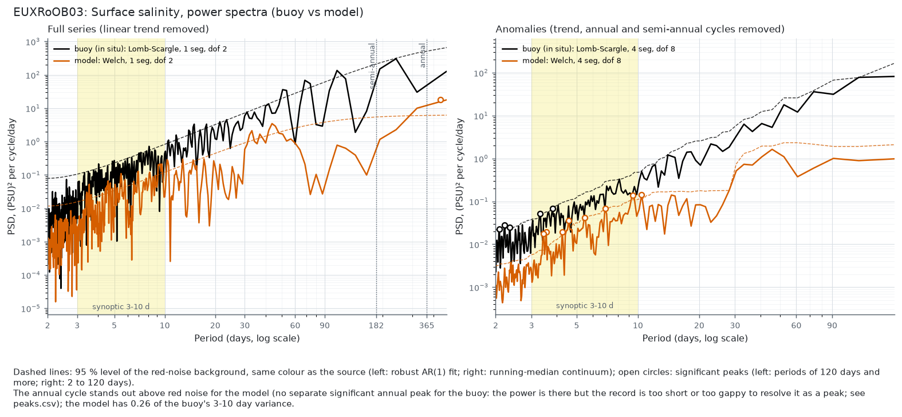

The annual cycle stands out above red noise for the model (no separate significant annual peak for the buoy: the power is there but the record is too short or too gappy to resolve it as a peak; see peaks.csv); the model has 0.26 of the buoy's 3-10 day variance.

### EUXRoOB03, Surface dissolved oxygen

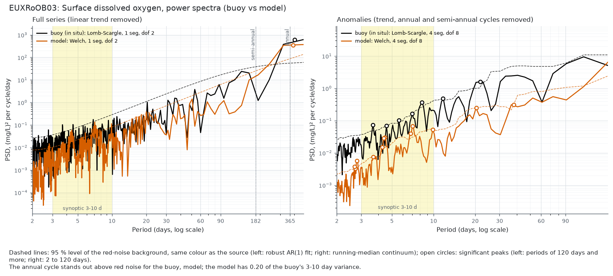

The annual cycle stands out above red noise for the buoy, model; the model has 0.20 of the buoy's 3-10 day variance.

## Limitations

- Daily means cannot show sub-daily cycles (diurnal, inertial 17.3 h, tides); only the SYNTHETIC hourly series shows what to expect from raw hourly buoy records.
- The 2.6-year OB buoys give one segment for the full spectrum (2 degrees of freedom): their annual peak is visible but its significance is weak, and periods longer than about 1.3 years are not resolved.
- Multi-year cycles (ENSO/NAO-like, 3-8 years) are not resolvable with 10 years at one point; only the SYNTHETIC 40-year series illustrates them. A real 40-year satellite SST series (from 1982) would replace it with one line once downloaded.
- The 95 % level is per frequency (no multiple-testing correction inside one spectrum); isolated short-period peaks need confirmation in another source or station before being called a cycle. The across-series consistency test treats the spectra as independent, which they are not (same weather at one station), so it errs towards finding a cycle; it still finds none.
- The running-median background of the anomaly spectra detects sharp peaks only: a broad bump (for example a preferred 5-10 day band) is absorbed into the background. Broad-band differences between sources are therefore read from the band-variance table, not from peaks.
- Satellite L4 SST and gap-free chlorophyll are interpolated analyses: their short-period variance is partly made by the analysis, not observed.

## Next step: trends

- Remove the mean seasonal cycle before Mann-Kendall / Sen's slope: it is the dominant significant signal everywhere. Prefer a day-of-year climatology (it also removes the 3-4 month harmonics) over two harmonics.
- No significant cycle between 2 days and 4 months: weekly and daily aggregates can be trend-tested after deseasoning without removing other periodicities, but red noise (autocorrelation) must be handled (pre-whitening or block bootstrap), using the lag-1 autocorrelation of the daily anomalies computed here (`false_alarm_check.csv`, column `rho_lag1`), which shows that daily values are far from independent.
- Interannual trends need the long records (satellite SST from 1982, model from 1993); the 10-year buoy is too short to separate a trend from a multi-year oscillation.

## Files

- `scripts/spectra/psd.py`: spectral core (Welch, WOSA Lomb-Scargle, AR(1) level, peaks), real-data run, figures, this report. `scripts/spectra/synthetic.py`: SYNTHETIC series. `tests/test_spectra.py`: planted-period recovery and normalisation tests.
- `peaks.csv`: machine-readable peak table, one row per peak, real and SYNTHETIC series. Columns: `variable`, `source` (in situ / satellite / model / synthetic), `station`, `synthetic`, `method` (welch / lomb-scargle), `period_days` (sub-daily periods as fractions of a day), `power` (PSD, variable units squared per cycle/day), `significant_95` (above the 95 % level of the red-noise background), `rank` (1 = strongest significant peak by power for that variable / source / station, both spectra together; empty when not significant), then `spectrum` (full / anomalies), `cycle`, `psd_over_background`, `psd_over_95_level`, `dof`. Besides all significant peaks it lists the local maximum nearest the annual and semi-annual periods in each full spectrum (or the nearest bin when the PSD rises without a local maximum, as for the 2.6-year buoys, whose frequency grid puts the annual cycle at 320 days), with `significant_95` from the 95 % level, so a harmonic fit can always find them. Note: ranking by power mixes the full and anomaly spectra; the seasonal rows dominate, but short-period rows with `psd_over_95_level` close to 1 are often chance exceedances.
- `band_variance.csv`, `method_check.csv`, `false_alarm_check.csv`, `figures/`.
