# Source validation: in situ vs satellite vs model

Romanian Black Sea shelf. Generated by `scripts/validation/compare_sources.py` on 2026-11-23 19:06 (re-run the script to refresh numbers and figures).

First step before trend detection: how well do the three kinds of source agree where we can check them? Later steps: choose a reference source per variable with its uncertainty, then a power spectrum, then trends.

## Method

- **In situ drives the comparison.** Only trusted in situ data are used: offshore buoys EUXRoOB01-03 (GeoEcoMar ERDDAP, Feb 2024 onwards), the older offshore buoy EUXRo03 (Copernicus In Situ TAC, 2013-2023) and EMODnet Chemistry bottle samples (0-5 m, within 30 km) at the Constanta coast. The coastal buoys EUXRoCB0x and NIMH station 15480 are untrusted (repo rule) and left out.
- **Satellite and model are fetched only where and when in situ exists**: at the station position, over the in situ period, then kept only on days with an in situ value. Variables without in situ data are not compared (waves: marinekit has no in situ wave source, so no wave validation here).
- **Matching**: daily means on both sides (buoy records averaged per day by `marinekit.datahub`; model daily means; satellite daily L4 analyses), nearest valid grid cell or pixel; the distance is in the inventory. A point measurement against a 1-5 km satellite pixel or a 2.5 km model cell is not like for like: part of the difference is sub-grid variability, not error.
- **In situ QC added here** (`marinekit.datahub` returns buoy data without these checks): (1) OB01-03 values before 2024-04-06 are dropped: the buoys then read about 21 °C and 35 mg/m³ chlorophyll while satellite and model give 8-10 °C and 0.3 mg/m³, so the instruments were not yet in the sea (inferred from the data, no deployment log seen); (2) a spike test against the buoy's own centred 15-day running median (SST 3 °C, salinity 2 PSU, O2 2.5 mg/L, chlorophyll a factor 5; thresholds OURS); (3) buoy surface O2 kept only when its saturation (own temperature, S = 18) is 60-150 % (OURS). None of the checks uses satellite or model values, so they do not pull the comparison towards them. Removed counts are in the inventory.
- **Data access**: everything through `marinekit.datahub.get_series` (read-only). Bottle temperature, salinity and O2 at the coast use the module's bottle reader (`_fetch_bottles`), because the source register lists bottles only for nutrients. Bottle O2 is converted from umol/L to mg/L (x 0.032); the unit is inferred from the magnitude of the values.
- **Metrics per pair**: n, bias (second source minus first), RMSE, unbiased RMSE (RMSE with the mean bias removed), Pearson r and R², slope and intercept of the least-squares fit of the second source on the first; the same split by season (DJF, MAM, JJA, SON) in `seasonal_metrics.md`.
- **Chlorophyll** is compared in log10 space (log-normal, standard practice for ocean colour); its table also gives the median ratio (other / in situ) in linear units.
- **Nutrients** (nitrate, phosphate): the repo rule says model nutrients are not usable as absolute values, so both sides are standardised (z-scores) and only the shape (timing, seasonal cycle, ranking) is compared.

### Why R² is not enough

R² measures how well the two sources move together (correlation), not whether they agree on the 1:1 line. A source that is always 1 °C too warm, or that doubles every value, can still have R² = 1. That is why every panel also gives the bias (systematic offset), the RMSE (typical size of the daily difference) and the fitted slope (1 = same amplitude). For SST most of R² comes from the shared seasonal cycle; it says little about day-to-day skill.

## Inventory

One row per station, variable and source. Gap share = share of days without a value between the first and last date of that source (for satellite and model: over the in situ period). Overlap = days with both this source and in situ. Distance = from the station to the grid cell or pixel used (km).

| station | variable | source | native interval | start | end | days | gap share | overlap | matched days | distance km | in situ QC removed | status |
|---|---|---|---|---|---|---|---|---|---|---|---|---|
| EUXRoOB01 | sst | in situ (buoy) | sub-daily records, daily means from datahub | 2024-04-06 | 2026-11-22 | 823.00 | 0.14 | 2024-04-06 to 2026-11-22 | 823.00 | 0.00 | 42 before deployment, 2 spikes | ok |
| EUXRoOB01 | sst | satellite | daily L4 analysis (REP 0.05 deg to 2024, then NRT 0.01 deg minus 0.53 C offset) | 2024-04-06 | 2026-11-22 | 961.00 | 0.00 | 2024-04-06 to 2026-11-22 | 823.00 | 3.00 | - | ok |
| EUXRoOB01 | sst | model | daily mean, 2.5 km grid (reanalysis, then analysis/forecast) | 2024-04-06 | 2026-11-22 | 961.00 | 0.00 | 2024-04-06 to 2026-11-22 | 823.00 | 1.36 | - | ok |
| EUXRoOB01 | chl | in situ (buoy) | sub-daily records, daily means from datahub | 2024-04-08 | 2026-11-22 | 814.00 | 0.15 | 2024-04-08 to 2026-11-22 | 814.00 | 0.00 | 42 before deployment, 11 spikes | ok |
| EUXRoOB01 | chl | satellite | daily L4 gap-free, 1 km (multi-year + interim, NRT last 20 days) | 2024-04-08 | 2026-11-22 | 959.00 | 0.00 | 2024-04-08 to 2026-11-22 | 814.00 | 0.45 | - | ok |
| EUXRoOB01 | chl | model | daily mean, 2.5 km grid (reanalysis, then analysis/forecast) | 2024-04-08 | 2026-11-22 | 959.00 | 0.00 | 2024-04-08 to 2026-11-22 | 814.00 | 1.36 | - | ok |
| EUXRoOB01 | sal | in situ (buoy) | sub-daily records, daily means from datahub | 2024-04-07 | 2026-11-22 | 819.00 | 0.15 | 2024-04-07 to 2026-11-22 | 819.00 | 0.00 | 0 before deployment, 2 spikes | ok |
| EUXRoOB01 | sal | model | daily mean, 2.5 km grid (reanalysis, then analysis/forecast) | 2024-04-07 | 2026-11-22 | 960.00 | 0.00 | 2024-04-07 to 2026-11-22 | 819.00 | 1.36 | - | ok |
| EUXRoOB01 | o2 | in situ (buoy) | sub-daily records, daily means from datahub | 2024-04-06 | 2026-11-22 | 823.00 | 0.14 | 2024-04-06 to 2026-11-22 | 823.00 | 0.00 | 42 before deployment, 2 spikes, 0 implausible saturation | ok |
| EUXRoOB01 | o2 | model | daily mean, 2.5 km grid (reanalysis, then analysis/forecast) | 2024-04-06 | 2026-11-22 | 961.00 | 0.00 | 2024-04-06 to 2026-11-22 | 823.00 | 1.36 | - | ok |
| EUXRoOB02 | sst | in situ (buoy) | sub-daily records, daily means from datahub | 2024-04-06 | 2026-07-31 | 740.00 | 0.13 | 2024-04-06 to 2026-07-31 | 740.00 | 0.00 | 35 before deployment, 1 spikes | ok |
| EUXRoOB02 | sst | satellite | daily L4 analysis (REP 0.05 deg to 2024, then NRT 0.01 deg minus 0.53 C offset) | 2024-04-06 | 2026-07-31 | 847.00 | 0.00 | 2024-04-06 to 2026-07-31 | 740.00 | 1.36 | - | ok |
| EUXRoOB02 | sst | model | daily mean, 2.5 km grid (reanalysis, then analysis/forecast) | 2024-04-06 | 2026-07-31 | 847.00 | 0.00 | 2024-04-06 to 2026-07-31 | 740.00 | 0.80 | - | ok |
| EUXRoOB02 | chl | in situ (buoy) | sub-daily records, daily means from datahub | 2024-04-06 | 2026-07-31 | 736.00 | 0.13 | 2024-04-06 to 2026-07-31 | 736.00 | 0.00 | 35 before deployment, 5 spikes | ok |
| EUXRoOB02 | chl | satellite | daily L4 gap-free, 1 km (multi-year + interim, NRT last 20 days) | 2024-04-06 | 2026-07-31 | 847.00 | 0.00 | 2024-04-06 to 2026-07-31 | 736.00 | 0.53 | - | ok |
| EUXRoOB02 | chl | model | daily mean, 2.5 km grid (reanalysis, then analysis/forecast) | 2024-04-06 | 2026-07-31 | 847.00 | 0.00 | 2024-04-06 to 2026-07-31 | 736.00 | 0.80 | - | ok |
| EUXRoOB02 | sal | in situ (buoy) | sub-daily records, daily means from datahub | 2024-04-06 | 2026-07-31 | 614.00 | 0.28 | 2024-04-06 to 2026-07-31 | 614.00 | 0.00 | 0 before deployment, 2 spikes | ok |
| EUXRoOB02 | sal | model | daily mean, 2.5 km grid (reanalysis, then analysis/forecast) | 2024-04-06 | 2026-07-31 | 847.00 | 0.00 | 2024-04-06 to 2026-07-31 | 614.00 | 0.80 | - | ok |
| EUXRoOB02 | o2 | in situ (buoy) | sub-daily records, daily means from datahub | 2024-04-06 | 2026-07-31 | 719.00 | 0.15 | 2024-04-06 to 2026-07-31 | 719.00 | 0.00 | 35 before deployment, 1 spikes, 21 implausible saturation | ok |
| EUXRoOB02 | o2 | model | daily mean, 2.5 km grid (reanalysis, then analysis/forecast) | 2024-04-06 | 2026-07-31 | 847.00 | 0.00 | 2024-04-06 to 2026-07-31 | 719.00 | 0.80 | - | ok |
| EUXRoOB03 | sst | in situ (buoy) | sub-daily records, daily means from datahub | 2024-04-06 | 2026-11-22 | 868.00 | 0.10 | 2024-04-06 to 2026-11-22 | 868.00 | 0.00 | 26 before deployment, 0 spikes | ok |
| EUXRoOB03 | sst | satellite | daily L4 analysis (REP 0.05 deg to 2024, then NRT 0.01 deg minus 0.53 C offset) | 2024-04-06 | 2026-11-22 | 961.00 | 0.00 | 2024-04-06 to 2026-11-22 | 868.00 | 2.78 | - | ok |
| EUXRoOB03 | sst | model | daily mean, 2.5 km grid (reanalysis, then analysis/forecast) | 2024-04-06 | 2026-11-22 | 961.00 | 0.00 | 2024-04-06 to 2026-11-22 | 868.00 | 0.24 | - | ok |
| EUXRoOB03 | chl | in situ (buoy) | sub-daily records, daily means from datahub | 2024-04-06 | 2026-11-22 | 862.00 | 0.10 | 2024-04-06 to 2026-11-22 | 862.00 | 0.00 | 26 before deployment, 6 spikes | ok |
| EUXRoOB03 | chl | satellite | daily L4 gap-free, 1 km (multi-year + interim, NRT last 20 days) | 2024-04-06 | 2026-11-22 | 961.00 | 0.00 | 2024-04-06 to 2026-11-22 | 862.00 | 0.41 | - | ok |
| EUXRoOB03 | chl | model | daily mean, 2.5 km grid (reanalysis, then analysis/forecast) | 2024-04-06 | 2026-11-22 | 961.00 | 0.00 | 2024-04-06 to 2026-11-22 | 862.00 | 0.24 | - | ok |
| EUXRoOB03 | sal | in situ (buoy) | sub-daily records, daily means from datahub | 2024-04-07 | 2026-11-22 | 768.00 | 0.20 | 2024-04-07 to 2026-11-22 | 768.00 | 0.00 | 25 before deployment, 3 spikes | ok |
| EUXRoOB03 | sal | model | daily mean, 2.5 km grid (reanalysis, then analysis/forecast) | 2024-04-07 | 2026-11-22 | 960.00 | 0.00 | 2024-04-07 to 2026-11-22 | 768.00 | 0.24 | - | ok |
| EUXRoOB03 | o2 | in situ (buoy) | sub-daily records, daily means from datahub | 2024-04-06 | 2026-11-22 | 826.00 | 0.14 | 2024-04-06 to 2026-11-22 | 826.00 | 0.00 | 26 before deployment, 0 spikes, 42 implausible saturation | ok |
| EUXRoOB03 | o2 | model | daily mean, 2.5 km grid (reanalysis, then analysis/forecast) | 2024-04-06 | 2026-11-22 | 961.00 | 0.00 | 2024-04-06 to 2026-11-22 | 826.00 | 0.24 | - | ok |
| EUXRo03 | sst | in situ (buoy) | sub-daily records, daily means from datahub | 2013-06-05 | 2023-10-31 | 3027.00 | 0.20 | 2013-06-05 to 2023-10-31 | 3027.00 | 0.00 | 0 before deployment, 8 spikes | ok |
| EUXRo03 | sst | satellite | daily L4 analysis (REP 0.05 deg to 2024, then NRT 0.01 deg minus 0.53 C offset) | 2013-06-05 | 2023-10-31 | 3801.00 | 0.00 | 2013-06-05 to 2023-10-31 | 3027.00 | 0.93 | - | ok |
| EUXRo03 | sst | model | daily mean, 2.5 km grid (reanalysis, then analysis/forecast) | 2013-06-05 | 2023-10-31 | 3801.00 | 0.00 | 2013-06-05 to 2023-10-31 | 3027.00 | 1.04 | - | ok |
| EUXRo03 | chl | in situ (buoy) | sub-daily records, daily means from datahub | 2013-06-05 | 2023-10-31 | 3011.00 | 0.21 | 2013-06-05 to 2023-10-31 | 3011.00 | 0.00 | 0 before deployment, 2 spikes | ok |
| EUXRo03 | chl | satellite | daily L4 gap-free, 1 km (multi-year + interim, NRT last 20 days) | 2013-06-05 | 2023-10-31 | 3801.00 | 0.00 | 2013-06-05 to 2023-10-31 | 3011.00 | 0.72 | - | ok |
| EUXRo03 | chl | model | daily mean, 2.5 km grid (reanalysis, then analysis/forecast) | 2013-06-05 | 2023-10-31 | 3793.00 | 0.00 | 2013-06-05 to 2023-10-31 | 3003.00 | 1.04 | - | ok |
| EUXRo03 | sal | in situ (buoy) | sub-daily records, daily means from datahub | 2013-06-05 | 2023-08-13 | 1634.00 | 0.56 | 2013-06-05 to 2023-08-13 | 1634.00 | 0.00 | 0 before deployment, 0 spikes | ok |
| EUXRo03 | sal | model | daily mean, 2.5 km grid (reanalysis, then analysis/forecast) | 2013-06-05 | 2023-08-13 | 3722.00 | 0.00 | 2013-06-05 to 2023-08-13 | 1634.00 | 1.04 | - | ok |
| EUXRo03 | o2 | in situ (buoy) | sub-daily records, daily means from datahub | 2013-06-05 | 2023-10-19 | 1783.00 | 0.53 | 2013-06-05 to 2023-10-19 | 1783.00 | 0.00 | 0 before deployment, 15 spikes, 52 implausible saturation | ok |
| EUXRo03 | o2 | model | daily mean, 2.5 km grid (reanalysis, then analysis/forecast) | 2013-06-05 | 2023-10-19 | 3781.00 | 0.00 | 2013-06-05 to 2023-10-19 | 1775.00 | 1.04 | - | ok |
| Constanta bottles | sst | in situ (bottles) | irregular cruises, 0-5 m samples averaged per day | 1993-02-19 | 2021-09-14 | 43.00 | 1.00 | 1993-02-19 to 2021-09-14 | 43.00 | <= 30 (radius) | none | ok |
| Constanta bottles | sst | satellite | daily L4 analysis (REP 0.05 deg to 2024, then NRT 0.01 deg minus 0.53 C offset) | 1993-02-19 | 2021-09-14 | 10435.00 | 0.00 | 1993-02-19 to 2021-09-14 | 43.00 | 1.11 | - | ok |
| Constanta bottles | sst | model | daily mean, 2.5 km grid (reanalysis, then analysis/forecast) | 1993-02-19 | 2021-09-14 | 10435.00 | 0.00 | 1993-02-19 to 2021-09-14 | 43.00 | 0.68 | - | ok |
| Constanta bottles | chl | in situ | - | - | - | - | - | - | - | - | - | no in situ: too few bottle samples |
| Constanta bottles | sal | in situ (bottles) | irregular cruises, 0-5 m samples averaged per day | 1993-02-19 | 2021-09-14 | 41.00 | 1.00 | 1993-02-19 to 2021-09-14 | 41.00 | <= 30 (radius) | none | ok |
| Constanta bottles | sal | model | daily mean, 2.5 km grid (reanalysis, then analysis/forecast) | 1993-02-19 | 2021-09-14 | 10435.00 | 0.00 | 1993-02-19 to 2021-09-14 | 41.00 | 0.68 | - | ok |
| Constanta bottles | o2 | in situ (bottles) | irregular cruises, 0-5 m samples averaged per day | 1993-02-19 | 2021-09-14 | 41.00 | 1.00 | 1993-02-19 to 2021-09-14 | 41.00 | <= 30 (radius) | none | ok |
| Constanta bottles | o2 | model | daily mean, 2.5 km grid (reanalysis, then analysis/forecast) | 1993-02-19 | 2021-09-14 | 10427.00 | 0.00 | 1993-02-19 to 2021-09-14 | 41.00 | 0.68 | - | ok |
| Constanta bottles | no3 | in situ (bottles) | irregular cruises, 0-5 m samples averaged per day | 1993-02-19 | 1999-09-15 | 35.00 | 0.98 | 1993-02-19 to 1999-09-15 | 35.00 | <= 30 (radius) | none | ok |
| Constanta bottles | no3 | model | daily mean, 2.5 km grid (reanalysis, then analysis/forecast) | 1993-02-19 | 1999-09-15 | 2400.00 | 0.00 | 1993-02-19 to 1999-09-15 | 35.00 | 0.68 | - | ok |
| Constanta bottles | po4 | in situ (bottles) | irregular cruises, 0-5 m samples averaged per day | 1993-02-19 | 1999-09-15 | 38.00 | 0.98 | 1993-02-19 to 1999-09-15 | 38.00 | <= 30 (radius) | none | ok |
| Constanta bottles | po4 | model | daily mean, 2.5 km grid (reanalysis, then analysis/forecast) | 1993-02-19 | 1999-09-15 | 2400.00 | 0.00 | 1993-02-19 to 1999-09-15 | 38.00 | 0.68 | - | ok |

## Results by variable

### Sea surface temperature

**Plain reading.** Satellite and model SST both agree with the offshore buoys to within about half a degree on a
typical day (RMSE 0.40-0.49 °C at all four buoys, 2013-2026). Both read slightly cooler than the buoys, by 0.0-0.15 °C
on average. That is small next to the 0.5 °C day-to-day scatter, and part of it is expected: the buoy measures at about
1 m, while satellite SST is a skin-to-subskin analysis averaged over a 1-5 km pixel. At the Constanta coast the scatter
is larger (RMSE about 0.9 °C, 43 bottle days 1993-2021), as expected for samples up to 30 km apart in a coastal zone.

**R² versus agreement.** R² is 0.99-1.00 everywhere, but almost all of it comes from the shared seasonal cycle
(8 °C in winter, 27 °C in summer). With each source's monthly mean removed, R² drops to about 0.9 ("R² anomalies"),
which is still high: both sources follow day-to-day and interannual changes, not only the seasons.

**Which source to trust.** Satellite SST, by a small margin: its RMSE is 0.02-0.08 °C lower than the model's at every
buoy, and it is an observation. Indicative uncertainty for a daily value at a point: about 0.45 °C (RMSE against the
buoys), with a bias under 0.15 °C. By season (median over the buoys), both read cooler than the buoys in winter
(satellite -0.2 °C, model -0.3 °C), the model also in spring (-0.25 °C), and both agree in summer
(`seasonal_metrics.md`).

**Caution.** Satellite and model agree with each other as closely as each agrees with the buoys (RMSE 0.45-0.49 °C).
The Black Sea physics system very probably assimilates satellite SST (inferred; to confirm in the product user manual),
so the two are not independent. Only the buoys are a fully independent check.


Numbers from the table (generated):

- **EUXRoOB01**: satellite is 0.11 °C colder on average, typical daily difference (RMSE) 0.43 °C, R² 1.00 (n = 823); model is 0.08 °C colder on average, typical daily difference (RMSE) 0.46 °C, R² 1.00 (n = 823). Closest to in situ: satellite (lowest RMSE).
- **EUXRoOB02**: satellite is 0.07 °C colder on average, typical daily difference (RMSE) 0.40 °C, R² 1.00 (n = 740); model is 0.15 °C colder on average, typical daily difference (RMSE) 0.45 °C, R² 1.00 (n = 740). Closest to in situ: satellite (lowest RMSE).
- **EUXRoOB03**: satellite is 0.09 °C colder on average, typical daily difference (RMSE) 0.41 °C, R² 1.00 (n = 868); model is 0.13 °C colder on average, typical daily difference (RMSE) 0.48 °C, R² 1.00 (n = 868). Closest to in situ: satellite (lowest RMSE).
- **EUXRo03**: satellite is 0.06 °C colder on average, typical daily difference (RMSE) 0.44 °C, R² 1.00 (n = 3027); model is 0.00 °C warmer on average, typical daily difference (RMSE) 0.49 °C, R² 1.00 (n = 3027). Closest to in situ: satellite (lowest RMSE).
- **Constanta bottles**: satellite is 0.01 °C warmer on average, typical daily difference (RMSE) 0.89 °C, R² 0.99 (n = 43); model is 0.16 °C warmer on average, typical daily difference (RMSE) 0.87 °C, R² 0.99 (n = 43). Closest to in situ: model (lowest RMSE).

| station | pair | from | to | n | bias [°C] | RMSE [°C] | ubRMSE [°C] | r | R² | R² anomalies | slope | intercept |
|---|---|---|---|---|---|---|---|---|---|---|---|---|
| EUXRoOB01 | in situ vs satellite | 2024-04-06 | 2026-11-22 | 823 | -0.11 | 0.43 | 0.42 | 1.00 | 1.00 | 0.90 | 1.01 | -0.31 |
| EUXRoOB01 | in situ vs model | 2024-04-06 | 2026-11-22 | 823 | -0.08 | 0.46 | 0.45 | 1.00 | 1.00 | 0.90 | 1.02 | -0.41 |
| EUXRoOB01 | satellite vs model | 2024-04-06 | 2026-11-22 | 823 | 0.03 | 0.49 | 0.49 | 1.00 | 0.99 | 0.88 | 1.00 | -0.05 |
| EUXRoOB02 | in situ vs satellite | 2024-04-06 | 2026-07-31 | 740 | -0.07 | 0.40 | 0.40 | 1.00 | 1.00 | 0.92 | 1.01 | -0.26 |
| EUXRoOB02 | in situ vs model | 2024-04-06 | 2026-07-31 | 740 | -0.15 | 0.45 | 0.42 | 1.00 | 1.00 | 0.91 | 1.02 | -0.50 |
| EUXRoOB02 | satellite vs model | 2024-04-06 | 2026-07-31 | 740 | -0.09 | 0.45 | 0.45 | 1.00 | 1.00 | 0.89 | 1.01 | -0.19 |
| EUXRoOB03 | in situ vs satellite | 2024-04-06 | 2026-11-22 | 868 | -0.09 | 0.41 | 0.40 | 1.00 | 1.00 | 0.92 | 1.01 | -0.25 |
| EUXRoOB03 | in situ vs model | 2024-04-06 | 2026-11-22 | 868 | -0.13 | 0.48 | 0.47 | 1.00 | 1.00 | 0.89 | 1.02 | -0.55 |
| EUXRoOB03 | satellite vs model | 2024-04-06 | 2026-11-22 | 868 | -0.03 | 0.49 | 0.49 | 1.00 | 0.99 | 0.88 | 1.01 | -0.25 |
| EUXRo03 | in situ vs satellite | 2013-06-05 | 2023-10-31 | 3027 | -0.06 | 0.44 | 0.44 | 1.00 | 1.00 | 0.92 | 1.01 | -0.21 |
| EUXRo03 | in situ vs model | 2013-06-05 | 2023-10-31 | 3027 | 0.00 | 0.49 | 0.49 | 1.00 | 1.00 | 0.91 | 1.02 | -0.39 |
| EUXRo03 | satellite vs model | 2013-06-05 | 2023-10-31 | 3027 | 0.06 | 0.47 | 0.46 | 1.00 | 1.00 | 0.91 | 1.01 | -0.14 |
| Constanta bottles | in situ vs satellite | 1993-02-19 | 2021-09-14 | 43 | 0.01 | 0.89 | 0.89 | 0.99 | 0.99 | 0.89 | 0.97 | 0.47 |
| Constanta bottles | in situ vs model | 1993-02-19 | 2021-09-14 | 43 | 0.16 | 0.87 | 0.85 | 0.99 | 0.99 | 0.86 | 1.00 | 0.21 |
| Constanta bottles | satellite vs model | 1993-02-19 | 2021-09-14 | 43 | 0.16 | 0.75 | 0.74 | 1.00 | 0.99 | 0.91 | 1.02 | -0.19 |

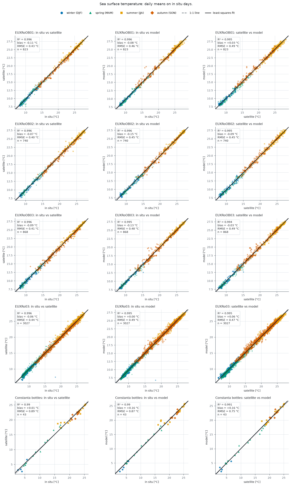

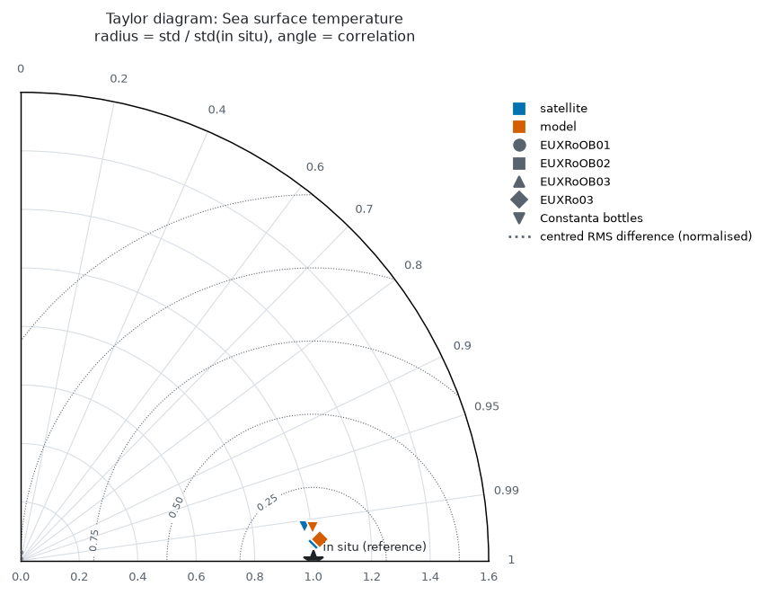

Optional interactive view: [3D scatter of in situ, satellite and model SST](figures/sst_3d.html) (open in a browser; rotate with the mouse). The 2D pairs plus the Taylor diagram remain the main view: a 3D cloud is hard to read on a static slide and hides which pair disagrees.

### Chlorophyll-a (surface)

**Plain reading.** Buoy chlorophyll (fluorescence) cannot be used as an absolute reference. At OB01-03 (2024-2026) the
buoys read 2 to 3 times more than both the satellite and the model (median ratio satellite / buoy 0.36-0.51), with
autumn values up to about 100 mg/m³ that neither other source shows. At EUXRo03 (2013-2023) the buoy values sit in flat
bands that jump between levels from one period to the next, and R² with the satellite is 0.00. Likely causes (inferred):
factory calibration of the fluorometer (manufacturer calibrations often read high in the field), daytime
fluorescence quenching, and biofouling of the optical window between maintenance visits.

**Satellite versus model.** On the same buoy days they agree on average (bias 0.00-0.07 log10, i.e. within about 17 %)
and share part of the variability (R² 0.30-0.54 in log space). This shows consistency, not accuracy: no trusted
in situ chlorophyll exists offshore to arbitrate, and bottles at the coast give only 3 chlorophyll days.

**Which source to trust.** Satellite chlorophyll as the working reference, with uncertainty not quantified here
(at least a factor of about 1.6, from the 0.2 log10 spread between satellite and model; indicative). Do not use buoy
fluorescence for thresholds or trends until it is calibrated against bottle samples.


Numbers from the table (generated):

- **EUXRoOB01**: satellite reads 0.51 x the buoy value (median ratio), R² 0.23 in log space (n = 814); model reads 0.54 x the buoy value (median ratio), R² 0.15 in log space (n = 814).
- **EUXRoOB02**: satellite reads 0.44 x the buoy value (median ratio), R² 0.16 in log space (n = 736); model reads 0.49 x the buoy value (median ratio), R² 0.17 in log space (n = 736).
- **EUXRoOB03**: satellite reads 0.36 x the buoy value (median ratio), R² 0.15 in log space (n = 862); model reads 0.34 x the buoy value (median ratio), R² 0.06 in log space (n = 862).
- **EUXRo03**: satellite reads 0.82 x the buoy value (median ratio), R² 0.00 in log space (n = 3011); model reads 1.11 x the buoy value (median ratio), R² 0.01 in log space (n = 3003).

| station | pair | from | to | n | bias [log10 mg/m³] | RMSE [log10 mg/m³] | ubRMSE [log10 mg/m³] | r | R² | R² anomalies | slope | intercept | median ratio (linear) |
|---|---|---|---|---|---|---|---|---|---|---|---|---|---|
| EUXRoOB01 | in situ vs satellite | 2024-04-08 | 2026-11-22 | 814 | -0.37 | 0.55 | 0.41 | 0.48 | 0.23 | 0.13 | 0.21 | -0.41 | 0.51 |
| EUXRoOB01 | in situ vs model | 2024-04-08 | 2026-11-22 | 814 | -0.37 | 0.57 | 0.44 | 0.39 | 0.15 | 0.02 | 0.24 | -0.41 | 0.54 |
| EUXRoOB01 | satellite vs model | 2024-04-08 | 2026-11-22 | 814 | 0.00 | 0.21 | 0.21 | 0.69 | 0.47 | 0.36 | 0.97 | -0.01 | 0.96 |
| EUXRoOB02 | in situ vs satellite | 2024-04-06 | 2026-07-31 | 736 | -0.52 | 0.72 | 0.51 | 0.40 | 0.16 | 0.02 | 0.15 | -0.48 | 0.44 |
| EUXRoOB02 | in situ vs model | 2024-04-06 | 2026-07-31 | 736 | -0.46 | 0.68 | 0.50 | 0.41 | 0.17 | 0.06 | 0.17 | -0.42 | 0.49 |
| EUXRoOB02 | satellite vs model | 2024-04-06 | 2026-07-31 | 736 | 0.06 | 0.20 | 0.19 | 0.64 | 0.41 | 0.20 | 0.71 | -0.08 | 1.06 |
| EUXRoOB03 | in situ vs satellite | 2024-04-06 | 2026-11-22 | 862 | -0.72 | 1.02 | 0.72 | 0.39 | 0.15 | 0.00 | 0.10 | -0.52 | 0.36 |
| EUXRoOB03 | in situ vs model | 2024-04-06 | 2026-11-22 | 862 | -0.73 | 1.04 | 0.75 | 0.25 | 0.06 | 0.00 | 0.07 | -0.52 | 0.34 |
| EUXRoOB03 | satellite vs model | 2024-04-06 | 2026-11-22 | 862 | -0.00 | 0.16 | 0.16 | 0.74 | 0.54 | 0.27 | 0.86 | -0.07 | 1.00 |
| EUXRo03 | in situ vs satellite | 2013-06-05 | 2023-10-31 | 3011 | 0.01 | 0.81 | 0.81 | 0.02 | 0.00 | 0.02 | 0.01 | -0.47 | 0.82 |
| EUXRo03 | in situ vs model | 2013-06-05 | 2023-10-31 | 3003 | 0.07 | 0.82 | 0.82 | 0.10 | 0.01 | 0.03 | 0.04 | -0.38 | 1.11 |
| EUXRo03 | satellite vs model | 2013-06-05 | 2023-10-31 | 3003 | 0.07 | 0.28 | 0.27 | 0.54 | 0.30 | 0.19 | 0.82 | -0.01 | 1.07 |

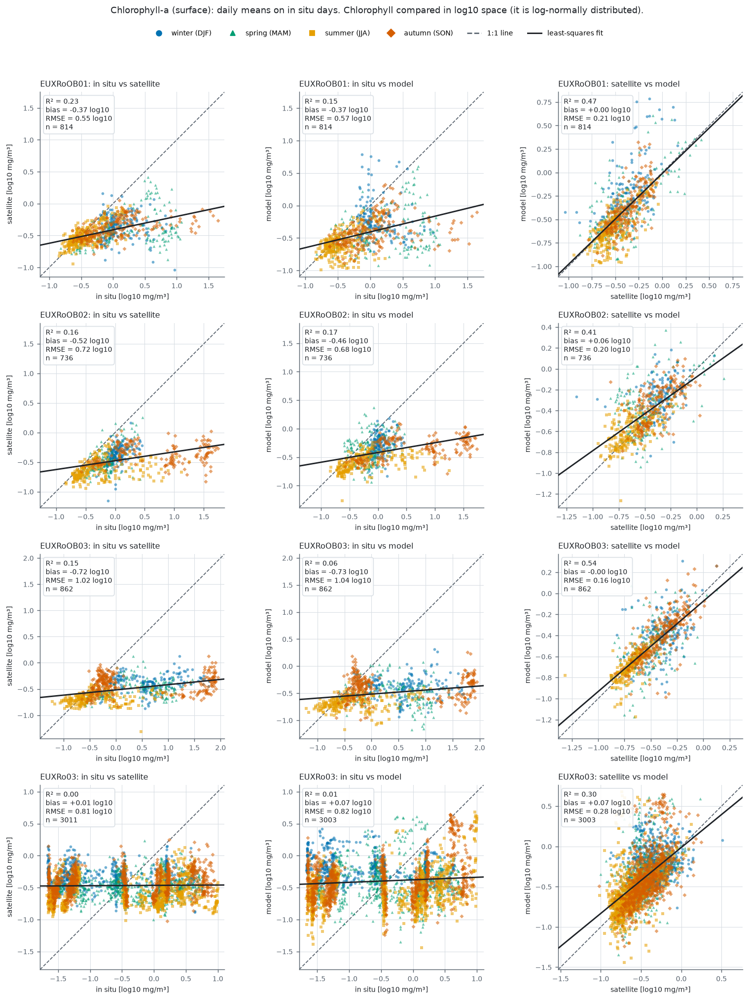

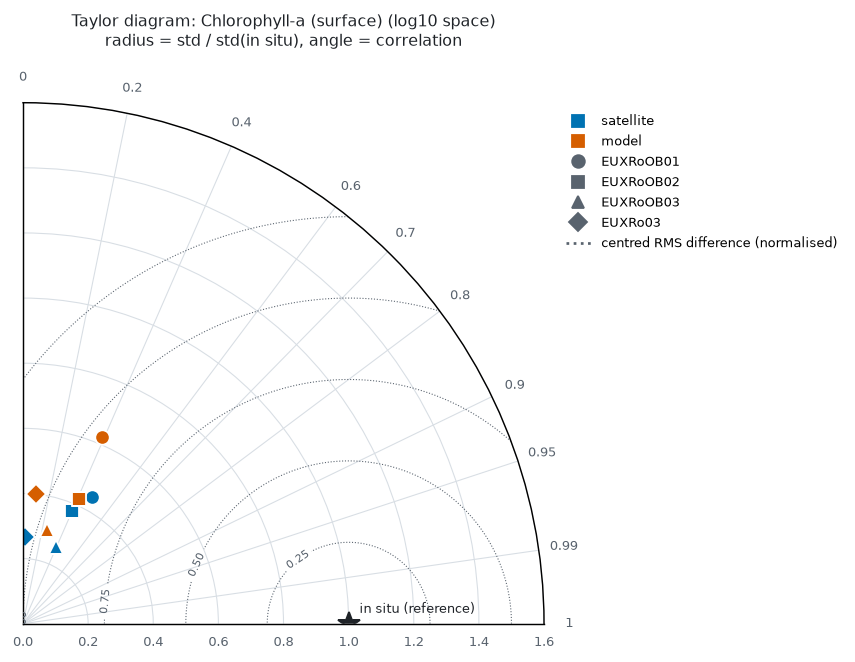

### Surface salinity

**Plain reading.** Offshore buoy salinity is not reliable in this record. It is derived from conductivity
(PSS-78 in `marinekit.datahub`) and shows drops to 13-15 PSU lasting weeks to months that end in steps, e.g. OB02 from
October 2025 to March 2026 and OB01 in spring 2025. Open-sea surface salinity near 30 °E stays around 18 PSU, and the
model shows no such events. The pattern matches conductivity-cell fouling (inferred; maintenance logs would confirm).
As a result, R² against the model is 0.00-0.17 at the buoys.

**At the coast** the model does much better against bottle samples (Constanta, 41 days 1993-2021): R² 0.55,
Spearman 0.81, bias -0.21 PSU, RMSE 1.1 PSU. It reproduces the low-salinity Danube plume episodes, but smooths them.

**Which source to trust.** The model for now, with an indicative uncertainty of about 1 PSU for a daily coastal value
(the bottle RMSE). Buoy salinity needs a fouling screen before it can serve as a reference.


Numbers from the table (generated):

- **EUXRoOB01**: model is 0.81 PSU higher on average, typical daily difference (RMSE) 1.95 PSU, R² 0.17 (n = 819).
- **EUXRoOB02**: model is 1.68 PSU higher on average, typical daily difference (RMSE) 3.52 PSU, R² 0.08 (n = 614).
- **EUXRoOB03**: model is 0.30 PSU higher on average, typical daily difference (RMSE) 1.11 PSU, R² 0.01 (n = 768).
- **EUXRo03**: model is 0.43 PSU higher on average, typical daily difference (RMSE) 0.98 PSU, R² 0.05 (n = 1634).
- **Constanta bottles**: model is 0.21 PSU lower on average, typical daily difference (RMSE) 1.14 PSU, R² 0.55 (n = 41).

| station | pair | from | to | n | bias [PSU] | RMSE [PSU] | ubRMSE [PSU] | r | R² | R² anomalies | slope | intercept |
|---|---|---|---|---|---|---|---|---|---|---|---|---|
| EUXRoOB01 | in situ vs model | 2024-04-07 | 2026-11-22 | 819 | 0.81 | 1.95 | 1.78 | 0.42 | 0.17 | 0.08 | 0.09 | 16.54 |
| EUXRoOB02 | in situ vs model | 2024-04-06 | 2026-07-31 | 614 | 1.68 | 3.52 | 3.09 | -0.28 | 0.08 | 0.01 | -0.03 | 18.75 |
| EUXRoOB03 | in situ vs model | 2024-04-07 | 2026-11-22 | 768 | 0.30 | 1.11 | 1.07 | -0.09 | 0.01 | 0.00 | -0.03 | 18.73 |
| EUXRo03 | in situ vs model | 2013-06-05 | 2023-08-13 | 1634 | 0.43 | 0.98 | 0.88 | 0.22 | 0.05 | 0.06 | 0.09 | 16.60 |
| Constanta bottles | in situ vs model | 1993-02-19 | 2021-09-14 | 41 | -0.21 | 1.14 | 1.12 | 0.74 | 0.55 | 0.70 | 0.71 | 4.30 |

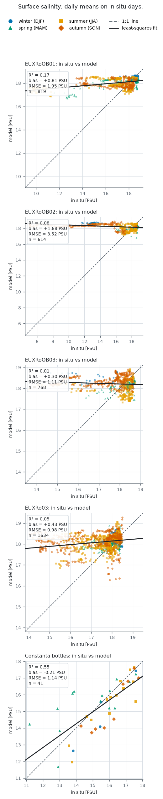

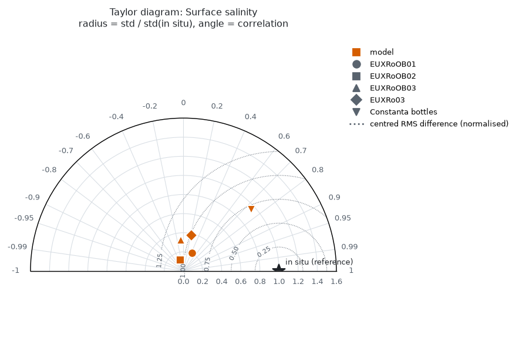

### Surface dissolved oxygen

**Plain reading.** After QC, the model's surface O2 differs from the buoys by about 0.9-1.2 mg/L on a typical day
(RMSE), but the sign of the bias depends on the buoy generation: the model reads higher than OB01-03 in 2024-2026
(+0.5 to +0.7 mg/L) and lower than EUXRo03 in 2013-2023 (-0.5 mg/L). Different sensors and calibrations are the likely
reason (inferred), so the true model bias is not known to better than about +/- 0.7 mg/L.

**Seasons only.** R² (0.35-0.70) comes from the seasonal cycle (high O2 in cold water). With monthly means removed,
R² is 0.00-0.10: the model does not reproduce day-to-day O2 changes at the buoys. Even after QC the summer and autumn
buoy values spread widely below the model (see figure), so some sensor drift probably remains.

**At the coast** the model is 1.5 mg/L lower than the bottles (RMSE 2.3 mg/L, 41 days). Coastal bottles often show
supersaturation during blooms, which a 2.5 km model cell smooths out (inferred).

**Which source to trust.** For surface O2 offshore, the buoys after QC are the only measurement, but their calibration
is uncertain. Use the model for the seasonal cycle and for areas without buoys, with an indicative uncertainty of about
1 mg/L offshore and 2 mg/L at the coast. This check says nothing about bottom O2 (hypoxia), where no sensor exists.


Numbers from the table (generated):

- **EUXRoOB01**: model is 0.56 mg/L higher on average, typical daily difference (RMSE) 0.86 mg/L, R² 0.60 (n = 823).
- **EUXRoOB02**: model is 0.69 mg/L higher on average, typical daily difference (RMSE) 1.16 mg/L, R² 0.35 (n = 719).
- **EUXRoOB03**: model is 0.47 mg/L higher on average, typical daily difference (RMSE) 0.90 mg/L, R² 0.53 (n = 826).
- **EUXRo03**: model is 0.51 mg/L lower on average, typical daily difference (RMSE) 0.92 mg/L, R² 0.70 (n = 1775).
- **Constanta bottles**: model is 1.46 mg/L lower on average, typical daily difference (RMSE) 2.31 mg/L, R² 0.40 (n = 41).

| station | pair | from | to | n | bias [mg/L] | RMSE [mg/L] | ubRMSE [mg/L] | r | R² | R² anomalies | slope | intercept |
|---|---|---|---|---|---|---|---|---|---|---|---|---|
| EUXRoOB01 | in situ vs model | 2024-04-06 | 2026-11-22 | 823 | 0.56 | 0.86 | 0.66 | 0.77 | 0.60 | 0.05 | 0.72 | 2.86 |
| EUXRoOB02 | in situ vs model | 2024-04-06 | 2026-07-31 | 719 | 0.69 | 1.16 | 0.93 | 0.59 | 0.35 | 0.07 | 0.45 | 5.22 |
| EUXRoOB03 | in situ vs model | 2024-04-06 | 2026-11-22 | 826 | 0.47 | 0.90 | 0.76 | 0.73 | 0.53 | 0.00 | 0.58 | 3.97 |
| EUXRo03 | in situ vs model | 2013-06-05 | 2023-10-19 | 1775 | -0.51 | 0.92 | 0.77 | 0.84 | 0.70 | 0.10 | 0.64 | 2.91 |
| Constanta bottles | in situ vs model | 1993-02-19 | 2021-09-14 | 41 | -1.46 | 2.31 | 1.79 | 0.63 | 0.40 | 0.03 | 0.49 | 4.23 |

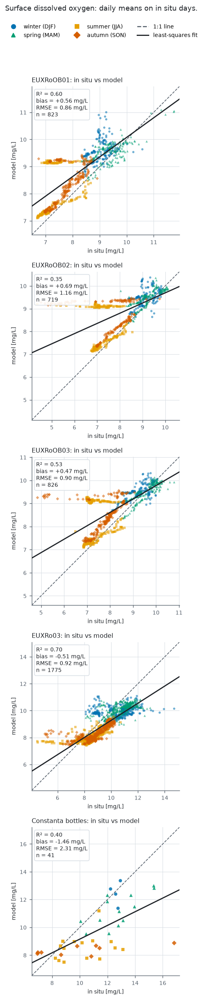

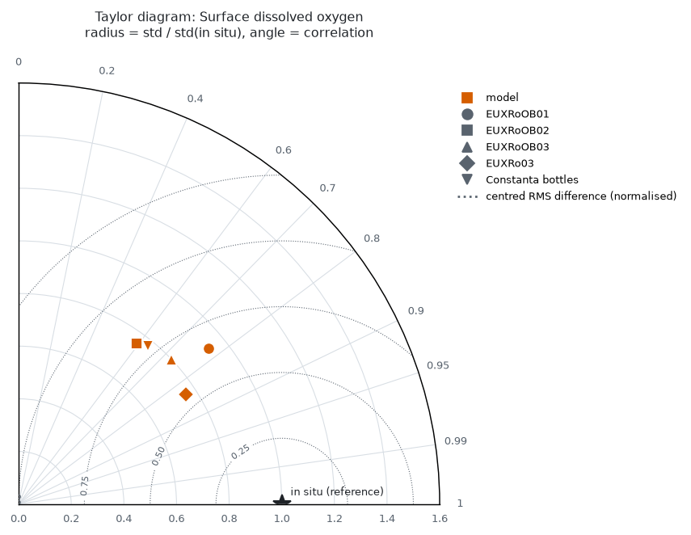

### Nitrate (shape only)

**Shape only.** Model nitrate is not usable as absolute values (repo rule), so both series are standardised. With only
35 bottle days (Constanta, 1993-1999), the model gets the broad seasonal pattern (high in late winter and spring, low
in summer: Spearman 0.41), but its maximum comes in February while the bottles peak in April, probably with the Danube
spring flood (inferred). R² 0.13. Use bottle samples and the DIVAnd climatology for nitrate levels; at most, use the
model for the timing of the winter maximum.


Numbers from the table (generated):

- **Constanta bottles**: model: seasonal shape R² 0.13, Spearman 0.41 (n = 35).

| station | pair | from | to | n | r | R² | Spearman | slope |
|---|---|---|---|---|---|---|---|---|
| Constanta bottles | in situ vs model | 1993-02-19 | 1999-09-15 | 35 | 0.36 | 0.13 | 0.41 | 0.36 |

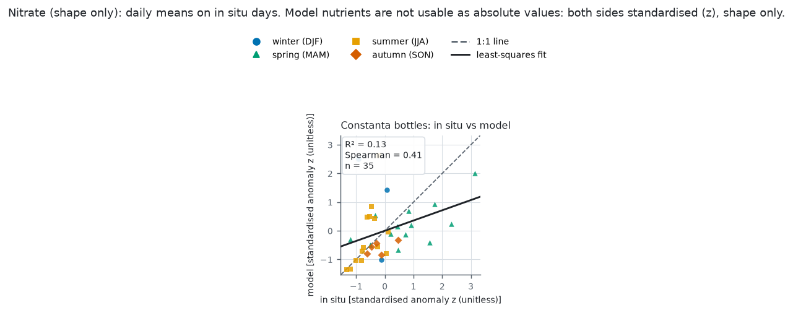

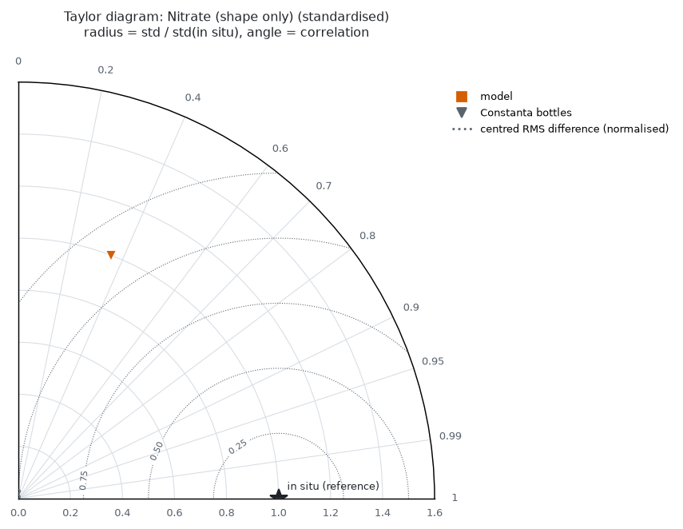

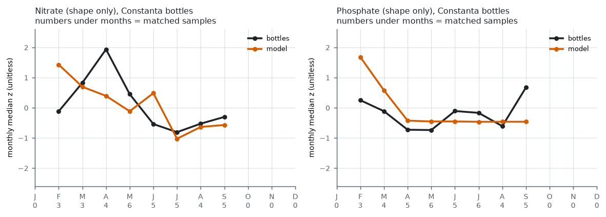

### Phosphate (shape only)

**Shape only.** No agreement in shape between model and bottle phosphate (Spearman 0.01, R² 0.01, 38 bottle days
1993-1999). The model shows a February maximum and a flat rest of the year; the bottles do not. Do not use model
phosphate at the coast, even for timing.


Numbers from the table (generated):

- **Constanta bottles**: model: seasonal shape R² 0.01, Spearman 0.01 (n = 38).

| station | pair | from | to | n | r | R² | Spearman | slope |
|---|---|---|---|---|---|---|---|---|
| Constanta bottles | in situ vs model | 1993-02-19 | 1999-09-15 | 38 | -0.09 | 0.01 | 0.01 | -0.09 |

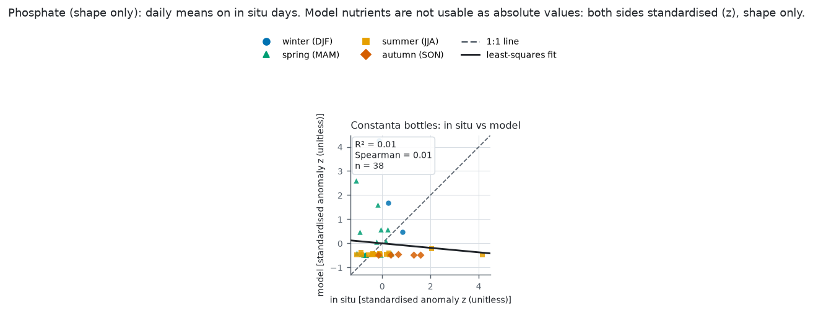

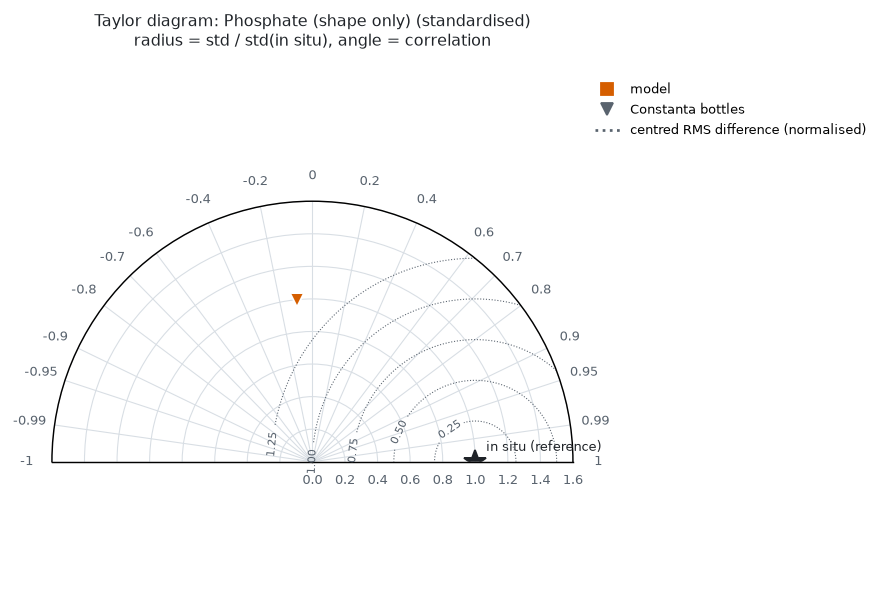


## Overall reading

- **Ranking of agreement with in situ:** SST (excellent, about 0.45 °C) >> surface O2 (seasonal cycle only, about
  1 mg/L) > salinity (coast fair, offshore buoys unusable) > chlorophyll (buoy fluorescence unusable as a reference) >
  nutrients (shape at best for nitrate, none for phosphate).
- **The in situ data need QC before they become the reference.** Pre-deployment records, fouled conductivity cells,
  drifting O2 optodes and uncalibrated fluorometers all show up. `marinekit.datahub` passes the buoy values through
  without these checks; the QC here lives only in this script (see the follow-up note below).
- **Proposed reference per variable** (for step 2; uncertainties indicative):

| Variable | Reference | Indicative uncertainty (daily, point) | Based on |
|---|---|---|---|
| SST | satellite L4 | about 0.45 °C, bias < 0.15 °C | 4 buoys, about 5400 matched days |
| Chlorophyll-a | satellite L4 | not quantified, at least a factor 1.6 | satellite vs model only |
| Surface salinity | model | about 1 PSU (coast) | 41 bottle days |
| Surface O2 | buoy after QC where available, else model | about 1 mg/L offshore, 2 mg/L coast | 4 buoys, 41 bottle days |
| Nitrate, phosphate | bottles / DIVAnd climatology | model shape only (nitrate), none (phosphate) | 35-38 bottle days |

- **Follow-up for `marinekit` (data side, not done here):** move the commissioning cut-off (OB01-03 before
  2024-04-06), the spike test and the O2 saturation screen into `datahub._platform_frame`, so the app's buoy values
  get the same QC.


## Limits

- Point versus cell: a buoy measures one point at about 1 m depth; the satellite pixel (1-5 km) and the model cell
  (2.5 km) average over an area and, for satellite SST, over the skin layer. Part of every RMSE is this
  representativeness error, not a fault of either source.
- Bottle samples at the coast are within 30 km of the point and 0-5 m deep, a few per year: small n (35-43), wide
  confidence intervals, and they mix nearshore and offshore water.
- The QC thresholds (commissioning date, spike limits, the 60-150 % saturation window) are ours, inferred from the
  data; no deployment or maintenance log was available. They remove gross errors only; slow drift and fouling remain
  (salinity, O2, chlorophyll).
- Satellite and model are probably not independent for SST (assimilation), so their mutual agreement is not
  validation.
- Daily means: sub-daily effects (diurnal warming, daytime fluorescence quenching) are averaged out, and the buoys'
  native sampling interval is not exposed by `marinekit.datahub` (only daily means).
- Waves are not validated: `marinekit` has no in situ wave source (the NIMRD AWAC is not in the API), and by the agreed
  rule nothing is compared without in situ.
- Old offshore bottle samples near OB01-03 (1971-2021) were not used; they could extend the salinity and O2 checks.

## Files

- `inventory.csv`, `metrics.csv`, `metrics_seasonal.csv`: the tables above, full precision.
- `seasonal_metrics.md`: metrics split by season.
- `matched_daily.csv`: the matched daily values (station, variable, date, in situ, satellite, model), input for the next steps (reference source, uncertainty, spectrum, trends).
- `figures/`: scatter rows (`scatter_<var>.png`), Taylor diagrams (`taylor_<var>.png`), nutrient seasonal shape, interactive `sst_3d.html`.
- `interpretation.md`: the hand-written reading included above (kept separate so the script can re-run).

Needs `matplotlib` in the venv (not yet in `requirements.txt`: add `matplotlib>=3.9`).


## Contract for the viewer

Added 2026-11-23 for GitHub issue #2, request 1 (source uncertainty on the Water page "Sources" section and the Methods page). The viewer should read these results through `marinekit.validation` (read-only, no network, paths resolved from the package location) rather than parse the files itself. Column names below are a stable contract: new columns may be added, existing ones are not renamed or removed.

Note: `compare_sources.py` rewrites this README. Until the script appends this section itself, re-add it after a re-run (the module docstring of `src/marinekit/validation.py` holds the same contract).

### Files

- `metrics.csv`, one row per station, variable and pair: `station, variable, pair` ("in situ vs satellite", "in situ vs model", "satellite vs model"), `space` (linear, log10 for chl, z for no3 / po4), `start, end` (ISO dates), `season` (all), `n` (matched days), `mean_ref, mean_other, bias` (other minus reference, i.e. second source minus first), `rmse, ubrmse` (RMSE with the mean bias removed), `r, r2, slope, intercept, std_ref, std_other, std_ratio, spearman, r2_anom` (R² with each source's monthly mean removed), `median_ratio` (chl only, other / in situ in linear units). Units: the variable's unit in linear space, log10 of it for chl, unitless z for nutrients.
- `metrics_seasonal.csv`: the same metrics split by `season` (DJF, MAM, JJA, SON), without `spearman, r2_anom, median_ratio`.
- `matched_daily.csv`: `station, variable, date, insitu, satellite, model`, one row per matched day, native units (°C, mg/m³, PSU, mg/L, mmol/m³; chl not log-transformed, nutrients not standardised). Empty cell = no value from that source (no satellite for sal, o2, no3, po4).
- `inventory.csv`: one row per station, variable and source, with `trust` (good, usable, indicative, not_usable_absolute) for the satellite and model rows.

### Python API (`marinekit.validation`)

| Function | Returns |
|---|---|
| `variables()` | variable ids in metrics.csv: sst, chl, sal, o2, no3, po4 |
| `source_summary(variable)` | dict: `variable, title, unit, error_unit, space, trusted_source` (satellite, model, in situ), `trusted_label, uncertainty` (text), `uncertainty_value, rmse, bias, bias_range, headline_pair, n, stations, confidence` (high, medium, low), `reading` (one plain line), `caveats, pairs, untrusted` (list of source + reason), `basis` (files, start, end, run_date, stations) |
| `summary_table()` | DataFrame, one row per variable, for the Methods page |
| `pair_points(variable, station=None)` | DataFrame `station, variable, date, season, insitu, satellite, model` for scatter plots |

- Headline `rmse` and `bias` are pooled over the headline rows (`headline=True` in `pairs`): n-weighted quadratic mean of RMSE and n-weighted mean bias, in `error_unit`. Headline rows: SST in situ vs satellite at the four offshore buoys; chlorophyll satellite vs model at the four buoys (consistency only, log10); salinity in situ vs model at the Constanta bottles; O2 in situ vs model at the four buoys; nutrients: none (`rmse` and `bias` are None, shape only).
- `pairs` keeps every row, untrusted comparisons included (e.g. buoy chlorophyll), so the viewer can show them labelled; `untrusted` says which sources not to use and why.
- An unknown variable or station raises `ValueError` with the list of valid ids.
- All uncertainties are indicative: daily value at a point, a few stations, surface only (nothing on bottom O2).

Example:

```python
from marinekit import validation as val

s = val.source_summary("sst")
# s["trusted_label"] -> "Satellite SST (Copernicus L4 analysis)"
# s["rmse"] -> 0.43 (°C, 5458 buoy days), s["bias"] -> -0.07, s["confidence"] -> "high"
# s["reading"] -> "Satellite SST is within about 0.45 °C of the offshore buoys on a typical day, ..."
pts = val.pair_points("sst", station="EUXRoOB01")   # x = insitu, y = satellite or model
table = val.summary_table()                         # Methods page
```
