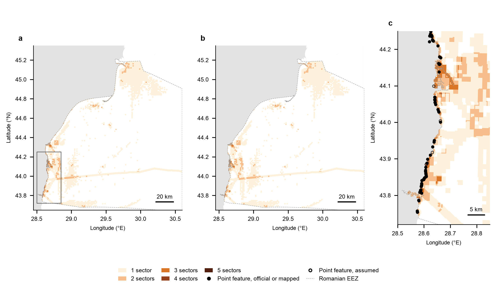

# Pressure zones v2: confirmed features, simple buffers, overlap count

This is workstream Z in `docs/plan/WORKFLOW.md`. The pressure map counts how many of the five blue-economy sectors are present in each cell, from 0 to 5. The sectors are ports, shipyards and marine engineering, tourism, fishing, and aquaculture. There are no weights and no composite index.

The count has two seasons:

| Season | Dates | Tourism zones | Other sectors |
|---|---|---|---|
| Summer | 1 June – 15 September | on | on |
| Winter | the rest of the year | off | on |



*Map panels: a) summer overlap count, b) winter overlap count, c) summer from Constanța to Vama Veche with point features. Hollow points are assumed locations. Colours run from 1 sector (pale) to 5 sectors (dark), on a light-to-dark warm ramp.*

## Files (Z to U interface, `data/zones/`, EPSG:4326)

| File | Content |
|---|---|
| `sector_features.geojson` | 330 features (32 shown but not counted). Fields: `feature_id, sector, activity, name, source, source_url, confidence, season, note, counted (yes/no), style_key`. |
| `sector_zones.geojson` | One buffer polygon per sector × activity × confidence, clipped to the Romanian sea. Fields: `sector, activity, buffer_m, buffer_basis, basis_ref, season, confidence, n_features, area_km2, style_key`. |
| `overlap_grid.geojson` | 250 m cells with at least one sector present in summer (57,496 cells). Fields: `cell_id, n_summer, n_winter, sectors_summer, sectors_winter, lon, lat`. |
| `overlap_summer.geojson` | Cells dissolved into one polygon per count level, for fast drawing. Fields: `count, season, n_cells, area_km2`. |
| `overlap_winter.geojson` | The same as `overlap_summer.geojson`, for winter. |
| `buffers.yaml` | **The single editable config:** the bathing-season dates, the optional fishing closure, and one buffer per activity with `buffer_m`, `buffer_basis` (law, literature or rule), `basis_ref` and `season`. |
| `top_overlap_areas.csv` | The ranked overlap areas for both seasons, as listed in this document. |
| `anchorages_detected.json` | The anchorage-detection settings, thresholds and statistics for each detected area. |
| `overlap_style.json` | The overlap colours, opacities and labels shared with the web viewer. |
| `*.qml` | QGIS styles, checked in a headless QGIS 3.44. |

`confidence` takes three values:
- **official:** a port authority, ANPA/ANAR, ACROPO, EMODnet, the EEA, a legal text or a permit.
- **mapped:** OpenStreetMap, visible on satellite imagery.
- **assumed:** located from a place name, approximate, or from a secondary source.

QML styles:
- `sector_zones.qml`, `sector_features.qml`, `sector_features_line.qml` and `sector_features_point.qml`. They categorize on `style_key = sector|confidence`.
  - Sector colours are Okabe-Ito.
  - Assumed features are hatched with a dashed outline (areas), dashed (lines) or hollow (points).
  - QGIS opens the mixed-geometry features file as three sublayers, so apply one QML to each.
- `overlap_grid.qml` (on `n_summer`), `overlap_grid_winter.qml` (on `n_winter`), `overlap_summer.qml` and `overlap_winter.qml` show counts 1–5 on a light-to-dark warm ramp, with no outlines: 1 #FDE0B2 at 45% opacity, 2 #F4A259 at 70%, 3 #D55E00 at 85%, 4 #8C2D04 at 90%, 5 #4A1402 at 95%. Lightness falls steadily from 1 to 5, also under simulated deutan and protan vision. The same colours are in `overlap_style.json` for the web viewer.

Python API (`src/marinekit/pressure_zones.py`):

```python
from marinekit import pressure_zones as pz
pz.season_for_date("2026-07-15")     # "summer" (1 Jun - 15 Sep inclusive) or "winter"
pz.load_features(sector=None)        # GeoDataFrame; sector in pz.SECTORS or "management"
pz.load_buffers()                    # the buffer table (data/zones/buffers.yaml)
pz.build_zones(buffers=None)         # sector_zones
pz.overlap_grid(zones=None, cell_m=250)
pz.overlap_polygons(grid, "summer")  # or "winter"
pz.top_overlap_areas(grid, "summer", min_count=3)
pz.export_all(cell_m=250)            # rebuild every file and the map
```

Rebuild (about 10 s, offline from the cache in `data/cache/pressure_zones/`):

```bash
cd src && ../.venv/bin/python -m marinekit.pressure_zones
```

## Method

1. **Features.** Every feature carries `source`, `source_url` and `confidence`. Features that are shown but not counted have `counted = no`:
   - planned wind farms and planned aquaculture perimeters
   - the potential pound-net zone
   - fishing-management areas
   - the superseded Constanța roadstead polygon from 2000–2001
2. **Buffers.** Each activity gets one buffer from `buffers.yaml`, with no rings. Buffers are clipped to the Romanian sea, so land-based features (beaches, shipyards, terminals) only produce their seaward part. A `buffer_m` of 0 means the mapped area is itself the zone, as with AIS density footprints.
3. **Sea mask.**
   - The coastline is OSM `natural=coastline`, merged and split against the bounding box lon 28.4–30.6, lat 43.6–45.4. The face whose centre lies below sea level in the EMODnet DTM is the sea.
   - The sea is then limited to the Romanian EEZ (Marine Regions, CC BY 4.0), extended 2 km landward because the EEZ's own shoreline is coarser than OSM. The result is 20,994 km².
   - Lagoons (Razim-Sinoe, Siutghiol, Tașaul) are not sea and get no zones.
4. **Overlap grid.** The grid has 250 m cells in UTM 35N.
   - A sector counts as present in a cell when any of its counted zones touches the cell.
   - `n_summer` uses every zone. `n_winter` drops the zones with `season = summer`, which are the tourism zones.
5. **Dissolved layers.** Cells with the same count are merged into one polygon per level (1–5) for each season.
6. **Top areas.** Connected cells with a count of at least 3 are merged and split by nearest coastal settlement. They are ranked by peak count, then by the area at that peak.

### Anchorages from ship traffic

Ships at anchor or waiting spend many hours in a cell for each passage, while ships in transit spend few. The detection therefore combines two EMODnet Human Activities rasters from EMSA AIS, read as numeric GeoTIFF through the WCS (no `rasterio` needed):
- **Vessel density** (hours per km² per month, annual average): cargo `vesseldensity_09avg` plus tanker `vesseldensity_10avg`.
- **Route density** (passages per year): cargo `routedensity_01avg` plus tanker `routedensity_04avg`.

Both are averaged over 2023 and 2024 on a grid of about 1.2 km (EPSG:3857). Only cargo and tankers are used, so fishing vessels cannot contaminate the result.

Steps:
1. **Ratio.** For each cell, hours per passage = 12 × vessel density ÷ route density.
2. **Candidate cells.**
   - At least 20 cargo and tanker passages a year.
   - Within 25 km of a port area, but at least 1 km outside it, which drops berths and shipyard quays.
   - In the Romanian sea.
   This gives 1,364 cells.
3. **Hysteresis threshold.**
   - Seeds are cells in the top 5% of the ratio (at least 2.88 h per passage).
   - Each seed grows into connected cells in the top 10% (at least 1.84).
4. **Cleaning.** A 3×3 binary closing fills one-cell gaps, and areas smaller than 2 cells (about 3 km²) are dropped. The remaining areas are turned into polygons.
5. **Naming and confirmation.** Each area is named after its nearest port and given a bearing. It counts as **mapped** when a published source confirms it:
   - it overlaps a published anchorage polygon by 50% or more, or
   - it lies within 2 km of a position from the Admiralty Black Sea Pilot (NP24) with a matching depth, or
   - its depth matches NP24's range for that port's roads.
   Otherwise it is an **assumed** waiting area.
6. **Buffer.** Areas get the standard 300 m anchorage buffer.

The signal is strong. Inside the published Constanța roadstead the median is 4.1 hours per passage; in the other candidate cells near ports it is 0.08.

Results:

| Area | km² | Hours per passage (median) | Passages/yr | Depth | Confidence | Validation |
|---|---|---|---|---|---|---|
| Constanța anchorage, 10 km E | 63.3 | 3.87 | 733 | 32 m | mapped | 82% of the area lies inside the published roadstead zones 1–3 (Port Handbook 2000–2001), which it covers 96% of. Also matches NP24 "3–8 nm ESE of Capul Constanța". |
| Mangalia anchorage, 7 km NE | 3.0 | 4.37 | 80 | 26 m | mapped | 0.1 km from the NP24 position (3.5 nm NE of the harbour entrance). Depth 23–29 m, as in NP24. Was missing from the earlier data. |
| Sulina anchorage, 13 km S | 59.9 | 3.29 | 141 | 15 m | mapped | Depth within NP24's range for the Rada Sulina anchorage (7–22 m). |
| Sulina waiting area, 24 km E | 66.6 | 2.18 | 163 | 32 m | assumed | Not in published lists. Probably ships waiting for the Sulina channel and the Danube ports. |
| Constanța waiting area, 30 km SE | 13.6 | 2.84 | 182 | 47 m | assumed | Not in published lists. It lies on the Neptun Deep pipeline route, where anchoring is banned within 1 km (Law 17/1990 art. 12), so it is probably drifting or waiting rather than anchoring. |

Other checks:
- **Midia:** no signal. In the approximate Midia anchorage polygon, cargo and tankers spend less than 1 hour per passage, and 65% of all ship-hours there come from fishing vessels. An all-ships version would have produced a fishing false positive here. The Midia polygon stays assumed and counted, and remains on the to-confirm list.
- **Fishing share elsewhere:** fishing vessels account for 0% of ship-hours in the detected areas, except 0.9% at Mangalia.
- **Constanța polygon from 2000–2001:** kept for reference but not counted (`counted = no`), because the AIS-derived roadstead replaces it.
- **Overlap counts:** they barely change, because ports were already present at these sites through the AIS shipping-lane layer.

## Buffer table (`data/zones/buffers.yaml`)

| Sector | Activity | Buffer | Basis | Reference |
|---|---|---|---|---|
| Ports | port area (basins, terminals, port points) | 1,000 m | rule | Berths, entrance channel, propeller wash and maintenance dredging: the near field of harbour turbidity and contaminated sediment |
| Ports | anchorage (published polygon) | 300 m | rule | Anchor and chain swing radius: chain about 5–7 × water depth (20–30 m) plus ship length |
| Ports | shipping lane (AIS) | 0 | rule | The AIS cells themselves: top decile of EMSA vessel density, all ships except dredgers |
| Shipyards | shipyard | 500 m | rule | Dry-dock discharge, blasting grit and antifouling residues next to the yard |
| Shipyards | offshore platform | **500 m** | **law** | Law 17/1990 art. 16(2): safety zones up to 500 m around installations in the EEZ; UNCLOS art. 60(5) |
| Shipyards | pipeline or cable | **1,000 m** | **law** | Law 17/1990 (republished MO 252/2014) art. 12(2): safety and protection zones "up to 1,000 m on either side" of the axis of cables and pipelines laid in the sea |
| Shipyards | coastal protection (breakwater, groyne) | 200 m | rule | Structure footprint plus the scour and accretion cell next to it |
| Shipyards | beach nourishment | 300 m | rule | Placement, burial and plume seaward of the nourished beach |
| Shipyards | dredging activity (AIS) | 0 | rule | The AIS cells themselves: top 5% of EMSA dredging and underwater-operations density |
| Tourism (summer) | beach | **300 m** | **law** | See the note below the table |
| Tourism (summer) | bathing water (EEA site) | **300 m** | **law** | Same as beaches, applied to 500 m of coastline at each site |
| Tourism (summer) | marina | 300 m | rule | Same width as the nautical recreation zone: leisure craft leaving the marina |
| Fishing | landing point | 1,000 m | rule | Boats launching and landing, and nets set nearby |
| Fishing | fishing ground (AIS) | 0 | rule | The AIS cells themselves: top decile of EMSA fishing-vessel density |
| Fishing | potential pound-net zone | 0 | rule | 5–13 m isobaths within 5 km of shore. Shown, not counted |
| Aquaculture | aquaculture lease (official perimeter) | 100 m | literature | See the note below the table |
| Aquaculture | planned perimeter | 0 | rule | Offered in a tender but not awarded. Shown, not counted |

**Tourism buffer.** OMT 1079/2014 Annex 2 says nautical recreation zones "may not extend more than 300 m from the shore", and small craft must stay within 300 m. This also matches the user's rule of 300 m seaward from the beach line.

**Aquaculture buffer.** The benthic effects of shellfish longlines and fish cages are mostly within 50–100 m of the farm edge:
- Wilding and Nickell 2013, PLoS ONE 8:e68313
- Kalantzi and Karakassis 2006, Mar Pollut Bull 52:484

**Seasons:**
- **Bathing season, 1 June – 15 September.** This is the Ministry of Health / INSP bathing-water monitoring season, run under HG 546/2008. No statutory article fixing the dates was found, so it is marked to confirm.
- **Optional fishing toggle, not applied.** The turbot ban runs 15 April – 15 June (Ordin MADR/MMAP 23/297/2025 art. 6(3)). It stops turbot gillnets only; other fishing continues. It is recorded in `buffers.yaml` under `fishing_closures_optional` with `applied: false`.

## Confirmation per sector

Counts are by confidence; "not counted" features are shown on the map but excluded from the overlap count.

| Sector | Official | Mapped | Assumed | Not counted |
|---|---|---|---|---|
| Ports | 4 | 16 | 4 | 1 |
| Shipyards and marine engineering | 17 | 91 | 11 | 6 |
| Tourism | 49 | 83 | 0 | 0 |
| Fishing | 1 | 0 | 20 | 1 |
| Aquaculture | 31 | 0 | 0 | 21 |
| Management (context only) | 3 | 0 | 0 | 3 |

- Ports "not counted" is the superseded Constanța roadstead polygon from 2000–2001.
- Shipyards "not counted" are the planned wind perimeters.
- Fishing "not counted" is the potential pound-net zone.
- Aquaculture "not counted" are the planned or offered perimeters.

### Ports

**Port areas, 16 features.**
- Mapped (13, OSM polygons): `Portul Constanța`, `Portul Constanța Sud - Agigea` (the Danube–Black Sea Canal entrance), `Portul Midia`, Mangalia basins (`Bazinul de Nord`, `Bazinul de Sud`), Sulina `Bazinul Mare`, terminals, and two berths that OSM tags as marinas.
- Official (3): EMODnet port points for Constanța, Midia and Mangalia.

**Anchorages, 7 features.**
- AIS-derived (5): Constanța, Mangalia and Sulina anchorages (mapped), and waiting areas off Sulina and Constanța (assumed). The method and validation are under "Anchorages from ship traffic" above.
- Published (2):
  - Constanța roadstead zones 1–3, from the Port Handbook 2000–2001 via JICA. Shown, not counted, because the AIS area replaces it.
  - Midia, approximate, from a port listing citing NP24. It is counted but has no AIS signal.
- The current official limits are set by the Romanian Naval Authority (ANR) and are not published online.

**Shipping lanes, 1 feature, official.** Mean EMSA AIS vessel density 2023–2024 from the EMODnet WCS, all ships except dredgers, top decile: at least 3.02 h/km²/month.

### Shipyards and marine engineering

**Offshore platforms, 10 features.**
- Official (9):
  - 7 installations from the ACROPO report to the EU (2020; 2021 identical): the Central Platform Complex PFCP + PFS-1 + PFS-2 (manned), PFSS-8, PFSS-U/Pescăruș, PGSU-3, PGSU-4, PGSU-6 and PGSU-7. These replace the earlier OSM points.
  - Neptun Alpha and the Pelican South drill centre, from the Neptun Deep environmental permit.
- Assumed (1): Ana (Midia Gas Development), from the GEM wiki. Ana is not in the ACROPO lists.

**Pipelines and cables, 2 features.**
- Official: the Neptun Deep 30-inch pipeline and fibre cable, Tuzla landfall to Neptun Alpha, with exact vertices from the permit.
- Assumed: KAFOS, a schematic route to its Mangalia landing (TeleGeography, CC BY-NC-SA).

**Coastal protection, 82 features, mapped.** OSM breakwaters and groynes, including the Eforie dikes ESN1–4 and ECN1–3.

**Beach nourishment, 9 lots, assumed.** The Romanian Waters project lists the lots by place name only. Each lot is placed at the EEA bathing-water sites of its resort.

**Shipyards, 9 features, mapped.** Șantierul Naval Constanța with its docks, SORENA, GSP Agigea and Damen Mangalia.

**Dredging activity, 1 feature, official.** EMSA AIS density of dredging and underwater-operations vessels, top 5%.

**Not counted.** 6 planned offshore-wind perimeters, Z1–Z6, from the Ministry of Environment list under Law 121/2024 (July 2026, WGS84). Their approval status is unclear.

### Tourism (summer only)

| What | Count | Confidence | Source |
|---|---|---|---|
| Beaches | 77 | mapped | OSM, Vama Veche to Sulina and Sfântu Gheorghe |
| Bathing-water sites | 49 | official | EEA, via EMODnet, 2024 season |
| Marinas | 6 | mapped | OSM: Tomis, Mangalia, Marina Eforie, LifeHarbour and others |

### Fishing

**Fishing grounds, 1 feature, official.** EMSA AIS fishing-vessel density, top decile: at least 0.088 h/km²/month, 676 km².

**Landing points, 19 features, assumed.**
- Ordin MADR 5/2026 annex 3 lists 44 landing points and first-sale centres by place name or address. 19 distinct places were located at the matching OSM place, beach or lighthouse and snapped to the coastline:
  - South coast: Vama Veche, 2 Mai, Mangalia, Olimp, 23 August, Tuzla, Eforie Sud, Eforie Nord (Belona), Agigea
  - Mamaia to Midia: Mamaia, Mamaia Sat, Midia/Năvodari, Cap Midia
  - North of Midia: Corbu, Vadu, Periboina/Gura Portiței, Edighiol, Sfântu Gheorghe, Sulina
- Decked vessels must land at Mangalia, Constanța, Tomis or Midia, which are already covered as port areas.

**Pound nets (taliene): sites not public.** The potential zone is the 5–13 m isobaths within 5 km of shore (Totoiu et al. 2016: 21 pound nets in 2014 on those isobaths). It is shown hatched and is **not counted** until NIMRD or ANPA supply the sites. NIMRD has logged them by GPS (Zaharia et al. 2014).

**Management context, official, not counted.** All from Ordin 23/297/2025 art. 4:
- the 2 Mai–Vama Veche reserve
- the Delta marine zone gillnet ban (9 April – 30 November)
- the Sahalin–Sfântu Gheorghe year-round no-fishing area

### Aquaculture

**Leases, 10 features, official.**
- These are the ANAR / ABA Dobrogea-Litoral marine perimeters awarded in 2024 on 20-year leases.
- Source: the "plan de situație" PDFs at rowater.ro. Their corners are in ETRS89-LAEA and were converted to WGS84.
- Fish perimeters: P3, P5, P6, P7 and P8 off 2 Mai–Vama Veche, P12 off Venus, P28 off Mamaia.
- Shellfish perimeters: P9 just south of the Agigea breakwater, P11 off Gura Portiței, P13 off Venus.
- All lie fully in the sea.

**Not counted, official.** 18 perimeters offered in 2024 but not awarded, and 3 from the November 2025 mollusc tender, which has no published award.

The earlier proxy (tender stretches placed 2–3 km offshore) has been dropped.

## Top overlap areas

The peak count is 4 sectors; no cell has all 5, because the real aquaculture leases are small and sit away from the ports.

### Summer (bathing season)

| Rank | Area | Peak count | Area at peak (km²) | Sectors at peak |
|---|---|---|---|---|
| 1 | Olimp coast | 4 | 1.31 | ports, shipyards, tourism, fishing |
| 2 | Mangalia coast | 4 | 1.31 | ports, shipyards, tourism, fishing |
| 3 | Eforie Nord coast | 4 | 1.25 | ports, shipyards, tourism, fishing |
| 4 | 2 Mai coast | 4 | 0.62 | ports, shipyards, tourism, fishing |
| 5 | Năvodari coast (Midia) | 4 | 0.12 | ports, shipyards, tourism, fishing |
| 6 | Eforie Nord coast, by the Agigea lease P9 | 4 | 0.12 | ports, shipyards, fishing, aquaculture |
| 7 | Constanța coast | 3 | 13.0 | ports, shipyards, fishing |

### Winter (tourism off)

| Rank | Area | Peak count | Area at peak (km²) | Sectors at peak |
|---|---|---|---|---|
| 1 | Eforie Nord coast, by the Agigea lease P9 | 4 | 0.12 | ports, shipyards, fishing, aquaculture |
| 2 | Constanța coast (port and roadstead) | 3 | 13.0 | ports, shipyards, fishing |
| 3 | Eforie Nord offshore (Constanța Sud approaches) | 3 | 5.3 | ports, shipyards, fishing |
| 4 | Mamaia-Sat offshore (Midia approaches) | 3 | 3.5 | ports, shipyards, fishing |
| 5 | Năvodari offshore | 3 | 2.8 | ports, shipyards, fishing |
| 6 | Agigea coast | 3 | 2.7 | ports, shipyards, fishing |
| 7 | Cap Aurora coast | 3 | 2.4 | ports, shipyards, fishing |
| 8 | Mangalia coast | 3 | 2.3 | ports, shipyards, fishing |

Cell counts:

| Sectors present | Summer cells | Winter cells |
|---|---|---|
| 1 | 50,756 | 49,797 |
| 2 | 5,856 | 5,680 |
| 3 | 808 | 673 |
| 4 | 76 | 2 |

Taking tourism out in winter removes almost all 4-sector cells. The remaining winter pressure sits at the port approaches.

## To confirm with NIMRD

| Sector | Item | Current status | What would confirm it |
|---|---|---|---|
| Fishing | Pound-net (taliene) sites | Potential zone only, not counted | NIMRD GPS log of pound-net sites (Zaharia et al. 2014) or ANPA authorisations |
| Fishing | Landing points | 19 places from Ordin 5/2026, located from place names | Coordinates of the 44 annex-3 points |
| Fishing | Trawling grounds | AIS top decile, vessels of 15 m or more only | VMS or logbook effort; the beam-trawl area on the ANAR use-overlay map |
| Fishing | Turbot ban toggle | Documented, not applied | Whether the viewer should use it |
| Aquaculture | 2025 mollusc tender | 3 perimeters shown, not counted | Award result; any farms actually in operation |
| Ports | Anchorages | Constanța, Mangalia and Sulina are now settled from AIS data and confirmed against published positions. Still open: Midia (no AIS signal) and the two waiting areas, 24 km E of Sulina and 30 km SE of Constanța on the Neptun Deep pipeline route. | ANR / harbour-master confirmation of the Midia anchorage and of the two waiting areas |
| Ports | Approach channels and TSS | Not mapped (NP24 text only) | Current traffic separation scheme coordinates |
| Shipyards | Ana platform and MGD pipeline to Vadu | Ana from a secondary source; pipeline route not public | BSOG permit coordinates |
| Shipyards | Dredge-spoil dumping sites | Not found (Constanța, Midia, Mangalia; Sulina explosives ground No 95 known by name only) | APM permits for maintenance dredging |
| Shipyards | Beach nourishment lots | Located at bathing-water sites | Phase II lot limits and the offshore sand borrow area |
| Shipyards | Cables | KAFOS schematic; Diamond Link landing at Constanța unknown | Surveyed routes |
| Shipyards | Petrom platform-to-shore pipeline | Not mapped (NP24 notes a 1 nm prohibition) | Route coordinates |
| Tourism | Bathing season dates | 1 June – 15 September, from INSP / Ministry of Health practice | The legal act fixing the season |
| Fishing | Near-shore small-scale fishing | Under-counted: AIS covers only vessels of 15 m or more, so small boats and pound nets near shore are missing from the fishing grounds | NIMRD / ANPA records of the small coastal fleet and pound-net sites |
| All | ANAR scanned PDFs (use-overlay and permit maps) | Not read: they are scanned images, no text or coordinates were extracted | Digitised maps or coordinates from ANAR / ABA Dobrogea-Litoral |
| All | Rule-based buffers | Port area 1 km, shipyard 500 m, landing point 1 km, coastal protection 200 m, anchorage 300 m | NIMRD's view on footprints |

## Limitations

- **Presence only.** A sector counts once whether it has one beach or ten, and a small marina counts the same as Constanța port. The count is a screening map of co-location, not of impact.
- **AIS coverage.** The AIS layers come from ~1.2 km cells and include only vessels of 15 m or more. The small coastal fishing fleet is represented only by the landing points until the pound-net sites are added.
- **Fishing under-counted near shore.** AIS only covers vessels of 15 m or more, so near-shore small-scale fishing (small boats, pound nets) is missing from the fishing grounds. Say so in the pitch.
- **ANAR scanned PDFs not read.** The ANAR / ABA Dobrogea-Litoral maps that exist only as scanned PDFs were not digitised, so any zone shown only there (for example the beam-trawl area on the use-overlay map) is missing.
- **Hover label.** `sector_zones.geojson` carries `buffer_label` (for example "300 m (law)"). Shipping lanes, fishing grounds and dredging areas show "AIS ... density cells, no buffer": their 0 m buffer is by design, the zone is the AIS cells themselves. The label is added by `scripts/add_buffer_labels.py`; re-run it after a rebuild.
- **Static zones.** Only tourism changes with season.
- **Romanian zones only.** Bulgarian and Ukrainian activities are excluded.

## Background: v1 weighted index (retired)

An earlier version weighted the sectors and their pressures and produced a composite hotspot index. It used:
- AHP sector weights from Black Sea impact shares in Micheli et al. 2013, Halpern et al. 2015 and Lazar et al. 2024, with a consistency ratio of 0.017
- Halpern 2015 and HELCOM vulnerability weights within each sector
- inner, middle and outer rings around each feature

The user decided on a plain overlap count instead. The v1 module, outputs and docs are kept in `data/zones/archive_v1/` for reference (`pressure_zones_v1.md` has the full weights tables and sources).
